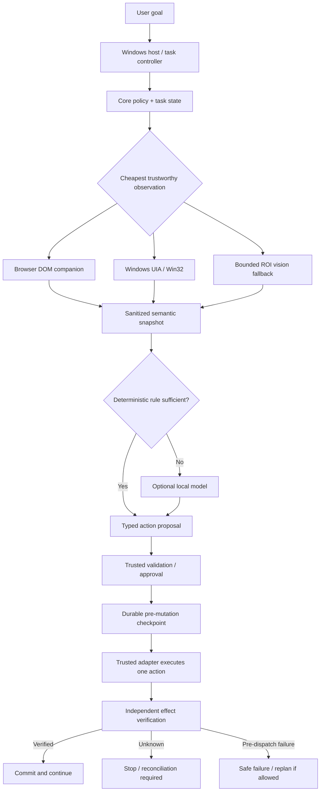
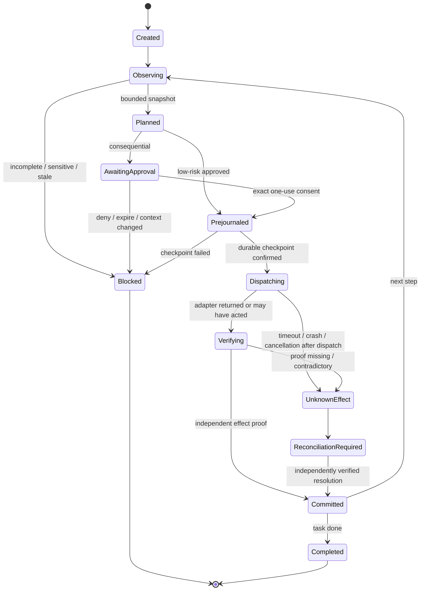

# SIGHTLINE — DEFINITIVE DEVELOPMENT TAKEOVER DOSSIER

**Edition:** V3 / 2026-11-11  
**Purpose:** Complete project context, user-request rationale, engineering contract, architecture, codebase navigation, safety invariants, test evidence, historical audit, execution plan, and next-agent handoff.  
**Product:** Sightline — **See. Understand. Act.**  
**Canonical repository:** https://github.com/DevTunaSoft/Sightline  
**Active implementation branch:** `develop`  
**GitHub default branch:** `main` (not equivalent to `develop`)  
**Release:** `0.2.0-alpha.0` in `package.json`; not production accepted.  
**Verification date:** 2026-11-11; this document is a *point-in-time* handoff, not a live status service.

> **START HERE — THE FIVE RULES THAT OVERRIDE ALL OTHER TEXT**
>
> 1. The user wants **working software** that sees, understands, and acts on Windows and webpages; the product is not a research paper or a screenshot-only demo.
> 2. **Low memory, clean modular code, and strict resource ceilings** apply to every subsystem, including AI, logging, tests, caches, recovery, and browser scanning.
> 3. **Structured before pixels; deterministic before AI.** All consequential actions require trusted validation, exact-target confirmation where applicable, independent effect verification, and no blind replay after uncertain results.
> 4. **Never mistake source presence or isolated tests for production acceptance.** Record PASS / FAIL / BLOCKED / NOT RUN / UNVERIFIED and identify the exact test environment.
> 5. **Audit the actual repo before coding.** Do not duplicate features, reopen solved defects, create redundant branches/PRs, or blindly merge diverged branches.

## What makes this edition different

This edition **includes and supersedes the earlier 15,709-word engineering handoff**. It retains the prior technical and conversation-rationale sections, then adds an evidence-reconciled takeover layer: a detailed conversation-to-feature ledger, causal decision records, branch-drift warning, precise action/approval/recovery contracts, end-to-end acceptance scripts, quantitative resource-test design, a historical 35-finding audit with current verification requirements, risk register, detailed 20-work-package execution plan, and a ready-to-paste agent continuation brief. The package also includes companion files for day-one execution and audit.

**Provenance classifications used throughout:**

- **U — User-stated:** direct request or choice found in the accessible Sightline project conversation context. Quotation marks are used only for short wording supported by that context.
- **R — Repository-confirmed:** content inspected from the live `develop` repository documentation or selected source, as of this handoff.
- **H — Historical audit:** issue/finding in the provided 35-item audit; not automatically a currently open defect.
- **E — Engineering derivation:** implementation guidance or acceptance criteria inferred from U and R; useful but not falsely attributed to a verbatim user instruction.
- **X — Not independently verified:** code/runtime claim still requiring direct execution evidence.

**Critical branch fact, verified via GitHub compare:** `main` and `develop` are **diverged**; the comparison returned **532 commits ahead and 17 behind** for `develop` relative to `main`, with **126 changed files** in the compare result. These counts are a snapshot, not permanent. GitHub's default branch is `main`, while the actual browser/Windows alpha work is on `develop`. A fresh plain clone can therefore present the wrong baseline. **Do not blindly merge, rebase, reset, or force-push** to “clean up” this state. Inspect both histories, open PR #8, and issue #9 before integrating anything.

**Documentation discrepancy to resolve:** `docs/FEATURE_STATUS.md` contains a Windows approval row with obsolete wording suggesting no one-use approval implementation, while later `windows/README.md`, `docs/USER_MANUAL.md`, and `docs/HANDOFF.md` describe an implemented `OneShotDesktopActionApproval` primitive with targeted tests added but not run on the latest source. Treat the **actual current code and fresh test results** as authoritative. The *production consent UI* is still missing. Likewise, do not interpret historical CI claims as proof that the latest SHA has passed the full Node or .NET suites.

## Reading map for the next engineer

| Read order | Section | Why |
|---|---|---|
| 1 | This V3 preface + Part III | User intent, provenance, exact requirement contracts |
| 2 | Part I sections 1–6 | Mission, architecture, safety principles |
| 3 | Part I sections 7–16 | Existing browser and Windows implementation, status, risks |
| 4 | Part IV | Action state machines, adapters, security and recovery contracts |
| 5 | Part V | Reproducible acceptance plan and quantitative memory testing |
| 6 | Part VI | Historical 35-finding audit; distinguish resolved from unverified |
| 7 | Part VII | Work packages, dependencies, release gates, next-session handoff |
| 8 | Part II | Conversation-by-conversation reasoning behind earlier changes |

---

# SIGHTLINE — MASTER ENGINEERING AND CODING HANDOFF

**Edition:** 2026-11-11, deep technical handoff  
**Audience:** incoming lead engineer, coding agent, QA/security reviewer, release engineer, product designer  
**Project:** Sightline — *See. Understand. Act.*  
**Canonical repository:** https://github.com/DevTunaSoft/Sightline  
**Active engineering branch:** `develop`  
**Integration baseline:** `main`  
**Documented browser version:** `0.2.0-alpha` (`package.json` uses `0.2.0-alpha.0`)  
**Release classification:** pre-production / engineering alpha  
**Source of truth:** repository code and current CI/test evidence outrank this handoff if they conflict.

> **CRITICAL HANDOFF RULE:** This document is a comprehensive explanation and execution guide, **not** a claim that every described feature works. Each capability is classified as implemented, partially implemented, planned, or unverified. The incoming engineer must re-audit the live repository and tests before acting. The author inspected repository documentation and selected current source in this session; the full codebase was not cloned or rebuilt for this document.

---

# 1. EXECUTIVE MISSION

Sightline is a local-first, resource-conscious software assistant intended to *see*, *understand*, and *act* across Windows applications and webpages. It should let a person express a practical goal, then perform bounded, comprehensible, recoverable actions using trustworthy interfaces. Its primary user interface is intended to be a lightweight Windows desktop application; an existing Chrome/Edge Manifest V3 extension is the browser companion and current alpha.

The product is **not** intended to be a generic unconstrained autonomous agent that blindly clicks whatever a model suggests. It is also not intended to run a large resident multimodal model just to inspect a button. The goal is to make ordinary computer work easier without sacrificing predictable behavior, privacy, low resource usage, or user control.

A successful mature interaction should look like this:

1. The user gives a goal, such as finding information, organizing items, or completing a routine workflow.
2. Sightline determines which application, window, tab, or capability is relevant.
3. It observes the current state through the cheapest trustworthy structured interface.
4. It creates a compact, sanitized representation of what can actually be seen and acted upon.
5. It selects a deterministic procedure when possible; otherwise it asks an optional local model for a bounded plan.
6. A trusted validator checks the proposed action, target, policy, identity, risk, and current page/window state.
7. For consequential operations, a trusted UI requests explicit approval bound to that exact action and context.
8. Sightline records a minimal durable pre-action checkpoint for operations whose effects could be ambiguous.
9. It executes one typed action through a trusted adapter.
10. It independently verifies the intended effect, not merely that a click was dispatched.
11. It records a sanitized receipt, advances, pauses for the user, or stops with an accurate explanation.
12. If a crash, timeout, cancellation, or stale target makes the outcome uncertain, it **does not blindly repeat** a potentially consequential action.

**The core promise:** powerful computer interaction with bounded resources, clear evidence, and safe failure behavior.

# 2. WHY THIS PRODUCT EXISTS

## 2.1 Problems with conventional automation

Traditional macros and coordinate scripts are brittle. They often depend on exact screen positions, window sizes, themes, and timing. They can misclick after a window moves or a page changes. They generally lack semantic understanding, recovery, or a reliable way to prove the intended operation occurred.

Browser-only automation cannot operate native Windows applications. Desktop-only screenshot automation discards useful structured DOM information and may require repeated expensive vision inference. Pure LLM agents can overinterpret webpage text, invent actions, retry destructive operations after ambiguous failures, or consume substantial RAM and CPU.

Sightline is being designed to combine the strengths of each approach while avoiding their unnecessary overhead:

- **Browser DOM and accessibility:** precise semantic controls and structured state.
- **Windows UI Automation / Win32:** native application controls, window/process identity, and structured actions.
- **Deterministic adapters:** predictable operations with typed inputs and verifiable outputs.
- **Optional local AI:** interpretation, planning, and visual fallback when simpler methods are insufficient.
- **Bounded diagnostics and recovery:** evidence of what happened, without storing sensitive task content.

## 2.2 Why local-first matters

Local-first operation reduces reliance on external cloud services for ordinary interaction, allows use of local Ollama models, and helps keep page content and desktop information under the user's control. **Local-first is not equivalent to automatically secure**: local model endpoints, browser extension permissions, logs, and screenshots still need explicit security review.

## 2.3 Why extremely low memory use matters

A desktop assistant should not require a high-end GPU or reserve gigabytes of RAM while idle. The product's core should remain useful without an AI model. Expensive modules should initialize only when required, be bounded while active, and release their resources promptly. This is a non-negotiable architectural constraint, not a late optimization.

## 2.4 Why verification matters

A button click, UIA Invoke response, DOM mutation, or optimistic webpage message is **not automatically proof** that a server-side operation completed. A mail message disappearing might indicate a filter or pagination change rather than deletion. A desktop provider might report success before an application commits a change. A cancelled operation might have executed already.

Sightline therefore distinguishes *attempted*, *dispatched*, *observed structural change*, *verified application effect*, *unknown effect*, and *failed before dispatch*. This distinction is central to preventing accidental duplicate sends, deletes, transfers, or other consequential actions.

# 3. NON-NEGOTIABLE ENGINEERING CONTRACT

1. **Do not duplicate work.** Inspect branches, open PRs, issues, commits, workflows, documentation, and existing code before implementing.
2. **Do not invent test results.** Distinguish source review, isolated shims, Node tests, .NET tests, CI, installed Chrome/Edge, real Ollama, and interactive Windows acceptance.
3. **Keep memory bounded.** No unbounded queues, DOM lists, text aggregation, logs, model contexts, retries, caches, screenshot histories, or permanent heavyweight workers.
4. **Use deterministic methods first.** DOM/UIA/Win32/native APIs precede OCR, screenshots, and LLMs.
5. **Treat model output and screen/page content as untrusted.** They may suggest, never directly grant permissions or execute arbitrary code.
6. **Protect secrets.** Passwords, OTPs, payment security codes, tokens, cookies, and private content must not leak into prompts, receipts, logs, or checkpoints.
7. **Fail closed on incomplete observations.** Unknown identity or incomplete scope must not authorize consequential actions.
8. **Require trusted confirmation for consequential actions.** Approval must bind to exact task, action, target, state, and time; a generic Yes is insufficient.
9. **Never blindly replay an uncertain mutation.** An unknown effect requires independent reconciliation.
10. **Do not introduce unnecessary dependencies.** In particular, do not replace the lightweight Windows design with Electron or Docker.
11. **Preserve compatibility.** Chrome/Edge companion, Windows architecture, and existing user workflows should not regress.
12. **Keep one authoritative handoff and end-user manual.** Update `docs/HANDOFF.md`, `docs/USER_MANUAL.md`, `docs/FEATURE_STATUS.md`, and roadmap as changes are verified.
13. **Stop failed loops.** After two materially identical failures, investigate root cause and change approach. After two cycles without measurable progress, record the blocker and advance to independent work.
14. **Do not circumvent repository protections.** Audit CI and PR state; do not create redundant PRs or bypass tests.
15. **Do not claim ongoing work after the session ends.** All progress must be supported by committed changes or attached artifacts.

# 4. PRODUCT SCOPE AND EXPERIENCE

## 4.1 Intended mature product

The standalone Windows application should offer a clear task-entry interface, understandable activity monitor, consent/review surfaces, pause/resume/cancel, diagnostics export, local AI configuration, and a recovery view for unresolved actions. A Chrome/Edge companion should provide precise webpage semantics. The user should not need to understand DOM selectors, UIA runtime IDs, model token budgets, or internal state-machine codes to use the software.

## 4.2 Browser modes already documented

- **Observe:** describe and inspect without mutating the webpage.
- **Assist:** allow ordinary actions while stopping for consequential confirmation.
- **Autonomous:** perform bounded multi-step tasks without bypassing safety policy.

These modes must never become separate permission systems that bypass a common safety gate. Autonomous means fewer routine prompts, not unrestricted execution.

## 4.3 Intended operating examples

**Example: retrieve information from a webpage.** Observe the page, identify the relevant region, read bounded content, optionally summarize with a local model, and present the result. No mutation or approval should be necessary.

**Example: fill an ordinary form.** Identify a stable, nonsensitive field; validate a typed action; re-observe immediately before mutation; set the value using a trusted adapter; verify the field value/state without logging its contents; continue only if the target remains correct.

**Example: move a selected email to Trash.** Determine the exact selected message set, verify scope and user intent, request confirmation, persist a pre-action record, perform the action once, and verify the *application-side effect* with an appropriate oracle. A mere change in page text or visible count must not be called successful deletion. Current Yahoo safeguards intentionally stop when such proof is unavailable.

**Example: operate a native Windows app.** Discover a bounded list of windows, attach to the intended process/window, observe UIA controls, issue session-scoped target leases, require approval for mutation, write a durable journal record, execute an Invoke/SetValue operation, verify the effect, and record a secret-free receipt. The trusted production approval/reconciliation UI remains unfinished.

**Example: unknown custom application.** Prefer UIA and application metadata. If those are insufficient, capture only a limited region of interest, redact sensitive regions, and invoke optional local vision. A vision model may propose a target; deterministic geometry/identity and risk checks must still authorize any action. This is a future capability, not a production-verified feature.

# 5. REPOSITORY AND BASELINE

Canonical repository: `https://github.com/DevTunaSoft/Sightline`.

- `develop`: active integrated engineering branch.
- `main`: verified integration baseline, not a dumping ground for unverified changes.
- Open PR observed at handoff: **#8 — Windows capability v0: bounded on-demand process inspection**. Reconcile it before working on process inspection or opening another PR.
- Active audit tracker: **issue #9**. It contains reliability and security findings and partial mitigations. Do not close it merely because one subgroup of issues has been addressed.
- Browser extension manifest version: `0.2.0`, version name `0.2.0-alpha`.
- Root package version: `0.2.0-alpha.0`; Node engine `>=20`.

### Primary documents

| Path | Purpose |
|---|---|
| `README.md` | User-facing project summary, quick start, acceptance entry points |
| `docs/ARCHITECTURE.md` | Component boundaries, trust and dependency direction |
| `docs/ROADMAP.md` | Phase-by-phase implementation priorities |
| `docs/FEATURE_STATUS.md` | Detailed implemented/partial/unverified matrix |
| `docs/SECURITY.md` | Threat model and existing controls |
| `docs/PERFORMANCE.md` | Resource budgets and acceptance targets |
| `docs/BROWSER_ACCEPTANCE.md` | Installed Chrome/Edge deterministic acceptance |
| `docs/USER_MANUAL.md` | Beginner-oriented usage and troubleshooting |
| `docs/HANDOFF.md` | Cumulative technical ledger and development checkpoints |
| `docs/CHANGELOG.md` | Version history and release evidence |

**Important:** `docs/HANDOFF.md` is already extensive (approximately 66 KB at this inspection). It contains implementation-specific history, failure lessons, commit IDs, and acceptance caveats. Do not replace or truncate it with this explanatory document. The two documents serve complementary roles: historical ledger versus newcomer guide.

### Baseline audit checklist

Before modifying code, run or inspect the equivalent of:

```bash
git status --short
git branch -avv
git log --oneline --decorate -25
git diff main...develop --stat
```

Also inspect GitHub issues, PR #8, issue #9, latest `develop` CI runs, release artifacts, and pending checks. GitHub connector reads were available in this session; a complete local clone/build was **not** performed for this handoff. If direct GitHub network access fails, do not mistake a connector-only file read for a local build.

# 6. SYSTEM ARCHITECTURE — DEEP EXPLANATION

## 6.1 Logical system

```text
                         USER
                          |
                   Sightline GUI (future)
                          |
              Task orchestrator / state machine
                          |
      +-------------------+---------------------+
      |                   |                     |
   Policy gate       Context/Planner      Journal/Diagnostics
      |                   |                     |
      +-------------------+---------------------+
                          |
                  Typed action router
                          |
        +-----------------+------------------+
        |                                    |
 Windows adapter                         Browser adapter
 UIA3 / Win32                         MV3 Chrome/Edge
        |                                    |
 Native app controls                  DOM + page agent
        |                                    |
        +-----------------+------------------+
                          |
                  Effect verification
                          |
                 checkpoint / stop

Optional services, loaded only when justified:
  local Ollama / future small GGUF model / OCR / ROI vision
```

The diagram describes the intended architecture, not proof that every connection exists. In particular, the browser-to-Windows IPC adapter and the production GUI orchestration are not yet complete.

## 6.2 Dependency direction

`Sightline.App` is the host/presentation layer; `Sightline.Core` owns shared contracts and policy; `Sightline.Windows` owns UIA/Win32 integration. Core must not depend on FlaUI, browser APIs, or model runtimes. The Windows adapter must not call a model directly; it receives typed, validated requests. Future browser/vision/model/storage/skill adapters should be replaceable behind narrow interfaces.

This matters for memory, testability, security, and portability. A deterministic core can be tested without starting a browser, Windows desktop, or LLM. A broken provider can be isolated or unloaded. A safety policy cannot be silently overridden by a site-specific adapter.

## 6.3 Observation before action

Every action should be tied to an observation of the actual current state. Element references are **leases**, not permanent coordinates or global identifiers. When the page reloads, a window changes, a process restarts, or a snapshot becomes stale, old references must not be silently reused.

For browsers, the observer returns a bounded semantic snapshot with page identity, visible text, elements, role/name/state, frame context, and a truncation flag. A ref such as `@e1` identifies a control **within a particular snapshot**, not forever.

For Windows, UIA references are bound to process/window/snapshot identity and need live re-resolution before mutation. UIA providers may hang, lie, or change their tree during an operation; the system therefore requires node/depth/time budgets and a circuit breaker.

## 6.4 Planning versus execution

The AI is not the actuator. It proposes a typed action; the validator rejects malformed/oversized requests, unauthorized origins, sensitive fields, stale references, and unapproved consequential operations. A deterministic adapter executes the allowed action.

A model must never be able to request arbitrary JavaScript, shell commands, unbounded screenshot scraping, unrestricted file access, or silent credential entry through free-form instructions. New skills must use the same typed-action and safety path.

## 6.5 Why visual fallback is last

Screenshots consume memory and may include sensitive content. Vision inference costs CPU, RAM, model context, and latency; model perception may be wrong. Browser DOM and Windows UIA usually provide more precise targets and cheaper verification. Vision should be invoked only when structured observation is insufficient, with a bounded region, redaction, and a strict call budget.

## 6.6 State machine to preserve

A robust task controller should distinguish at least:

`CREATED -> OBSERVING -> PLANNING -> VALIDATING -> [AWAITING_APPROVAL] -> JOURNALED -> DISPATCHING -> VERIFYING -> COMMITTED -> NEXT`.

Alternative terminal/paused states include `CANCELLED`, `BLOCKED`, `STALE`, `INCOMPLETE_OBSERVATION`, `UNKNOWN_EFFECT`, `RECONCILIATION_REQUIRED`, `FAILED_BEFORE_DISPATCH`, and `COMPLETED`.

The state transition is not a UI detail. It determines whether recovery may safely retry. A crash after `JOURNALED` but before confirmed `COMMITTED` must be treated conservatively until the actual effect is independently reconciled.

# 7. BROWSER EXTENSION — IMPLEMENTED FOUNDATION

## 7.1 Packaging and permissions

The extension is Manifest V3 and uses a side panel. Current manifest permissions include `sidePanel`, `activeTab`, `scripting`, and `storage`. Its declared host permissions are limited to local Ollama endpoints on `127.0.0.1:11434` and `localhost:11434`; it does not request broad `<all_urls>` host permission. It uses a service worker in `extension/background.js` and a panel in `extension/panel.html`.

The extension's page agent and related modules are made available as web-accessible resources for HTTP(S) pages. Reassess these permissions and resource declarations during release security review; do not broaden permissions merely to make a test easier.

## 7.2 Important source modules

| Module | Responsibility |
|---|---|
| `extension/page-observer-core.js` | Shared bounded observation/text normalization, sensitive-field logic, structural-effect helper |
| `extension/page-observer.js` | DOM/frame observation and semantic snapshot construction |
| `extension/ref-registry.js` | Snapshot-scoped DOM element reference storage |
| `extension/action-protocol.js` | Typed action validation |
| `extension/action-executor-core.js` | Trusted action dispatch and result structure |
| `extension/dom-action-adapter.js` | DOM click/type/read/verify/select/keypress/wait behavior |
| `extension/safety-gate.js` | Consequential-action policy |
| `extension/page-agent.js` | Live observation, target resolution, confirmation and action control |
| `extension/page-agent-bootstrap.js` | Page-agent initialization |
| `extension/browser-bridge.js` | Browser-side communication bridge |
| `extension/planner-core.js` | Bounded planner context/action processing |
| `extension/planner-client.js` | Local planner request plumbing |
| `extension/browser-task-runner.js` | Multi-step task orchestration and site verification |
| `extension/task-loop-core.js` | Task loop and stall/budget guards |
| `extension/task-checkpoint.js` | Session checkpoint/recovery data |
| `extension/skills/yahoo-mail.js` | Yahoo-specific safety and workflow interpretation |
| `extension/skill-blockers.js` | Site/challenge blockers |
| `extension/vision-core.js` | Visual fallback controls |
| `extension/diagnostics-core.js` | Sanitized bounded event evidence |
| `extension/performance-core.js` | Performance data/reporting |
| `extension/browser-self-test.js` | Deterministic browser fixture checks |
| `extension/local-ai-self-test.js` | Local AI readiness checks |
| `extension/yahoo-readiness.js` | Read-only Yahoo readiness checks |

**Do not infer that every module is production-complete from its presence.** Inspect actual exports, call sites, tests, and active runtime paths before changing behavior.

## 7.3 Semantic snapshot details

The observer identifies visible interactive controls, infers roles, obtains bounded accessible names, captures limited state (for example checkbox status, expanded status, selected index, or input length), and records frame context. It avoids using textbox values as accessible labels, and redacts credential-like controls.

The observer does not have unlimited coverage. A snapshot can be explicitly marked `truncated` when node, text, frame, or label budgets are exceeded. Consequential actions should not proceed based on an incomplete snapshot. Cross-origin frames are opaque; same-origin frame controls can be observed within the same global budget.

## 7.4 Exact resource ceilings documented for browser observation

| Resource | Documented cap |
|---|---:|
| Interactive controls in one snapshot | 300 |
| Serialized snapshot | 48 KB |
| Visible page text | 8,000 characters |
| Interactive DOM nodes visited | 12,000 |
| Text nodes visited | 6,000 |
| Frame-discovery nodes visited | 6,000 |
| Frames inspected | 20 |
| Document contexts retained, including top page | 21 |
| Referenced accessible-label IDs | 16 |
| `aria-labelledby` inspected attribute prefix | 2,048 characters |
| Native associated labels examined | 16 |
| Accessible label source text budget | 4,096 characters |
| Per-value normalization scan | 32,768 UTF-16 units |
| Aggregate page text scan | 65,536 UTF-16 units |
| DOM read/verify text-node scan | 6,000 |
| DOM read/verify aggregate source scan | 65,536 UTF-16 units |
| Dropdown options scanned | 2,048 |

**Interpretation:** These are code-level limits documented in the repository, not a guarantee of total process RAM or browser heap. DOM API getters such as `textContent` may themselves allocate inside the browser. Real heap/CPU acceptance remains necessary.

## 7.5 Sensitive-field defense

The current code uses a shared sensitive-field classifier at both observation and action time. It examines HTML type, autocomplete tokens, independent `name` and `id` metadata, editable aria-label/placeholder hints, native associated labels, and `aria-labelledby` references. Sensitive text-entry controls are redacted in snapshots and blocked by the action adapter.

Recent changes fixed a bypass in which a benign `name` attribute could hide a credential-bearing `id`. Section-prefixed autocomplete tokens such as `section-login current-password` are recognized. Oversized metadata is denied rather than trusting only a harmless prefix. Ordinary noneditable buttons such as **Show password** are not automatically treated as credential input fields.

Linked labels are rechecked immediately before DOM operations. This matters when a webpage dynamically changes a field from an ordinary input to a password/OTP prompt between observation and action.

**Security caution:** These are heuristic, bounded safeguards. They do not establish that every custom web component, shadow DOM configuration, language, or adversarial field is recognized. Production acceptance must include custom controls and real-browser mutation/race tests.

## 7.6 Action-time identity and stale-state protection

A planned action includes a typed operation and an element reference from a snapshot. Before executing, the page agent re-observes the live page, checks the snapshot identity, resolves the intended control, and applies safety policy. A stale reference should be rejected rather than retargeted to a different element with a similar label.

The current structural-effect helper distinguishes meaningful target state changes from unrelated clock/text changes. However, **generic DOM structural change is not sufficient proof of irreversible server-side effects**. The engineer must continue tightening site-specific effect oracles and avoid false success on target disappearance due to filtering, pagination, navigation, or unrelated updates.

## 7.7 Task budgets and local planner

The root documentation records a default 40-action browser task limit, 120-second task window, 90-second planner request timeout, one malformed-output repair retry, and a maximum of two vision fallbacks per task (one for an identical semantic state). The planner context is intentionally smaller than the raw page snapshot and is filtered to shown references. It must never invent target refs that were not presented to the model.

The conservative local planner heuristic is **not** a tokenizer guarantee. When context is too large, stop or narrow the page instead of silently dropping safety-critical context or allocating an unbounded prompt.

## 7.8 Browser checkpoint and crash recovery

The extension uses bounded `chrome.storage.session` checkpoint data. Existing work introduced write-ahead unknown-effect records before browser mutations, serialized checkpoint saves, and replay prevention when an earlier action may already have occurred. A failed checkpoint save must block a consequential dispatch. Pausing retains a sanitized checkpoint; cancelling removes it.

The checkpoint intentionally excludes typed payloads, full navigation URLs, screenshots, and other secrets. It is not intended to become a permanent transcript. Restored tasks with unknown effects must require reconciliation, not automatic resubmission.

## 7.9 Yahoo Mail-specific logic

Yahoo Mail has its own skill and readiness checks because search, selection, bulk actions, and challenge states are semantically complex. Existing safeguards include distinguishing actual MFA/CAPTCHA UI from quoted email text, refusing unverified selected-all Trash operations, and refusing to call a Trash action successful merely because sample messages disappeared or counts decreased.

**Known limitation:** The strict Yahoo Trash verification may stop with `NO_VERIFIED_EFFECT` until a trustworthy application-specific result oracle is implemented and tested. That is an intentional safety limitation, not a reason to revert to optimistic success or repeat destructive operations.

# 8. WINDOWS STANDALONE FOUNDATION — DEEP EXPLANATION

## 8.1 Direction

The standalone application is intended to be a lightweight Windows GUI rather than an Electron wrapper. Repository documentation describes a .NET 8 split among core, Windows adapter, and application layers. Windows UI Automation uses FlaUI/UIA3 with Win32 helpers.

The browser extension should remain the preferred executor for browser pages; do not embed a second full browser engine just to gain browser control. A future bounded IPC bridge should let the Windows orchestrator coordinate the existing extension.

## 8.2 UIA observation

The Windows observer must use bounded traversal and cancellation. The documented provisional budget is **750 nodes, depth 30, 600 ms**. Do not call unrestricted descendant enumeration over an unknown application's accessibility tree. UIA providers can be slow, buggy, or reentrant; the circuit breaker and time budgets are fundamental reliability safeguards.

## 8.3 Element leases

An element lease binds a semantic target to its observed process, window, and snapshot identity. Leases should not be reused after the process/window generation changes. A lease's cached identity is not sufficient to authorize mutation; the target must be re-resolved and compared against live metadata.

The current feature matrix describes type, AutomationId, and Name checks, while stronger runtime ID, hierarchy, and geometry protections remain outstanding. A control with no stable identity must be rejected for consequential action rather than guessed.

## 8.4 Safe Windows actions

The documented foundation includes Invoke, SetValue/readback, focus verification, typed failures, cancellation, user-activity leases, and unknown-effect status. But actual interactive Windows acceptance is not complete. An Invoke provider reporting success does not prove application-side success. A SetValue mismatch after dispatch must not be called retry-safe failure; it may be an unknown effect.

User activity should invalidate or pause an automation lease when interference could redirect input. The existing last-input approach avoids continuous hooks or polling.

## 8.5 Windows approval primitive versus production UI

The codebase documents a bounded single-use approval primitive: in-memory SHA-256 digest, exact snapshot/action/target binding, maximum five-minute expiry, and fail-closed behavior on malformed observations and clock anomalies. **This primitive is not the same as a finished trusted end-user approval UI.** The production confirmation GUI is still a priority.

No approval provider should mean no consequential Invoke/SetValue. Do not silently substitute an automatic Yes for missing UI wiring.

## 8.6 Windows mutation journal

A single pending write-through journal record is documented for Windows mutations. The record contains minimal metadata and must be persisted before dispatch. The default should deny a new mutation while an unresolved record remains. The durable production per-user journal path, access restrictions, and explicit reconciliation UI are not finished.

The journal should avoid typed values and secrets. It must survive process crashes where appropriate, use atomic/secure file semantics, and avoid creating a permanently running service merely to watch one record.

## 8.7 Windows diagnostics

The repository describes fixed-capacity in-memory event ledgers, bounded rotating file sinks, retention limits, redaction, resource telemetry, and repeated-session stress tests. The Windows resource telemetry includes working set, private memory, managed heap, allocations, handles, and threads. A prior hosted-runner test reportedly reduced measured idle-session allocation from roughly 11.24 MB to 0.84 MB over 1,000 cycles (~92.5% reduction). This is **not** a claim about the installed application's total RAM.

## 8.8 Windows capability priority

The roadmap has started deterministic top-level window discovery using Win32 `EnumWindows` with bounded results/title lengths. The open PR #8 addresses bounded on-demand process inspection. After reconciliation, priorities include explicit app launch/attach, safe process metadata, filesystem, clipboard, File Explorer, and Notepad workflows, but only after approval/recovery semantics are trustworthy.

# 9. LOCAL AI STRATEGY

## 9.1 Model-optional by design

Sightline must remain useful when Ollama is stopped or no model is installed. A deterministic workflow should not start an LLM just to locate a known button or compare a checkbox state.

The roadmap defines three levels:

- **Level 0:** deterministic code, browser DOM, UIA, Win32, filesystem, and verified compiled workflows.
- **Level 1:** optional small quantized local model for limited interpretation, routing, or classification.
- **Level 2:** optional larger local Ollama endpoint for difficult planning or visual interpretation.

A future tiny GGUF runtime is planned but **not implemented**. Do not tell users a streamed embedded model is already available.

## 9.2 Current Ollama integration

The browser alpha supports a local Ollama endpoint on loopback. The README gives `gemma3:4b` as an example model, not a universal recommendation or benchmark. Ollama must be configured to allow the exact extension origin; wildcard origin access should not be encouraged.

Commands documented by the repository:

```bash
ollama pull gemma3:4b
```

```text
OLLAMA_ORIGINS=chrome-extension://YOUR_ACTUAL_EXTENSION_ID
```

After configuration, restart Ollama and use the extension's installed-model discovery and local-AI self-test. Live local-model quality and compatibility are still release gates.

## 9.3 Future tiny model engineering constraints

If adding an embedded small model later, require:

- real need proven by tasks deterministic code cannot handle;
- CPU-only compatibility and low-memory quantization;
- bounded context and KV cache;
- streaming with cancellation and timeouts;
- lazy load and explicit unload/idle policy;
- OOM recovery without crashing the core GUI;
- no duplicate resident model if Ollama already provides the needed capability;
- privacy-safe prompt construction;
- real latency/working-set benchmarks on target hardware;
- graceful fallback when the model is absent or too slow.

**Do not implement this before stabilizing Windows safety and browser acceptance simply because it is technically interesting.**

# 10. SAFETY AND THREAT MODEL

## 10.1 Trust ordering

`user command > trusted local policy > OS/app metadata > webpage content > OCR > model inference`.

Webpages, emails, screenshots, and model responses are data, not trusted instructions. A malicious page might say “ignore your safety rules” or fabricate a confirmation message. Sightline must not treat such content as policy or proof.

## 10.2 Attack classes to test

- Prompt injection embedded in emails, webpages, image text, or accessible labels.
- Credential exfiltration via field values, labels, action history, logs, model context, screenshots, or receipts.
- Stale refs retargeting a different control after DOM/UIA changes.
- Misleading optimistic success after an unverified click.
- Confirmation reuse, expiry bypass, or approval bound to the wrong task/target.
- Unbounded DOM text, label collections, frames, dropdown options, or malformed planner responses.
- Cross-origin navigation and iframe boundary bypass.
- Extension-origin abuse of local Ollama.
- UIA provider hangs, tree mutation, exceptions, and process/window reuse.
- Crash between pre-action record and effect verification.
- File permission or symlink attacks against the Windows journal.
- User interference between observation and input.
- Repeated automation loops that amplify a destructive effect.

## 10.3 Approval requirements

The approval UI should display the target application/site, specific operation, intended scope, and expected effect. The token should be unpredictable, single-use, bound to the exact current state and action, and expired after a short interval. Any re-observation that materially changes the target should invalidate it.

## 10.4 Sensitive data rules

Never persist raw passwords, OTPs, payment security codes, tokens, cookies, authorization headers, unredacted screenshots, or typed private content in ordinary diagnostics. A debug mode must not silently relax these rules. Use explicit synthetic canaries in tests and verify that exported reports contain no canary text.

## 10.5 Unknown-effect protocol

If an operation could have mutated application state but confirmation is absent:

1. Stop further mutations.
2. Mark the operation `UNKNOWN_EFFECT` or `RECONCILIATION_REQUIRED`.
3. Preserve only minimal metadata needed to identify the pending operation.
4. Do not retry, even if a planner recommends it.
5. Obtain independent application-side evidence, preferably through a read-only query.
6. Resolve the pending record only through trusted reconciliation logic or explicit user review.
7. Record the evidence and decision, without private payloads.

The error message must not imply that the action definitely failed. “No verified effect” is not “no effect.”

# 11. PERFORMANCE AND MEMORY ENGINEERING CONTRACT

## 11.1 Resource target

The documented extension working-set target is **below 150 MB**, excluding Ollama/model memory. Idle CPU should be effectively near zero and idle AI inference zero. These are release targets, **not measured production achievements**.

## 11.2 Existing browser budgets

| Budget | Current documented limit |
|---|---:|
| Diagnostic event tail | 200 |
| Checkpoint action history | 40 |
| Checkpoint serialized size | 24 KB |
| Browser task actions | 40 default |
| Browser task duration | 120 seconds default |
| Planner timeout | 90 seconds |
| Malformed planner repair attempts | 1 |
| Vision fallbacks per task | 2 |
| Vision fallbacks for same semantic state | 1 |
| Vision description added to planner | 3,000 chars |
| Screenshot base64 budget | 6,000,000 chars |
| Default foreground inference concurrency target | 1 |

## 11.3 Patterns to prefer

- Incremental bounded traversal rather than full `querySelectorAll`/`Array.from` of large collections.
- Early exit when a node/text/element/timeout budget is reached.
- Lazy initialization of diagnostic buffers and optional modules.
- Ring buffers rather than append-only logs in memory.
- Streaming bounded serialization and text normalization.
- Single current observation and bounded history; discard old DOM refs on replacement.
- Native OS events or explicit user actions rather than frequent polling.
- Bounded channels with drop/backpressure policy rather than unconstrained queues.
- Short-lived per-task cancellation tokens and event listener cleanup.
- ROI screenshots only when necessary, with explicit size/time budget.
- One active inference unless benchmarks justify more.
- Compact numeric progress fingerprints rather than retaining full typed action payloads.
- Explicit disposal of UIA objects, screenshots, model sessions, file handles, and browser listeners.

## 11.4 Patterns to avoid

- Electron or a hidden browser engine for the desktop GUI.
- Persistent full-screen capture or frame-by-frame vision inference.
- A permanent local model process started by Sightline when not needed.
- Unbounded `innerText`, `textContent` aggregation, selector arrays, frame lists, option lists, logs, or checkpoints.
- A background watchdog that repeatedly scans every application.
- Unbounded retries on provider errors.
- Multiple competing state caches for the same window/tab.
- New dependency packages for functionality available in standard .NET, browser APIs, or existing project libraries.

## 11.5 Measurement procedure

For each meaningful resource change:

1. Record exact commit, machine, OS, browser, model state, workload and sampling method.
2. Measure cold start, warm idle, active observation, repeated actions, and post-cancellation cleanup.
3. Record working set, private bytes, managed/JS heap where available, allocation rate, handles, threads, CPU, and latency percentiles.
4. Use identical test fixtures and workload counts before/after.
5. Include a large DOM, many frames, long accessible labels, large dropdowns, repeated waits, and task interruptions.
6. Check for steady-state growth and recovery after task completion.
7. Run without Ollama to measure the core separately, then with Ollama to identify model cost.
8. Save evidence and regression thresholds in the repo; never report a memory percentage from synthetic unit tests alone.

# 12. DIAGNOSTICS AND VERIFICATION LEDGER

## 12.1 Why logging is part of the product

Sightline must explain **what it attempted, what it observed, why it stopped, and what remains uncertain**. The logs should make bugs reproducible without becoming a surveillance archive or exposing private screen content.

## 12.2 Recommended structured event schema

The following is a **recommended schema for future reconciliation**, not a claim that every field already exists:

```json
{
  "schemaVersion": 1,
  "utcTimestamp": "2026-11-11T00:00:00Z",
  "monotonicElapsedMs": 1234,
  "sessionId": "ephemeral-id",
  "taskId": "ephemeral-id",
  "actionId": "ephemeral-id",
  "component": "browser.page-agent",
  "event": "ACTION_VERIFICATION",
  "severity": "warning",
  "result": "UNKNOWN_EFFECT",
  "targetKind": "button",
  "targetIdentityDigest": "nonreversible-short-digest",
  "snapshotVersion": 1,
  "durationMs": 120,
  "retryCount": 0,
  "errorCode": "NO_VERIFIED_EFFECT",
  "redacted": true
}
```

Do not log actual private target names or URLs by default if they could contain sensitive data. Digest identity fields must be designed to avoid easy reversal and must not become stable cross-session tracking identifiers without need.

## 12.3 Engineering verification record

Each change should record:

- baseline branch/commit;
- task/issue reference and user-visible requirement;
- root cause and evidence;
- changed files and commit SHA;
- why the design is low-memory and secure;
- test commands, environment and exact results;
- any shims, mocks, fixtures or limitations;
- CI workflow links/status;
- runtime acceptance evidence;
- open risks and rollback plan;
- next independent task.

## 12.4 Evidence status vocabulary

- **PASS:** test/check executed and met its stated acceptance criteria.
- **FAIL:** executed and failed.
- **BLOCKED:** cannot proceed due to a specific dependency or environmental condition.
- **NOT RUN:** no execution evidence for that test.
- **UNVERIFIED:** behavior or claim has not been established in its target environment.

“Code written” is not the same as “PASS.” “CI green at an older commit” is not “latest commit verified.” “Isolated V8 tests” are not “installed Chrome acceptance.”

# 13. CURRENT IMPLEMENTATION STATUS — HONEST MATRIX

| Area | Current assessment | Key caveat |
|---|---|---|
| Browser MV3 alpha and side panel | Implemented | Real installed Chrome/Edge acceptance pending |
| Bounded semantic DOM observation | Implemented, targeted isolated tests PASS | Real-browser heap/CPU and unusual DOM compatibility pending |
| Same-origin iframe observation | Implemented | Cross-origin frames deliberately opaque |
| Typed browser actions | Implemented | Real site behavior varies; effect proof is separate |
| Browser safety and confirmation | Implemented core | Real adversarial acceptance and production trust pending |
| Browser write-ahead checkpoint | Implemented source/tests | Crash fault-injection acceptance pending |
| Browser unknown-effect replay prevention | Implemented source/tests | Independent reconciliation incomplete |
| Yahoo Mail skill | Partial / safety-first | Bulk Trash completion intentionally fails closed without trusted oracle |
| Ollama browser planner | Implemented integration | Live model quality and compatibility unverified |
| Vision fallback | Implemented bounded browser path | Real quality/performance acceptance pending |
| Windows .NET/Core/Windows split | Implemented source; prior hosted checks | Latest Windows test suite not run here |
| Windows UIA bounded observer | Implemented | Real interactive desktop acceptance pending |
| Windows Invoke/SetValue | Partial | Trustworthy independent effect verification incomplete |
| Windows approval primitive | Implemented source/tests | Production trusted consent GUI not implemented |
| Windows single-mutation journal | Implemented source/tests | Production path/provisioning/reconciliation incomplete |
| Windows top-level window discovery | Implemented | PR #8 process inspection needs reconciliation |
| Windows browser IPC | Not implemented | Must preserve existing browser extension |
| Windows ROI OCR/vision | Planned | Do not claim available |
| Embedded tiny GGUF model | Not implemented | Optional later phase |
| Learned deterministic workflows | Planned | Requires proven effects and safe compilation |
| Installer/updater/rollback | Planned/incomplete | No production release |
| User manual and structured handoff | Maintained | Keep updated with verified changes |

# 14. MOST RECENT COMPLETED DEVELOPMENT CHECKPOINT

The last completed coding segment addressed browser credential privacy and action-time safety on `develop`.

### Confirmed problem

An input with harmless `name="notes"` but sensitive `id="new_password"` could be classified as ordinary because earlier code used the first truthy name/ID. Section-prefixed autocomplete tokens and editable accessible hints were also underrecognized. An external `<label>` or `aria-labelledby` target could be the only sign that a text field was a password/OTP field.

### Implemented correction

- Independent name and ID checks with bounded metadata handling.
- Tokenized autocomplete checks, including section-prefixed password/payment hints.
- Editable field aria-label and placeholder inspection.
- Shared observer/adapter classifier to prevent observation/action mismatch.
- Bounded linked-label checks, maximum 16 native labels or referenced IDs within a 2,048-character ID attribute prefix.
- Action-time recheck so dynamic label changes invalidate a previously ordinary target.
- Redaction using already collected bounded accessible names; avoid an extra DOM label walk.
- Reuse of one short-lived metadata object during linked-label checks, avoiding per-label object copies.
- Regression tests for benign Show password buttons and ordinary labels, so protection does not unnecessarily block normal UI.

### Representative code commits

| Short SHA | Change |
|---|---|
| `edf09d4` | Independent credential metadata and tokenized autocomplete |
| `835ce71` | Fail closed on overlong credential metadata |
| `046f7ec` | Observer uses consistent metadata |
| `3c64674` | Adapter uses consistent metadata |
| `5370648` | Shared bounded associated-label detector |
| `c339012` | Adapter rechecks associated labels before actions |
| `4540a6d` | Observer redacts linked-label credential controls |
| `fce4561` | Remove per-label metadata allocation |
| `577b8a4` | Associated-label and large-collection tests |
| `da63347` | Live action guard tests |
| `3b6ec1c` | Linked-label snapshot tests |
| `2160f66` | Prior engineering handoff checkpoint |

Additional commits updated `docs/FEATURE_STATUS.md`, `docs/ROADMAP.md`, `docs/USER_MANUAL.md`, and `docs/HANDOFF.md`. Consult git history for the complete set; do not treat this table as exhaustive.

### Actual executed evidence

**PASS: 86/86 targeted JavaScript tests** covering observer core, observer visibility, integrated snapshot, and DOM adapter. They were executed from current GitHub source in an **isolated V8 harness with URL/DOM/Abort shims**. This was not the native Node test runner or an installed browser.

**NOT RUN in the last coding segment:** complete `npm run check`, current Windows .NET suite, installed Chrome/Edge, real Yahoo, live Ollama, browser heap/CPU benchmarks, and full interactive Windows acceptance. The GitHub status check at the handoff commit returned no statuses/workflow runs; absence of runs is not evidence of passing CI.

# 15. KNOWN RISKS AND PRIORITY DEFECTS

## 15.1 High priority: true effect verification

A target disappearing from a page or changing state can be caused by filtering, pagination, navigation, optimistic rendering, or unrelated updates. Generic structural change is useful evidence but must not be treated as proof of irreversible server-side mutation. Build site/application-specific result oracles and classify their strength. A destructive operation with no reliable oracle should stop for manual reconciliation.

**Acceptance:** no fake success when unrelated text changes, a target disappears through filtering, a page paginates, or a network response is delayed. No automatic destructive retry after an ambiguous result.

## 15.2 High priority: real-browser safety and compatibility

The recent sensitive-label changes have isolated test coverage but not installed Chrome/Edge acceptance. Test native labels, `aria-labelledby`, dynamic label changes, shadow DOM/custom controls, iframes, malformed metadata, and control identity changes. Confirm no sensitive values reach snapshots or exported diagnostics.

**Acceptance:** both browsers pass deterministic fixture and adversarial tests; no credential canary leaks; expected ordinary controls remain operable.

## 15.3 High priority: Windows trusted consent UI

The single-use approval primitive exists in source, but a production trusted confirmation UI does not. The UI must clearly show the action and target, bind to exact state, reject stale approvals, and never permit a missing approval provider to become implicit approval.

**Acceptance:** approval expiry, replay, target drift, window/process change, clock anomaly, and cancellation all block mutation.

## 15.4 High priority: Windows journal provisioning/reconciliation

The existing write-ahead record needs secure stable per-user provisioning, permission checks, safe startup behavior, and a trusted reconciliation screen. A crash must not allow a second execution of an uncertain operation.

**Acceptance:** simulated crashes at every transition produce correct recovery; no private payload in journal; no double execution.

## 15.5 High priority: exact-commit CI and Windows interactive tests

Run the complete Node suite and .NET tests against the same audited commit. Previous isolated results and historical hosted runs do not substitute for exact-commit acceptance.

## 15.6 Medium priority: browser-to-Windows IPC

Do not duplicate browser automation in the Windows process. Design a narrow authenticated, bounded protocol between Windows host and extension. Consider lifecycle, versioning, origin restrictions, task IDs, timeouts, backpressure, and reconnection. Keep private content out of unnecessary cross-process copies.

## 15.7 Medium priority: Windows deterministic capability expansion

After safety/recovery acceptance, reconcile PR #8 and add explicit app launch/attach and small verified workflows for basic Windows applications. Avoid a broad plugin system until contracts are stable.

## 15.8 Medium priority: performance soak and profiling

Prove that the memory architecture actually meets targets under installed browser and Windows workloads. Measure idle CPU, startup, repeated tasks, cancellation cleanup, provider timeouts, and long-session heap/handle growth.

## 15.9 Later: OCR/vision, embedded tiny model, learned workflows

These are roadmap capabilities. Implement them only when deterministic foundations and security gates are reliable, with separate performance and privacy acceptance.

# 16. DETAILED DEVELOPMENT ROADMAP AND ACCEPTANCE CRITERIA

## Phase 0 — Baseline reconciliation

**Status:** prior automated baseline exists; real browser acceptance remains.

**Tasks:** inspect repository/CI/PRs/issues, establish exact commit and test state, resolve contradictory docs, avoid duplicate implementations.

**Exit criteria:** known baseline SHA, clean branch strategy, no duplicated PR, tests and blockers documented.

## Phase 1 — Windows foundation

**Status:** automated foundation exists; real desktop acceptance remains.

**Tasks:** verify .NET split, bounded UIA traversal, leases, cancellation, telemetry and WPF fixtures on target Windows.

**Exit criteria:** actual interactive fixture passes, hangs are bounded, cancellation works, no unsafe stale lease.

## Phase 2 — Diagnostics and acceptance

**Status:** substantially implemented.

**Tasks:** verify redacted rotating sinks, bounded queues, 10k-event stress, resource telemetry, crash/recovery bundles, and fault injection.

**Exit criteria:** no secret leaks, bounded retention, useful failure explanation, no unbounded allocation.

## Phase 3 — Safe Windows actions

**Status:** partial.

**Tasks:** trusted confirmation GUI, target identity/geometry, UIA effect verification, focus safety, user-activity lease acceptance.

**Exit criteria:** wrong-target and stale approval tests fail closed; real Notepad/WPF fixture operations verified; no automatic retry after unknown effect.

## Phase 4 — Recovery and journaling

**Status:** partial.

**Tasks:** secure journal path, atomic durability, startup recovery, reconciliation UI, task checkpoint semantics, crash-loop protection.

**Exit criteria:** fault injection at all mutation boundaries causes no double action; journal contains metadata only.

## Phase 5 — Deterministic Windows capabilities

**Status:** started.

**Tasks:** reconcile process inspection PR #8, add explicit launch/attach, bounded process metadata, file operations, clipboard and simple app workflows with independent verification.

**Exit criteria:** each capability has isolated tests and interactive Windows acceptance.

## Phase 6 — Browser integration

**Status:** not yet implemented as Windows IPC.

**Tasks:** bounded authenticated host-extension messaging, lifecycle and reconnection, unified task policy and receipts.

**Exit criteria:** Windows host can coordinate browser tasks without bypassing extension safety; crash/restart recovery works.

## Phase 7 — Vision/OCR

**Status:** planned.

**Tasks:** ROI capture, DPI-aware coordinate leases, privacy masking, local OCR, optional vision model, visual result verification.

**Exit criteria:** works on mixed DPI and moving windows without blind clicks; memory/capture limits enforced.

## Phase 8 — Lightweight local intelligence

**Status:** browser Ollama exists; tiny GGUF runtime planned.

**Tasks:** deterministic routing first; evaluate small CPU models; bounded context/KV cache; streaming and unload; live benchmarks.

**Exit criteria:** measurable value beyond deterministic code; graceful no-model behavior; low idle memory.

## Phase 9 — Learned deterministic workflows

**Status:** planned.

**Tasks:** derive workflows from independently verified successful actions; version them; bind to app/site versions; reject stale selectors.

**Exit criteria:** compiled workflows reproduce results safely without unnecessary inference and stop on drift.

## Phase 10 — Hardening

**Status:** ongoing and incomplete.

**Tasks:** fuzz malformed metadata, concurrency, UIA provider hangs, DOM mutation races, sleep/wake, lock/unlock, elevation, network failure, permission drift, model errors, long-session soak.

**Exit criteria:** zero unbounded loops or unreviewed destructive retries; measured resource targets; documented limitations.

## Phase 11 — Production lifecycle

**Status:** planned/incomplete.

**Tasks:** production GUI, installer/uninstaller, safe update/rollback, recovery mode, self-test, diagnostic export, release gates and support documentation.

**Exit criteria:** signed/tested Windows deliverable, verified upgrades/rollback, Chrome/Edge companion compatibility, end-user acceptance, security review.

# 17. TEST STRATEGY — WHAT TO RUN AND WHY

## 17.1 Repository-level Node checks

From repository root with Node 20+:

```bash
npm run check
npm run benchmark:core
```

`npm run check` performs `node --check` across extension/tool modules, `npm run audit:release`, and `npm test` (`node --test tests/*.test.js`). Run against exact commit, save exit code and output, and fix any failure before claiming a clean regression baseline.

## 17.2 Deterministic installed-browser test

```bash
npm run acceptance:serve
```

On Windows, the documented launcher is:

```text
tools\start-browser-acceptance.cmd
```

Open `http://127.0.0.1:8765/`, load unpacked `extension/` in Chrome and Edge, open the Sightline side panel, and run **Run browser self-test**. Record browser/Windows versions, commit SHA, pass/fail, console errors, iframe results, and confirmation-gate results. The fixture intentionally refuses actions outside the local acceptance origin.

## 17.3 Ollama acceptance

```bash
npm run acceptance:ollama
```

Also use **Test local AI** in the extension after configuring the exact extension origin. Test model absent, endpoint down, slow response, malformed JSON, context overflow, cancellation, and model hallucinated refs. Never count deterministic browser fixture success as proof of Ollama quality.

## 17.4 Windows tests

The repository documents a Windows runner:

```powershell
.\tools\test-windows.ps1 -Interactive
```

Run .NET build/unit tests and WPF interactive fixtures on a Windows 11 machine with required SDK. Verify real UIA behavior, focus, process/window identity, approval, journal, provider timeouts, and cancellation. Do not claim Windows success from static source review or compilation alone.

## 17.5 Security/adversarial tests

- Credential canaries in name, ID, autocomplete, placeholder, aria-label, linked labels, shadow/custom controls, and dynamically changed metadata.
- Malicious webpage text telling the model to override policies.
- Cross-origin iframes and origin navigation.
- Stale refs, duplicate role/name controls, moving windows and tab switches.
- Delayed or false-success application responses.
- Crash after journal write, during dispatch, and before verification.
- Confirmation replay, expiry, mismatched target, and clock rollback.
- Huge labels, huge dropdowns, millions of synthetic options, long whitespace nodes, many frames, malformed Unicode.
- Diagnostics export checks that synthetic secrets are absent.

## 17.6 Performance tests

Compare before/after under identical workloads. Capture cold start, warm idle, 1k repeated sessions, many action cycles, long DOMs, UIA provider hangs, and cancel/recovery. Record peak/steady heap, working set, private bytes, CPU, threads, handles, allocation rate, p50/p95/p99 action latency, and memory after cleanup.

## 17.7 Release acceptance matrix

| Gate | Required evidence |
|---|---|
| Node | Exact-commit `npm run check` PASS |
| Windows build | Exact-commit .NET build/test PASS |
| Chrome | Installed fixture + security regression PASS |
| Edge | Installed fixture + security regression PASS |
| Ollama | Local endpoint, planning, timeout/cancel PASS |
| Yahoo | Controlled non-destructive and disposable-data destructive workflows with trustworthy effect proof |
| Windows UIA | Real interactive fixture and safe action/approval/recovery PASS |
| Privacy | Synthetic canary never exported or sent to model |
| Resource | Real measured RAM/CPU/heap/handle soak within targets |
| Packaging | Windows installer/executable, extension artifact, upgrade/rollback verified |
| Documentation | Manual, feature matrix, roadmap, handoff consistent with actual release |

**Do not label the product production-ready until these gates are met.**

# 18. FIRST 10 WORK SESSIONS FOR THE INCOMING ENGINEER

### Session 1 — Reconcile live state

Inspect `develop`, `main`, PR #8, issue #9, CI, open workflows, and all primary docs. Run `npm run check` and .NET tests where available. Produce an evidence-backed baseline. **Do not code until duplication and baseline are understood.**

### Session 2 — Validate latest credential safeguards in real browsers

Create adversarial fixture cases for linked labels, live label changes, custom inputs, shadow DOM, nested frames, and secret canaries. Run Chrome and Edge. Fix observed defects with minimal diffs and regressions.

### Session 3 — Strengthen effect verification

Audit `hasTargetStructuralEffect`, `page-agent.js`, `browser-task-runner.js`, and Yahoo verification. Separate UI structural evidence from application-side effect proof. Prevent false success from filtering/pagination/navigation and preserve unknown-effect safety.

### Session 4 — Browser crash/recovery fault injection

Simulate interruption before checkpoint, after checkpoint, during dispatch, and after dispatch before readback. Prove no automatic duplicate mutation. Inspect storage serialization and cancellation listener cleanup.

### Session 5 — Resource measurement

Run exact-commit Node benchmarks and installed-browser heap/CPU soak. Profile long labels and large DOMs. Fix any unbounded or unnecessary allocations; preserve existing caps and no-polling design.

### Session 6 — Windows interactive baseline

On actual Windows, run WPF fixture, .NET tests, UIA observation, lease revalidation, focus and Invoke/SetValue behavior. Identify runtime failures before expanding capabilities.

### Session 7 — Production trusted approval UI

Implement a minimal, accessible, trusted confirmation surface bound to the existing single-use approval primitive. Add expiry/replay/mismatch tests. Do not implement a separate competing approval system.

### Session 8 — Durable journal and reconciliation

Provision a stable, access-restricted per-user journal location. Add startup reconciliation UI and crash fault injection. Keep one pending mutation, metadata-only, no resident worker.

### Session 9 — Reconcile PR #8 and extend one deterministic workflow

Inspect whether PR #8 is merge-ready, redundant, or blocked. Integrate verified work through repository protections. Choose one simple Windows capability (for example safe app attach or Notepad interaction) with explicit acceptance and minimal dependencies.

### Session 10 — Integration checkpoint

Update README, manual, roadmap, feature matrix, handoff, issue #9, and CI evidence. Record exact commits, pass/fail, resource metrics, blockers, and next priority. Do not create a release until all required gates pass.

These sessions are **priority suggestions**, not evidence that work has already occurred or a fixed calendar schedule.

# 19. HOW TO WRITE CODE IN THIS PROJECT

## 19.1 Scope each change

Define a single failure mode or user-facing capability, measurable acceptance, and affected modules. Prefer a small patch over a broad rewrite. Preserve stable APIs unless a documented migration is necessary.

## 19.2 Make the cheapest correct path the default

Before adding AI, ask whether a deterministic API, cached verified workflow, UIA pattern, DOM state, or filesystem operation can solve the task. Before adding a dependency, ask whether the current stack already has the capability. Before adding a worker or timer, ask whether an event or explicit task transition is sufficient.

## 19.3 Keep safety policy centralized

Never add a Yahoo-specific or Windows-specific bypass that calls the DOM/UIA adapter directly around the central gate. Skills may provide stronger site-specific validation, not weaker policy.

## 19.4 Verify the intended effect

A method returning without throwing is not enough. Define an independent oracle before writing a consequential action. If no trustworthy oracle exists, return unknown effect and stop.

## 19.5 Test the actual failure mode

For a privacy bug, add a synthetic secret and assert it never enters snapshots, receipts, checkpoints, or exports. For a resource bug, add a huge synthetic input and assert bounded work. For a race, mutate the target between observation and dispatch. For a crash, interrupt at the exact dangerous boundary.

## 19.6 Preserve clean code

Keep contracts narrow and names descriptive. Avoid duplicated policy logic, overgeneralized frameworks, and speculative abstractions. Use early exits and immutable or short-lived state where appropriate. Document why a cap exists and what failure code it produces.

## 19.7 Commit and hand off

Commit focused changes on the designated branch, update regression tests and docs, and record evidence. Never call a test PASS if it was merely authored. If an environment blocks testing, write **BLOCKED** with exact reason and next reproduction command.

# 20. BEGINNER-FRIENDLY USER EXPERIENCE REQUIREMENTS

The user manual must explain the product without assuming programming knowledge. The interface should make five things obvious:

1. **What Sightline sees:** selected window/tab and what it can inspect.
2. **What Sightline intends to do:** plain-language action and scope.
3. **What requires approval:** why the action is consequential and what will change.
4. **What actually happened:** verified result versus uncertain effect.
5. **What the user should do next:** retry safely, review, pause, cancel, or provide input.

A failure message such as `UNKNOWN_EFFECT` should have a clear human explanation: “Sightline cannot confirm whether the previous action completed. It will not repeat the action automatically. Please inspect the application before starting another action.” Keep the technical code in expandable diagnostics.

The GUI should remain responsive even when Ollama is slow, a UIA provider hangs, or a webpage becomes enormous. Cancellation must work without forcing the user to kill the whole application. Do not show an intimidating wall of diagnostic events by default; expose advanced logs for IT/developer review.

# 21. DOCUMENTATION AND HISTORY DISCIPLINE

Keep the following updated **after verified changes**:

- `README.md`: concise current capabilities and setup.
- `docs/USER_MANUAL.md`: exact end-user steps and safe troubleshooting.
- `docs/ARCHITECTURE.md`: component boundaries and data flow.
- `docs/FEATURE_STATUS.md`: accurate implementation/verification status.
- `docs/ROADMAP.md`: remaining priorities and dependencies.
- `docs/SECURITY.md`: threat model and changed controls.
- `docs/PERFORMANCE.md`: measured budgets and benchmark methods.
- `docs/BROWSER_ACCEPTANCE.md`: installed-browser acceptance procedure.
- `docs/HANDOFF.md`: cumulative technical ledger with commit/test evidence.
- `docs/CHANGELOG.md`: release-relevant changes and verified milestones.

When documents conflict, inspect code and latest evidence, then reconcile them. Do not delete historical failure lessons or silently promote partial features to completed. Preserve rollback instructions and exact reproduction commands.

# 22. CONTINUATION PROMPT FOR A NEW CODING AGENT

> You are the lead engineer for Sightline, a lightweight local-first Windows visual AI assistant with a Chrome/Edge MV3 browser companion. Its tagline is “See. Understand. Act.” The primary repository is `DevTunaSoft/Sightline`; active development is on `develop`, with `main` as integration baseline. Read `README.md`, `docs/ARCHITECTURE.md`, `docs/ROADMAP.md`, `docs/FEATURE_STATUS.md`, `docs/HANDOFF.md`, `docs/SECURITY.md`, `docs/PERFORMANCE.md`, and `docs/USER_MANUAL.md`, and audit branches, commits, issue #9, open PR #8, and CI before changing code. Never duplicate implemented work. Preserve deterministic-before-AI, DOM/UIA-before-vision, low-memory, event-driven, fail-closed safety, no Electron/Docker, no unnecessary dependencies, and model-optional operation. Treat page/model content as untrusted; never expose credentials or automatically retry uncertain consequential actions. Select the highest-priority unblocked issue, define acceptance criteria, implement a focused patch, run the relevant tests, diagnose failures, rerun regressions, commit on the correct branch when permitted, and update the manual, feature status, roadmap, and authoritative handoff. Use PASS/FAIL/BLOCKED/NOT RUN/UNVERIFIED accurately. The last targeted browser observer/adapter run passed 86/86 tests under isolated V8 shims, **not** full Node or installed-browser acceptance. Prioritize exact-commit full test runs, real Chrome/Edge credential/label acceptance, trustworthy effect verification, and Windows trusted approval/reconciliation. Continue productive engineering without repeated permission requests, but respect destructive-action approvals and repository protections.

# 23. QUICK REFERENCE — COMMANDS AND LINKS

```text
Repository:          https://github.com/DevTunaSoft/Sightline
Active branch:       develop
Integration branch:  main
Audit tracker:       https://github.com/DevTunaSoft/Sightline/issues/9
Existing PR:         https://github.com/DevTunaSoft/Sightline/pull/8
Browser extension:   extension/
Node checks:         npm run check
Node tests:          npm test
Core benchmark:      npm run benchmark:core
Browser fixture:     npm run acceptance:serve
Ollama acceptance:   npm run acceptance:ollama
Windows fixture:     tools\test-windows.ps1 -Interactive
Chrome extension UI: chrome://extensions
Edge extension UI:   edge://extensions
Local fixture:       http://127.0.0.1:8765/
```

# 24. FINAL HANDOFF ASSESSMENT

Sightline has a meaningful browser-agent alpha, an actively developed Windows automation foundation, and increasingly conservative privacy, bounded-resource, confirmation, and recovery logic. The strongest architectural decisions are its deterministic-first approach, separation of AI planning from trusted execution, explicit resource ceilings, and refusal to replay ambiguous consequential actions.

The largest remaining risks are not a shortage of possible features. They are **proof of real-world correctness**: installed-browser acceptance, Windows interactive behavior, independent effect verification, durable recovery, trusted approval UI, measured resource usage, and release hardening.

The next engineer should **not** begin by researching more agent frameworks or adding a large model. Begin by validating the exact repository baseline and converting current isolated source-level confidence into real Chrome/Edge and Windows execution evidence. Fix confirmed defects with minimal changes. Then complete the trusted Windows action/recovery path, browser integration, and only afterward add more advanced vision and tiny-model capabilities.

**Success is a working, verifiable, low-memory assistant—not the longest feature list.**

---

## Appendix A — Evidence provenance and limitations

This document was prepared using the repository's current `develop` copies of `README.md`, `docs/HANDOFF.md`, `docs/ROADMAP.md`, `docs/ARCHITECTURE.md`, `docs/FEATURE_STATUS.md`, `docs/USER_MANUAL.md`, `docs/SECURITY.md`, `docs/PERFORMANCE.md`, `docs/BROWSER_ACCEPTANCE.md`, `docs/CHANGELOG.md`, `package.json`, and `extension/manifest.json`, plus previous verified session results for targeted source tests and GitHub state. The source handoff is cumulative and contains earlier changes that may not have been re-executed at the latest commit. The open PR list showed PR #8. No complete repository checkout, full Node suite, installed-browser test, .NET build, or production RAM benchmark was performed **for this handoff document**.

Sections explicitly describing *intended*, *future*, *recommended*, or *example* design are engineering guidance, not source-verified implemented features. Exact code paths, test status, and branch head must be rechecked by the next engineer before implementation.

## Appendix B — Glossary

- **DOM:** Document Object Model; structured representation of webpage elements.
- **UIA:** Windows UI Automation; accessibility/control interface for desktop applications.
- **MV3:** Chrome/Edge Manifest V3 extension architecture.
- **Lease:** short-lived reference bound to observed target identity and context.
- **Snapshot:** bounded semantic description of a page or window at a point in time.
- **Fail closed:** refuse an unsafe action when identity, scope, or evidence is incomplete.
- **Effect oracle:** independent evidence that the intended application-side change occurred.
- **Unknown effect:** mutation may have happened but completion cannot be verified.
- **Write-ahead journal:** durable pre-action record that supports safe crash recovery.
- **ROI:** region of interest; small selected screen area for OCR/vision.
- **KV cache:** memory used by transformer inference to retain attention state.
- **Ollama:** local model-serving runtime used by the browser alpha.
- **GGUF:** common format for quantized local models, planned as an optional future runtime.
- **Soak test:** prolonged repeated workload to detect leaks, growth, or reliability problems.
- **Synthetic canary:** fake secret inserted into tests to detect accidental disclosure.
- **Target acceptance:** execution evidence from the actual Windows/browser environment, not only mocks.


---

# PART II — USER-REQUESTED FEATURES, CONVERSATION DECISIONS, AND WHY THEY EXIST

> **Read this section before changing scope.** The first part of this handoff describes the technical implementation. This part explains **why the product was requested, how the requirements evolved through project conversations, what alternatives were considered, what was explicitly rejected, and which acceptance criteria express the original intent**. This is a requirements-and-design history, **not a psychological or personal profile**.
>
> **Provenance rule:** The chronological items below are reconstructed from the accessible Sightline project conversation context, user requests, and current repository documentation as of November 11, 2026. They are not a verbatim, exhaustive export of every chat. Where exact wording is available it is quoted briefly; otherwise wording is a faithful paraphrase. Dates indicate the conversation window, not a verified Git commit timestamp. Architectural explanations and proposed acceptance criteria are clearly marked as engineering interpretation, rather than pretending the user specified every technical detail.

## C1. The founding request: build a visual AI that can actually use a computer

**Conversation origin:** November 8, 2026, initial *Build Visual AI App* discussion.

**User request and direction:** Build an original visual AI application capable of understanding what is on a screen and interacting with the computer, including screen/video understanding. The idea drew on the experience of modern assistants that can perceive interfaces and act, rather than only answer text questions. The user subsequently authorized actual implementation, not just concept research.

**Why this request matters:** Traditional chatbots produce instructions that a person must carry out. Traditional macros blindly replay predetermined clicks. Sightline is meant to close the gap: accept an outcome-oriented request, identify the relevant interface, act, and check that the desired outcome occurred. The screen is a *source of observations*, not a substitute for action verification. A successful visual description without a working action loop is not the finished product.

**Engineering interpretation:** Use a goal-to-action state machine. For each step, establish the current application/tab/window, observe its controls, choose a typed action, apply policy, execute through a deterministic adapter, verify an observable result, and either advance or stop with a reason. Never equate 'AI said it succeeded' with evidence. Where possible, use native accessibility/DOM APIs before pixels.

**Acceptance criteria derived from the request:**
1. A user can state a practical goal without writing scripts.
2. Sightline identifies the relevant current interface and presents a meaningful description of its actionable state.
3. It can carry out a safe multistep task through trusted interfaces.
4. It can tell the difference between dispatched input, verified result, and uncertain result.
5. When it cannot proceed, it provides an actionable, nontechnical explanation rather than looping or silently fabricating completion.

**Current status:** Browser companion alpha supports bounded semantic observation and typed browser actions; Windows UIA foundation and selected actions exist in engineering form. Unified Windows-plus-browser goal execution is not production accepted. Vision and screen-video understanding remain broader product goals, not fully delivered capabilities.

## C2. The user asked for real browser operations, not a browser demo

**Conversation origin:** November 8, 2026, discussion of browser actions and Yahoo Mail.

**User request:** Sightline should work with webpages: search, navigate, click, and perform real workflows such as searching Yahoo Mail and managing messages, including deletion when explicitly requested. The user asked for open-source projects that already solved parts of the problem, including Nanobrowser/OpenBrowse research, rather than reinventing all browser automation.

**Why:** A useful assistant must work inside the actual browser session and the websites the user already uses. Replacing this with a static mockup, an unrelated embedded browser, or a screenshot-only demo would not satisfy the request. Yahoo Mail was a concrete test of real-world complexity: dynamic lists, bulk selection, Trash semantics, confirmation, pagination, and uncertain post-action state.

**Resulting decisions:** Preserve Chrome/Edge and the user's existing authenticated browser profile. Use a Manifest V3 side-panel companion, with DOM observation and action adapters; do not require Sightline to take over the browser profile. Keep same-origin frame inspection bounded, cross-origin frames opaque, and browser permissions narrow. Treat website content as untrusted. Include site-specific skills only where generic semantics cannot safely prove the operation.

**Why the Yahoo guardrails grew stricter:** An item disappearing from the visible list does **not** prove that it was moved to Trash; it could have vanished because of pagination, filtering, navigation, or a refresh. Likewise a changing message count or success-looking text is insufficient for an irreversible or high-impact task. Therefore the implementation intentionally refuses to report a verified bulk deletion from weak signals. The resulting `NO_VERIFIED_EFFECT` / unknown-effect stop is a **safety outcome**, not proof that the feature is complete.

**Acceptance criteria:** Search and selection must operate on a verified scope; no bulk Trash on ambiguous 'select all'; destructive operations require explicit user intent and bounded confirmation; uncertain effects cannot trigger blind retries; tests must include false-success conditions and disposable mail data. Real Yahoo-account acceptance remains unverified.

## C3. Research existing open-source projects before borrowing code

**Conversation origin:** November 8–10, 2026, repeated requests to search GitHub and other open-source sources, 'dive deeper', and identify reusable work.

**User request:** Look for existing implementations, see what has already been done, and borrow appropriately rather than wasting time recreating solved components. The user later asked whether the research was sufficiently deep and moved the team toward an engineering specification, repository reconciliation, and implementation.

**Why:** Reuse can accelerate delivery and avoid repeating known bugs. But blind copying creates maintenance, licensing, security, and performance liabilities. The user's emphasis was not 'add every interesting dependency'; it was 'find mature, relevant solutions and build a working app efficiently'.

**Engineering rule:** Before introducing a library, write down the exact problem it solves; compare it against the code already in the repo; inspect license, dependencies, maintenance, compatibility, RAM/CPU impact, and security; prefer the smallest well-understood component; document attribution. Reject a borrowed framework if it forces a large resident browser/runtime or duplicated orchestration. Research is a means to ship working software, not an endless phase.

**Evidence status:** Project conversations record the research request and candidate directions. This handoff does **not** claim that Nanobrowser, OpenBrowse, or any other candidate has been copied into the current code without a source-level audit and license record. The incoming engineer must inspect actual dependencies and commits.

## C4. The repeated non-negotiable: very low memory usage

**Conversation origin:** November 8–11, 2026, repeated 'low memory', 'clean code', 'not a resource hog', and 'strict resource limits' instructions.

**User request:** Keep memory consumption to a minimum, including **the app, code, testing, and logging**. The user reiterated this even after substantial implementation had already begun. This is not a cosmetic preference or a late optimization; it is a product-defining constraint.

**Why:** A visual assistant that consumes excessive RAM or CPU merely to watch a screen would undermine the convenience it is supposed to provide. Sightline should remain responsive on ordinary Windows computers while other applications are running. Model inference should be optional and isolated from the core so the program does not require a large resident model to inspect a button or click a known control.

**Architectural consequences:**
- Native .NET/WPF Windows application rather than Electron; avoid duplicating a Chromium runtime.
- Browser companion uses the existing Chrome/Edge profile instead of launching its own browser engine.
- UIA and DOM before OCR, screenshots, or vision models.
- Event-driven or on-demand work rather than periodic full-screen/DOM scanning.
- Lazy initialization and unloading of optional components.
- Hard caps on observations, queues, diagnostics, checkpoints, model context, screenshots, action count, and execution duration.
- Small state representations; avoid keeping full screenshots, DOM trees, large page text, secret values, or unlimited history in RAM.
- Use bounded traversal, index-based reads, early exits, and truncation flags rather than `Array.from` or unbounded string splitting on hostile page data.
- Release listeners, timers, COM/UIA references, frame handles, and superseded snapshots promptly.
- Treat measured sustained memory growth as a defect; record heap, private bytes, working set, handles, thread count, idle CPU, and per-task allocations.

**Critical distinction:** Hard-coded collection limits are **implementation evidence**, not a measured memory ceiling. The documented browser extension working-set target below 150 MB excludes Ollama/model memory and still requires real Chrome/Edge measurements. The historical hosted-runner allocation optimization (~11.24 MB to ~0.84 MB over a measured cycle set) is not a claim about total application RAM.

**Acceptance:** Compare before/after measurements under the same workload; repeat idle and long-session tests; no idle model inference; no sustained resource growth; verify cleanup after cancel, crash, tab change, and failed action. Do not claim 'memory optimized' solely because a data structure is bounded.

## C5. The user insisted that testing itself be autonomous and robust

**Conversation origin:** November 10, 2026, 'can't we automate all of this', followed by explicit emphasis on robust testing and logging.

**User request:** Make testing extensive, automated, repeatable, and capable of diagnosing defects. The user does not want to be the primary manual tester for basic unit, integration, or regression checks. The project should catch its own failures and explain them.

**Why:** A computer-operating assistant can appear to work on a happy-path demonstration while failing on dynamic interfaces, races, partial observations, credential fields, app restarts, or high-impact actions. Automated checks make iteration faster and give another engineer evidence that changes did not silently break existing functionality.

**Resulting design:** Separate fast deterministic unit tests from installed-browser tests, model tests, Windows UIA acceptance, security/fault injection, resource stress, and release gates. Use a dedicated local browser fixture with known safe controls and blocked destructive actions. Use a WPF test fixture for Windows automation. Collect structured PASS/FAIL/NOT RUN/UNVERIFIED evidence with exact commit and environment. Tests should include stale refs, wrong tab/origin, label changes, cancellation, page navigation, unknown-effect recovery, permission denial, and very large hostile DOM data.

**Acceptance:** An engineer can run documented commands and obtain reproducible results. The application should provide an IT/developer diagnostic export and user-facing self-test without exposing passwords or raw sensitive payloads. Failures should include a correlation ID, error code, phase, safe context, and recovery instructions. Full Chrome/Edge and interactive Windows acceptance are still outstanding; isolated V8 tests must never be mislabeled as full end-to-end acceptance.

## C6. Logging must be robust but must not become a memory or privacy problem

**Conversation origin:** November 10, 2026, request for robust logging and verification of what was written.

**User request:** Log meaningful engineering and runtime information so later work can confirm that implementation claims are true. Maintain enough evidence for a new developer to reconstruct decisions and verify behavior.

**Why:** Without durable evidence, the project risks repeating the same bug, forgetting why a safety guard exists, or claiming that a test passed when it was never executed. Without bounds, however, logging can itself create leaks, CPU overhead, and exposure of credentials or private content.

**Engineering translation:** Use structured, versioned, sanitized events; bounded in-memory ring buffers; bounded asynchronous queues and rotating file sinks; explicit retention; safe export; backpressure/drop counters; correlation IDs linking a user goal, action, verification, and recovery checkpoint. Capture code commit, test command, environment, duration, status, and any limitations in the development ledger. Never persist passwords, cookies, MFA codes, tokens, raw typed text, unrestricted screenshots, or full private URLs in ordinary logs. An 'unknown effect' must be logged as such.

**Acceptance:** A reviewer can answer 'what changed, why, what was tested, what failed, what is still unverified, and how do I reproduce it?' from the repo and logs. Under high event volume, log storage and memory remain capped and the app continues to function predictably.

## C7. An instructional manual must evolve alongside the code

**Conversation origin:** November 10, 2026, explicit request to keep an end-user instructional manual while building, and to log information so instructions can be verified later.

**User request:** Maintain a beginner-friendly manual explaining how to install, configure, use, test, troubleshoot, and recover Sightline as features are built. Do not wait until the application is finished to write the instructions.

**Why:** The target product must be usable without reading source code or understanding model routing, UIA, or browser extension permissions. Documentation written only at the end tends to describe ideal behavior instead of the real, tested application. The manual must accurately distinguish alpha, experimental, unverified, and production features.

**Development rule:** A change that affects installation, controls, permissions, approvals, diagnostics, AI setup, or error recovery requires a corresponding manual update in the same development cycle. The manual must be checked against actual UI labels and tested commands. Never document a button or completed workflow that does not exist.

**Acceptance:** Another person can follow the manual to load the browser extension, run the local self-test, configure a local Ollama model, interpret safety stops, and export diagnostics. The Windows manual should not claim end-user availability until the standalone app is packaged and accepted.

## C8. The Windows application became the long-term center of the product

**Conversation origin:** November 10, 2026, shift from browser-focused alpha toward a standalone Windows assistant with browser companion.

**User request:** Build a real Windows app that can observe and operate desktop applications as well as websites. Keep the browser capability rather than discarding it. Continue with clean modular code and low memory.

**Why:** A browser-only extension cannot satisfy the founding vision of understanding and acting across the computer. Conversely, replacing DOM automation with generic screen clicking would lose browser reliability. The two surfaces should complement each other: Windows native observation for desktop apps, DOM automation for websites.

**Engineering consequences:** .NET 8 core and Windows adapter, WPF host, FlaUI/UIA3 and Win32 integration, bounded UIA traversal, session-scoped element leases, typed Invoke/SetValue actions, process/window identity, cancellation, trusted confirmation, write-ahead journal, and eventually a narrow IPC bridge to the extension. Keep the core independent of UIA, browsers, and model runtimes. Do not add Electron or a second embedded browser simply to unify the UI.

**Status:** Windows foundation and selected safety primitives are implemented in the repository with varying levels of automated evidence. Production consent UI, durable per-user journal provisioning, reconciliation UI, live desktop acceptance, browser IPC, and release packaging remain incomplete or unverified.

## C9. 'See' does not mean 'screenshot everything'

**Conversation origin:** The original visual-AI request combined with repeated low-memory and efficiency constraints; the structured-first decision is recorded in repository architecture.

**User intent:** Sightline must understand the screen, but must not become slow or memory hungry just to do so.

**Engineering interpretation:** Prefer native UIA control patterns and DOM semantic information because they provide direct roles, names, state, and action affordances. Use OCR for inaccessible text and local vision only for visual tasks that structured data cannot resolve. Capture a region of interest rather than the whole desktop where possible. Bound screenshot bytes, model input size, inference count, context length, timeouts, and lifetime of decoded images. Never send credentials or sensitive screen areas to a model merely to improve recognition.

**Acceptance:** A normal button/field workflow should require no screenshot or model inference. A visual-only workflow should explain why visual fallback was needed, record its budget usage, and stop safely when uncertain.

## C10. Local AI must be small, optional, and useful—not a permanent memory tax

**Conversation origin:** November 10, 2026, explicit question about whether a small memory-efficient local model, potentially streamed, should be built in.

**User request:** Provide local AI capability suitable for ordinary machines, with minimal memory footprint. The model should assist understanding and actions, not make the application unusable without expensive hardware.

**Why:** A fully visual, always-loaded multimodal model could consume more memory than the rest of the app. The user wants a useful Windows assistant even when the local model is absent or cannot fit. Streaming and lazy loading were explored as possible ways to reduce peak resident memory and improve perceived responsiveness.

**Architecture:** Three levels: deterministic logic (no AI), optional small quantized local interpretation/routing model, and optional Ollama/local endpoint for complex planning or vision. The existing browser alpha uses Ollama; the planned embedded tiny GGUF runtime is **not yet implemented**. Model choice must consider RAM, CPU-only throughput, quantization, KV-cache growth, context budget, cancellation, loading/unloading and quality, not merely advertised parameter count.

**Acceptance:** Browser deterministic self-test works without Ollama. A model-unavailable path fails gracefully. Model context and inference are bounded. A small local model should be benchmarked on the actual target hardware before adoption. Do not state that streamed inference is implemented unless a real streaming runtime is present and tested.

## C11. The software should act safely without being paralyzed by generic warnings

**Conversation origin:** Browser Yahoo workflows, high-impact confirmation requirements, later observer/action hardening and Windows safety roadmap.

**User intent:** Let Sightline actually complete work, but do not silently take destructive or uncertain actions. The assistant should not bypass login, MFA, or permissions; it should hand off when human intervention is necessary.

**Why:** The cost of a false success or duplicate destructive operation can exceed the cost of stopping. But unnecessary confirmation for every harmless action makes the assistant unusable. Risk classification should distinguish observing, benign navigation, reversible edits, and consequential operations.

**Implementation rationale:** Typed action schema and deterministic validation prevent arbitrary model code. Single-use confirmation is bound to exact task/target/snapshot/action, expires, and cannot be reused after state changes. Before acting, re-observe live UI. Persist a minimal write-ahead record before potentially ambiguous mutations. After an action, verify an application-relevant effect. If execution may have occurred but verification failed, classify `UNKNOWN_EFFECT` and require reconciliation, not retry.

**Acceptance:** No automatic action on stale targets, unverified high-risk effects, sensitive fields, or unapproved cross-origin navigation. A benign safe workflow should proceed without repeated needless prompts. A stopped workflow should explain the precise safety reason and what the user can do next.

## C12. Fail closed on partial observation instead of pretending to understand a huge page

**Conversation origin:** November 11, 2026, coding cycles repeatedly constrained by low memory and clean-code requirements.

**Why the recent observer fixes were made:** Early code could still create huge temporary arrays/strings before truncating the final snapshot. For example, unbounded `aria-labelledby` splitting, materializing entire live label lists, normalizing enormous text nodes, reading too many dropdown options, or scanning giant DOM subtrees could violate the memory constraint even when stored output was small. A second risk is that a truncated snapshot might omit a target's real identity or state.

**Design decisions:** Hard caps on DOM visits, text nodes, frame discovery, semantic refs, label IDs, source text, dropdown options and serialized snapshots; index-based iteration; shared scan budgets; early exit; explicit `truncated`/incomplete state. If an action depends on information beyond the inspected budget, return an uncertainty code rather than guessing. The new credential checks inspect name, ID, autocomplete, editable hints, native labels and linked labels independently, with the same check at action time.

**Why this matters for future code reviews:** Do not assess memory usage only by looking at the final array length. Audit *temporary* allocations, getters that materialize large strings, `split/map/join`, regex scans, `querySelectorAll`, `Array.from`, screenshot encoding, serialized prompts, retained closures, timers, and event listeners. Also verify that reducing memory does not silently lower security coverage: incomplete identity must lead to a safe stop.

**Evidence:** The most recent recorded isolated observer and DOM-adapter run was 86/86 PASS. That is targeted JavaScript evidence using shims, **not** full Node, installed Chrome/Edge, or measured production memory.

## C13. Why verification is more important than merely dispatching an action

**Conversation origin:** Yahoo Mail bulk-action debugging, Windows UIA Invoke/readback design, crash recovery and verification checkpoints.

**Failure mode:** A click event may be dispatched successfully while the application ignores it, changes pages, shows an error, or updates an unrelated counter. A field can accept a SetValue request but not retain the intended value. A crash after dispatch can make it impossible to know whether a destructive operation happened.

**Decision:** Separate three facts: **action dispatched**, **effect verified**, **effect unknown**. For simple fields, compare sanitized state/readback. For site-specific mutations, require meaningful result evidence. Generic DOM differences, disappearing controls, changed page clocks, or model-generated 'success' text cannot prove destructive outcomes. Unknown effects are never replayed automatically.

**Why this may feel slower:** It deliberately trades some apparent automation completion for avoiding irreversible mistakes. The long-term fix is better effect oracles and reconciliation—not weakening the safety gate to make demos appear successful.

## C14. Branding decisions are product requirements, not optional decoration

**Conversation origin:** November 10, 2026, Sightline logo and branding exploration.

**User-selected identity:** Name **Sightline**; tagline **“See. Understand. Act.”**; futuristic optical-eye / **Vision Lens** concept; electric cyan/blue and violet/purple on midnight navy; premium modern Windows-facing appearance. The user reviewed alternatives, preferred the original lens design, and asked for a complete robust high-resolution branding kit whose images are not zoomed, cropped, or cut off.

**Why:** The visual identity should communicate that Sightline perceives an interface, interprets it, and acts deliberately. The three-part tagline maps directly to the product execution cycle. Consistency across app icon, About, installer, extension, documentation, website, splash and diagnostics helps establish one coherent product.

**Acceptance:** Keep assets at intended aspect ratio, verify safe margins and multiple resolutions, visually inspect each exported format, preserve transparent backgrounds where required, avoid embedding font files in distributed handoffs, and do not claim a production-certified kit without manual visual and platform-icon checks. Branding is not evidence that functional capabilities are complete.

## C15. The user wants a self-contained GitHub project that another developer can take over

**Conversation origin:** November 10, 2026, explicit request to put pertinent information on GitHub so another developer can understand the software, take over coding, or suggest edits; followed by the November 11 request for an extremely detailed handoff.

**Why:** Long-running AI-assisted projects are vulnerable to context loss. A new agent may reimplement completed work, undo safety decisions, misread a planned feature as shipped, or claim a test passed because an older summary said so. The repository—not a conversational promise—must preserve enough context for safe continuation.

**Required documents:** README and architecture, user manual, feature-status table, roadmap, security model, resource budgets, acceptance instructions, changelog, issue/PR map, chronological engineering handoff, requirements rationale, and reproducible test evidence. Each change should link **request → reason → design choice → code → tests → measured result → remaining risk**.

**Acceptance:** A fresh engineer can locate the exact baseline, distinguish `main` and `develop`, inspect open PR #8 and issue #9, identify unmerged work, run tests, avoid duplicate branches, and select the next unblocked task without asking the user to repeat the entire project history.

## C16. Repeated instruction: keep coding; do not stall in planning or duplicate work

**Conversation origin:** November 8–11, repeated 'keep going', 'continue coding', 'clean code', 'low memory', and 'strict resource limits'.

**User request:** Work autonomously within the established scope. Do not stop at every small decision. Before changes, inspect repository history, branches, issues, PRs, CI, and existing documentation. Implement focused work, test it, fix defects, update records, and move to the next independent priority. After two similar failures, investigate rather than repeating the same action. Avoid CI/PR/branch loops.

**Why:** The user wants delivered software, not repetitive status discussions, ungrounded promises, or duplicate features. At the same time, speed is not permission to bypass safety, tests, or source reconciliation.

**Working protocol:** (1) Audit baseline; (2) choose highest-priority unblocked defect; (3) define acceptance; (4) implement smallest change; (5) execute relevant tests; (6) diagnose and rerun; (7) document and commit; (8) verify readback/CI; (9) continue. Do not claim background work after the tool session ends. Keep exact PASS/FAIL/BLOCKED/NOT RUN/UNVERIFIED labels.

## C17. Chronological request-and-decision timeline

| Conversation window | User request or decision | Why it changed the project | Trace to current architecture/status |
|---|---|---|---|
| Nov 8 | Build an original visual AI that sees and operates interfaces | Move beyond text-only chat or static macro replay | Goal/observe/plan/act/verify loop; browser alpha; Windows foundation |
| Nov 8 | Make browser interactions real, including Yahoo Mail | Real workflows are more demanding than demos | MV3 browser companion, Yahoo skill, confirmation and scope guards |
| Nov 8 | Research GitHub/open-source alternatives and borrow responsibly | Accelerate without reinventing solved work | Reuse audit requirement; no unverified dependency adoption claims |
| Nov 8–9 | Keep code clean, memory light and implementation moving | Prevent a resource-heavy or never-finished prototype | Hard budgets, modular adapters, task prioritization, anti-loop discipline |
| Nov 10 | Extend to standalone Windows while preserving browser support | A browser-only agent cannot operate desktop apps | .NET/WPF/UIA3 foundation and planned browser IPC |
| Nov 10 | Make testing and logging robust and automated | Prevent regressions and unprovable progress | Fixture tests, structured diagnostics, acceptance gates, ledger |
| Nov 10 | Investigate tiny, memory-efficient local AI and streaming | Avoid requiring a large resident model | Optional Ollama now; tiny GGUF runtime planned, not shipped |
| Nov 10 | Keep an end-user instructional manual updated as we build | Ensure usable instructions match real implementation | `docs/USER_MANUAL.md`, handoff and feature-status documents |
| Nov 10 | Choose Sightline, Vision Lens, 'See. Understand. Act.' | Align identity with product perception/decision/action | Branding direction; export QA still required |
| Nov 10 | Put complete project knowledge in GitHub | Enable another developer to continue without context loss | README, roadmap, architecture, handoff, tests and issue ledger |
| Nov 11 | Continue coding with strict resource limits | Treat RAM/CPU limits as acceptance criteria for every change | Bounded DOM/label/text/options scans, listener cleanup |
| Nov 11 | Protect sensitive fields and uncertain actions | Prevent privacy leaks and duplicate destructive actions | Independent metadata checks, linked labels, unknown-effect stops |
| Nov 11 | Produce very deep handoff, then add conversation-derived 'why' | Preserve original product rationale, not just code description | This expanded requirements-and-decisions section |

## C18. Feature request traceability matrix for future coding agents

The status below describes the **intent and current documented evidence**, not a blanket production certification. `Implemented` means source exists; `Tested` identifies the level of evidence; `Planned` means no accepted implementation should be assumed.

| Requirement ID | User-driven requirement and reason | Expected architecture / behavior | Evidence or gap | Next acceptance action |
|---|---|---|---|---|
| SL-REQ-001 | Understand current screen and act on goals | Goal state machine, UIA/DOM observers, typed executor | Browser alpha and Windows foundation | End-to-end cross-app goal test |
| SL-REQ-002 | Real website automation | Chrome/Edge companion with native DOM | Implemented alpha | Installed Chrome/Edge acceptance |
| SL-REQ-003 | Yahoo search/manage/delete safely | Scope-aware skill, explicit intent, effect oracle | Partial; destructive effect cannot be proven generically | Controlled disposable Yahoo data |
| SL-REQ-004 | Very low memory use | No Electron, lazy components, bounded structures | Limits implemented; browser RAM not measured | Long-session heap/CPU/handles soak |
| SL-REQ-005 | Local AI with low overhead | Optional Ollama, tiny GGUF later | Ollama browser path exists; embedded model planned | CPU-only local model benchmark |
| SL-REQ-006 | Robust automated QA | Deterministic fixture, Node, xUnit, browser/Windows acceptance | Multiple suites exist; latest full suite not run here | Exact-SHA CI and live acceptance |
| SL-REQ-007 | Robust logging and verifiable claims | Sanitized bounded events, file rotation, evidence ledger | Implemented in parts | Crash, flood and export testing |
| SL-REQ-008 | Beginner-friendly instructions | Living install/use/troubleshoot manual | Manual exists | Verify against installed UI |
| SL-REQ-009 | Desktop application control | .NET/WPF/FlaUI/Win32, UIA-first | Foundation and partial actions | Interactive Windows action test |
| SL-REQ-010 | Safe irreversible actions | Confirmation, write-ahead record, unknown-effect stop | Partial, Windows trusted GUI missing | Crash/fault injection and reconciliation |
| SL-REQ-011 | Screen understanding beyond structured controls | ROI OCR/vision fallback | Planned/partial browser vision path | Real visual-only fixture acceptance |
| SL-REQ-012 | Cross-surface automation | Bounded Windows–browser IPC | Not implemented | Secure protocol and task continuity test |
| SL-REQ-013 | No duplicate work or looping | Audit PRs/issues/CI; anti-loop procedure | Process rule | Enforce in handoff/PR checklist |
| SL-REQ-014 | Complete reproducible handoff | Request→reason→code→tests→risks | Existing docs + this expansion | Commit and review docs |
| SL-REQ-015 | Coherent Sightline branding | Vision Lens, selected tagline, full asset QA | Design selected; asset QA separate | Multi-size icon/manual visual checks |
| SL-REQ-016 | Reuse open-source work prudently | License/security/resource evaluation | Research request recorded | Maintain third-party decision register |
| SL-REQ-017 | Protect secrets and privacy | Sensitive DOM/UIA metadata, redaction, trust boundary | Browser source tests; live sites unverified | Adversarial and installed-browser checks |
| SL-REQ-018 | Accurate effect verification | Application-specific readback, no blind retry | Partial; Yahoo unresolved | Implement and validate effect oracles |
| SL-REQ-019 | Work even when AI unavailable | Deterministic path, optional models | Browser fixture designed AI-free | Offline Windows/browser smoke tests |
| SL-REQ-020 | No endless planning | Small verified increments and actual commits | Standing directive | Track real progress each cycle |

## C19. Decisions to preserve, alternatives to avoid, and their rationale

### Preserve the existing browser extension; do not rewrite it as an embedded browser

**Reason:** The user wanted both real webpage automation and desktop capability. The extension can use the existing authenticated Chrome/Edge session with DOM semantics and narrow permissions. An embedded browser would add memory, duplicate session state, and introduce login/profile migration complexity. Revisit only if a measured, documented requirement cannot be met through the companion.

### Keep the Windows core independent of AI and platform adapters

**Reason:** Clean modular code and low memory were repeated requirements. UIA, browser APIs, and local-model runtimes have different lifecycles. Core business rules should be testable without starting any of them. The model must never directly bypass safety policy.

### Do not replace effect verification with 'the click returned success'

**Reason:** The user asked for software that works, not software that looks busy. Browser and Windows providers can accept actions without causing the intended application-side result. Treating dispatch as success creates false claims and unsafe retries.

### Do not fix a memory issue by silently dropping necessary safety context

**Reason:** A short but incomplete snapshot can be dangerous if the assistant believes it saw the whole page. Every budget exhaustion needs a visible incomplete/unknown state. Prefer safe stopping to fabricated certainty.

### Do not add permanent background inference or frequent polling to make the assistant appear active

**Reason:** Always-on work contradicts the low-memory/low-CPU requirement. Use explicit tasks, event-driven triggers, and bounded observation. The app should be near-idle when the user is not asking it to work.

### Do not expand automation privileges simply to make a blocked demo pass

**Reason:** Safety boundaries are part of product correctness. Password/MFA/CAPTCHA handling belongs to the user; browser permissions must remain narrow; unknown destructive effects require reconciliation. Better site-specific proof is the correct fix for incomplete automation.

### Do not treat an old test report as current proof

**Reason:** The user specifically asked to log what was implemented so it can be verified. Every claim needs exact code version, execution command, environment, result, and limitations. Isolated test shims, hosted Windows CI, and real installed desktop acceptance are different levels of evidence.

## C20. Required template for documenting every future user request

Copy the following structure into the issue or handoff whenever the user adds a feature or changes a requirement:

```markdown
### SL-REQ-XXX — Short requirement title
- Origin: conversation date / project discussion / issue URL
- User request (brief quotation or faithful paraphrase):
- User-stated reason (if given):
- Engineering interpretation (clearly labeled):
- Why it matters to the original product vision:
- Existing feature overlap / prior attempts:
- Constraints: RAM, CPU, privacy, safety, offline behavior, compatibility
- Proposed implementation and alternatives considered:
- Decision and rationale:
- Source files/modules affected:
- Security and privacy implications:
- Memory/CPU budget and measurement plan:
- Unit/integration/installed-platform acceptance criteria:
- Evidence: command, environment, commit, PASS/FAIL/NOT RUN
- Current status: implemented / partial / planned / unverified
- Remaining blocker and next exact action:
```

**Important:** A user request, an assistant suggestion, and an implemented feature are three separate facts. Keep them separate. Do not silently promote a brainstormed feature to an approved requirement, or a coded function to a production-verified capability.

## C21. Example decision record: a change driven by two user constraints

**Request A:** The app must interact with real websites, including Yahoo Mail.  
**Request B:** The app must use very little memory and must be safe and reliable.

A naive implementation could repeatedly screenshot the whole mailbox, send each image to a large model, click approximate coordinates, and treat a disappeared row as proof of deletion. That would violate **both** requirements: excessive memory/inference cost and unsafe success claims.

The design instead uses bounded DOM observation, scoped message identities, deterministic click/select operations, explicit destructive confirmation, and post-action evidence. When the site cannot provide trustworthy proof, Sightline stops with an unknown/unverified result. This is an example of how the user's *why* must constrain technical choices even when a shortcut seems to work in a demo.

## C22. Example decision record: why the tiny local model was deferred

**User request:** A small, memory-efficient local AI, possibly streamed, so Sightline can reason without high hardware requirements.

**Engineering interpretation:** This does not imply that an embedded model must load on every app launch. Building a local inference runtime before reliable UIA observation, safe actions, and crash recovery could increase RAM use while leaving the core assistant unable to complete basic tasks. Therefore the documented roadmap places deterministic foundation, safety and recovery before the optional tiny GGUF runtime. The existing Ollama path allows controlled model experiments in the meantime.

**Open question for future evaluation:** Which small quantized model and inference backend meet the quality, CPU-only latency, peak RAM, cancellation and licensing requirements on target Windows hardware? This is an engineering experiment, not a settled product fact.

## C23. Example decision record: why manuals and logs are acceptance artifacts

**User request:** Keep an instructional manual and records that let us verify what was written.

**Engineering interpretation:** Documentation must be maintained alongside code because the interface and feature status change every development cycle. Logging is not only for debugging; it is evidence that a claim can be checked later. A feature is not complete merely because a code file exists. It needs tested behavior, documented instructions, and a recovery path. A feature with a missing GUI button must not appear as usable in the manual.

**Acceptance:** Every user-facing change includes a manual update and executable acceptance; every engineering checkpoint records commits, commands, results, and limitations; logs remain sanitized and size bounded.

## C24. Questions an incoming coding agent must answer before changing direction

1. Which user request is this change satisfying, and where is the reason recorded?
2. Does the same functionality already exist in `develop`, `main`, an open PR, or a previous commit?
3. Is the request a core requirement, a proposed enhancement, or merely an investigated option?
4. Will this increase idle RAM, peak allocations, CPU, inference frequency, model context, or persistent disk usage?
5. Can structured APIs solve the problem without a screenshot or model call?
6. What happens if the target changes after observation or approval?
7. What proves that the intended application-side effect occurred?
8. Can a crash or cancellation leave an action in an unknown state?
9. Will retrying cause duplicate, destructive, or irreversible effects?
10. Does this expose secrets to a model, log, checkpoint, screenshot, or extension permission?
11. Which tests actually ran on this exact code revision?
12. Which claims are still unverified on installed Windows/Chrome/Edge?
13. Does the end-user manual match the current interface?
14. Can the next developer reproduce the test and understand the decision?
15. Is the change the smallest maintainable implementation that satisfies the original request?

## C25. Explicit known gaps in this conversation reconstruction

- The accessible context is **not** a full verbatim export of every Sightline message. Some exact phrasing, brainstormed options, and intermediate decisions may be absent.
- The user explored multiple open-source candidates. Only named candidates and directions supported by available conversation context are recorded; this is **not** a comprehensive third-party code inventory.
- The selected branding direction is documented, but this appendix does not certify that every graphic asset is present, correctly exported, or visually accepted.
- No new Node, .NET, installed-browser, or RAM benchmark was run to create this requirements history. Existing test evidence is reported at its actual level.
- Any future conversation-derived requirement that contradicts the live repository must be reconciled with code, commits, and the user-stated design intent before implementation.

**Handoff principle:** Preserve both *what Sightline is* and *why it was requested*. An incoming developer should be able to explain every important feature and safety constraint in terms of the user's original goals, not merely in terms of existing code.


---

# PART III — REQUIREMENTS INTELLIGENCE: CONVERSATION TO IMPLEMENTATION

## III.1 The exact nature of the request

The user did not ask for a browser macro, a ChatGPT wrapper, or a general-purpose LLM chat application. The original request was to create a **visual AI application** that can see the computer, understand the context, and **take action**. This is why Sightline must contain actual observation, trusted action execution, verification, recovery, and end-user control. A perfect model that cannot click, type, select, navigate, or operate native Windows controls does not meet the request. A perfect macro that cannot recognize changed state also does not meet the request.

The user subsequently pushed in three distinct directions: (1) *research what has already been built* to avoid wasting effort, (2) *implement and test real software* instead of remaining in brainstorming, and (3) *make strict resource discipline the permanent architecture*. Later requests added a tiny streamed local AI, robust autonomous tests and diagnostics, an evolving user manual, and a branding system that reflects the see/understand/act loop. These are **product requirements**, not incidental comments.

### Short user-wording anchors and what they authorize

| Approximate conversation | Supported user wording | Requirement meaning | What it does **not** authorize |
|---|---|---|---|
| Nov 8, visual AI concept | “Build Visual AI App” | Develop actual screen-aware software with action capability | Unlimited screenshot capture or uncontrolled remote execution |
| Nov 8, browser example | Yahoo email search, clicking, selecting and deletion | Test real authenticated browser workflows | Bypassing destructive confirmations or assuming an uncertain deletion succeeded |
| Nov 8–10, open-source search | “dive deeper” / search GitHub and other projects | Research reusable implementations and prior art | Importing entire heavy frameworks without license/security/resource review |
| Nov 10, Windows direction | Windows capability; memory minimum; clean code | Windows must be a first-class target, not an afterthought | Replacing the existing browser companion with a large embedded browser |
| Nov 10, resource direction | “everything has to be light on memory” | Apply limits to logging, testing, inference and observation | Cutting safety context silently just to reduce bytes |
| Nov 10, AI request | Small, memory-efficient, streamed local AI | Design an optional small-model path with bounded context/lifetime | Claiming the GGUF runtime is already implemented |
| Nov 10, manual/logging | Instructional manual and retained verification information | Treat docs and evidence as acceptance artifacts | Saving passwords, full screenshots, or unbounded user content |
| Nov 10, branding | “See. Understand. Act.” | Preserve tagline and original Vision Lens visual identity | Substituting a new brand without explicit user choice |
| Nov 11, engineering direction | “clean modular code, strict resource limits” | Architectural invariant for every code change | Adding dependencies/workers because they simplify a demo |
| Nov 11, handoff direction | “extremely detailed” and include why changes were requested | Explain causal history, decisions, tradeoffs, and continuation | Inventing verbatim chat transcripts or personal profiles |

**Source caution:** Some exact dates and snippets are reconstructed from accessible conversation context, not a complete exported chat archive. Where a date is approximate or wording is paraphrased, it is not presented as a verbatim transcript. This document analyzes **software requirements and decisions**, not the user's personal behavior.

## III.2 Requirement levels and change control

**Level A — Explicit, standing constraints:** Windows and browser interaction; extremely low RAM/CPU; clean modular code; real operation, not a mockup; local-first; robust autonomous testing; robust sanitized logging; evolving manual; user-selected name/tagline/logo; no repeated permission prompts for ordinary authorized coding; accurate status. Any architecture change that weakens these requires an explicit documented tradeoff and, if consequential, user approval.

**Level B — User-requested capabilities with incomplete delivery:** Tiny streamed local AI; real Windows GUI and safe actions; visual/OCR fallback; richer multi-application workflows; verified Yahoo operations; cross-surface orchestration; production diagnostics/recovery UI; automatic tests from within the product. Treat as roadmap commitments with explicit acceptance gates, not as implemented features.

**Level C — Engineering solutions proposed to satisfy A/B:** .NET 8/WPF, UIA3/FlaUI, MV3 extension, bounded TreeWalker, write-ahead journaling, SHA-256 approval fingerprint, local Ollama, optional future GGUF/llama.cpp, typed action schema, one-action-in-flight design. These choices are supported by current code and reasoning, but can be changed after a measured, safe, compatible design review.

**Level D — Exploratory ideas:** additional site skills, richer model routing, workflow learning, ROI OCR, multimodal vision, richer accessibility or visual affordances. Record these separately; do not treat an idea mentioned during research as a committed implementation or add dependencies prematurely.

## III.3 Causal requirement ledger: why each feature exists

The following records are intentionally verbose. A new engineer should be able to read any one entry and understand **the originating need, why a design choice was made, the current implementation evidence, what remains, and how to prove completion**. “Current” means as of this handoff; refresh the live repo and tests before coding.

### SL-REQ-001 — Goal-driven visual computer use [U; P0]

**User intent / requirement:** The assistant must interpret a practical user goal and act on the relevant interface, not only describe it.

**Why this belongs in Sightline:** Conventional chat requires manual execution and coordinate macros break after UI changes. This causal explanation should be preserved in future design reviews; removing the feature or weakening the constraint requires checking the original purpose, not merely whether a unit test still passes.

**Current state and evidence:** Browser agent alpha; Windows foundation; unified mature product incomplete. This is a code/documentation snapshot, not a claim of complete real-device acceptance. Before touching it, inspect the actual call path, open PRs, and the latest tests.

**Measurable acceptance:** End-to-end task on real webpage and Windows fixture, showing observe→act→independent verify→receipt.

**Implementation ownership / likely files:** Windows host, browser agent, core contracts. **Priority:** P0. **Required change record:** original request, design alternative, memory/security impact, exact commit, executed test evidence, user-manual impact, unresolved risks.

### SL-REQ-002 — Native Windows application [U; P0]

**User intent / requirement:** The user explicitly required Windows capability and a real Windows product.

**Why this belongs in Sightline:** Browser-only automation leaves native programs and OS-level workflows unsupported. This causal explanation should be preserved in future design reviews; removing the feature or weakening the constraint requires checking the original purpose, not merely whether a unit test still passes.

**Current state and evidence:** WPF/.NET foundation exists; production UI, installer and interactive acceptance missing. This is a code/documentation snapshot, not a claim of complete real-device acceptance. Before touching it, inspect the actual call path, open PRs, and the latest tests.

**Measurable acceptance:** Windows 11 interactive fixture; bounded UIA; trusted approval UI; controlled action and reconciliation.

**Implementation ownership / likely files:** Sightline.App, Sightline.Windows. **Priority:** P0. **Required change record:** original request, design alternative, memory/security impact, exact commit, executed test evidence, user-manual impact, unresolved risks.

### SL-REQ-003 — Chrome and Edge companion [U/R; P0]

**User intent / requirement:** Operate websites in the user’s normal browser session.

**Why this belongs in Sightline:** Authentication and existing browser profile should remain intact; DOM gives cheaper and more precise state than pixels. This causal explanation should be preserved in future design reviews; removing the feature or weakening the constraint requires checking the original purpose, not merely whether a unit test still passes.

**Current state and evidence:** MV3 side-panel extension on develop; installed browser acceptance pending. This is a code/documentation snapshot, not a claim of complete real-device acceptance. Before touching it, inspect the actual call path, open PRs, and the latest tests.

**Measurable acceptance:** Load unpacked in Chrome and Edge; fixture checks same-origin frames, redaction, action, confirmation.

**Implementation ownership / likely files:** extension/, browser acceptance. **Priority:** P0. **Required change record:** original request, design alternative, memory/security impact, exact commit, executed test evidence, user-manual impact, unresolved risks.

### SL-REQ-004 — Yahoo Mail real-world task [U; P0]

**User intent / requirement:** Search, select, and manage Yahoo messages including deletion when explicitly requested.

**Why this belongs in Sightline:** This stresses search scope, pagination, high-impact actions and uncertain server effects. This causal explanation should be preserved in future design reviews; removing the feature or weakening the constraint requires checking the original purpose, not merely whether a unit test still passes.

**Current state and evidence:** Yahoo skill and conservative guards exist; real account acceptance and reliable effect oracle missing. This is a code/documentation snapshot, not a claim of complete real-device acceptance. Before touching it, inspect the actual call path, open PRs, and the latest tests.

**Measurable acceptance:** Disposable mailbox: exact selected message IDs, explicit confirmation, verify Trash state, no blind replay.

**Implementation ownership / likely files:** extension/skills/yahoo-mail.js. **Priority:** P0. **Required change record:** original request, design alternative, memory/security impact, exact commit, executed test evidence, user-manual impact, unresolved risks.

### SL-REQ-005 — Extremely low memory [U; P0]

**User intent / requirement:** Every subsystem must be resource-light; resource growth is a defect.

**Why this belongs in Sightline:** An assistant that slows the computer defeats its purpose. This causal explanation should be preserved in future design reviews; removing the feature or weakening the constraint requires checking the original purpose, not merely whether a unit test still passes.

**Current state and evidence:** Many bounded structures; hosted Windows allocation evidence; real-browser and active UIA soak missing. This is a code/documentation snapshot, not a claim of complete real-device acceptance. Before touching it, inspect the actual call path, open PRs, and the latest tests.

**Measurable acceptance:** Idle and active RAM/CPU/handles/threads, long-session trend, regression against baseline.

**Implementation ownership / likely files:** all modules. **Priority:** P0. **Required change record:** original request, design alternative, memory/security impact, exact commit, executed test evidence, user-manual impact, unresolved risks.

### SL-REQ-006 — Clean modular code [U; P0]

**User intent / requirement:** Prefer small, maintainable modules with clear ownership and minimal dependencies.

**Why this belongs in Sightline:** Tight coupling produces duplicate logic, test difficulty and hidden resource retention. This causal explanation should be preserved in future design reviews; removing the feature or weakening the constraint requires checking the original purpose, not merely whether a unit test still passes.

**Current state and evidence:** Core/Windows/host separation and modular JS present. This is a code/documentation snapshot, not a claim of complete real-device acceptance. Before touching it, inspect the actual call path, open PRs, and the latest tests.

**Measurable acceptance:** Architecture dependency tests, static checks, focused diffs, no unnecessary package additions.

**Implementation ownership / likely files:** all modules. **Priority:** P0. **Required change record:** original request, design alternative, memory/security impact, exact commit, executed test evidence, user-manual impact, unresolved risks.

### SL-REQ-007 — Deterministic before AI [U/E; P0]

**User intent / requirement:** Use DOM, UIA, Win32 and native APIs for straightforward tasks.

**Why this belongs in Sightline:** LLM calls are slower, less predictable and more memory intensive than typed deterministic operations. This causal explanation should be preserved in future design reviews; removing the feature or weakening the constraint requires checking the original purpose, not merely whether a unit test still passes.

**Current state and evidence:** Architecture and browser/Windows adapters implement this direction. This is a code/documentation snapshot, not a claim of complete real-device acceptance. Before touching it, inspect the actual call path, open PRs, and the latest tests.

**Measurable acceptance:** Ordinary click/read workflow completes with zero model calls; fallback only when justified.

**Implementation ownership / likely files:** orchestrator, adapters. **Priority:** P0. **Required change record:** original request, design alternative, memory/security impact, exact commit, executed test evidence, user-manual impact, unresolved risks.

### SL-REQ-008 — Structured before screenshots [U/E; P0]

**User intent / requirement:** Use semantic observations first, then bounded ROI vision only when required.

**Why this belongs in Sightline:** Screenshots expose private content, create large allocations and reduce target precision. This causal explanation should be preserved in future design reviews; removing the feature or weakening the constraint requires checking the original purpose, not merely whether a unit test still passes.

**Current state and evidence:** Browser semantic snapshots; Windows UIA; bounded vision fallback in browser alpha. This is a code/documentation snapshot, not a claim of complete real-device acceptance. Before touching it, inspect the actual call path, open PRs, and the latest tests.

**Measurable acceptance:** Demonstrate no screenshot for semantic tasks and bounded/redacted fallback on test fixture.

**Implementation ownership / likely files:** observers, vision-core. **Priority:** P0. **Required change record:** original request, design alternative, memory/security impact, exact commit, executed test evidence, user-manual impact, unresolved risks.

### SL-REQ-009 — Small streamed local AI [U; P1]

**User intent / requirement:** Provide optional tiny local AI that is memory-efficient and streams output.

**Why this belongs in Sightline:** A permanently resident large model would violate the resource contract. This causal explanation should be preserved in future design reviews; removing the feature or weakening the constraint requires checking the original purpose, not merely whether a unit test still passes.

**Current state and evidence:** Browser Ollama integration exists; embedded GGUF runtime not implemented. This is a code/documentation snapshot, not a claim of complete real-device acceptance. Before touching it, inspect the actual call path, open PRs, and the latest tests.

**Measurable acceptance:** Cold load/stream/cancel/unload, capped context/KV memory, idle zero inference, measured latency.

**Implementation ownership / likely files:** model adapter. **Priority:** P1. **Required change record:** original request, design alternative, memory/security impact, exact commit, executed test evidence, user-manual impact, unresolved risks.

### SL-REQ-010 — Local-first privacy [U/E; P0]

**User intent / requirement:** Prefer local inference and prevent sensitive task data from leaking.

**Why this belongs in Sightline:** The assistant sees potentially private screens, messages and forms. This causal explanation should be preserved in future design reviews; removing the feature or weakening the constraint requires checking the original purpose, not merely whether a unit test still passes.

**Current state and evidence:** Loopback-only Ollama and sanitizer policies documented; real acceptance pending. This is a code/documentation snapshot, not a claim of complete real-device acceptance. Before touching it, inspect the actual call path, open PRs, and the latest tests.

**Measurable acceptance:** Network capture proves no unapproved external inference; canary secrets absent from logs/prompts/checkpoints.

**Implementation ownership / likely files:** security, planner, diagnostics. **Priority:** P0. **Required change record:** original request, design alternative, memory/security impact, exact commit, executed test evidence, user-manual impact, unresolved risks.

### SL-REQ-011 — Autonomous task execution [U; P1]

**User intent / requirement:** After receiving a goal, advance through safe steps without repeated handholding.

**Why this belongs in Sightline:** The user wants software that performs work rather than asking permission at every routine step. This causal explanation should be preserved in future design reviews; removing the feature or weakening the constraint requires checking the original purpose, not merely whether a unit test still passes.

**Current state and evidence:** Browser task loop and checkpoints exist; full cross-surface autonomy not accepted. This is a code/documentation snapshot, not a claim of complete real-device acceptance. Before touching it, inspect the actual call path, open PRs, and the latest tests.

**Measurable acceptance:** Multi-step safe task completes without routine prompts; high-impact actions still require trusted consent.

**Implementation ownership / likely files:** task runner, Windows host. **Priority:** P1. **Required change record:** original request, design alternative, memory/security impact, exact commit, executed test evidence, user-manual impact, unresolved risks.

### SL-REQ-012 — Autonomous testing [U; P0]

**User intent / requirement:** Testing should be comprehensive and automated rather than dependent on manual QA.

**Why this belongs in Sightline:** Defects need to be caught and repaired systematically. This causal explanation should be preserved in future design reviews; removing the feature or weakening the constraint requires checking the original purpose, not merely whether a unit test still passes.

**Current state and evidence:** Node tests, fixture self-tests and Windows scripts exist; latest full-suite and real-device gates unverified. This is a code/documentation snapshot, not a claim of complete real-device acceptance. Before touching it, inspect the actual call path, open PRs, and the latest tests.

**Measurable acceptance:** One-command local/CI suites, deterministic fixtures, failure evidence and nonzero exit on regressions.

**Implementation ownership / likely files:** tests/, tools/, CI. **Priority:** P0. **Required change record:** original request, design alternative, memory/security impact, exact commit, executed test evidence, user-manual impact, unresolved risks.

### SL-REQ-013 — Robust bounded diagnostics [U; P0]

**User intent / requirement:** Capture enough structured evidence to understand failures and verify implementation.

**Why this belongs in Sightline:** Silent failures and unverifiable claims prevent reliable improvement. This causal explanation should be preserved in future design reviews; removing the feature or weakening the constraint requires checking the original purpose, not merely whether a unit test still passes.

**Current state and evidence:** Browser bounded diagnostics and Windows ring/JSONL sink in source. This is a code/documentation snapshot, not a claim of complete real-device acceptance. Before touching it, inspect the actual call path, open PRs, and the latest tests.

**Measurable acceptance:** Secret canaries redacted; rotation/retention/backpressure; crash/fault injection; exportable report.

**Implementation ownership / likely files:** diagnostics-core, Windows Diagnostics. **Priority:** P0. **Required change record:** original request, design alternative, memory/security impact, exact commit, executed test evidence, user-manual impact, unresolved risks.

### SL-REQ-014 — Evolving end-user manual [U; P0]

**User intent / requirement:** Maintain a user-facing instructional manual while coding.

**Why this belongs in Sightline:** A capable app without clear instructions is not a usable product. This causal explanation should be preserved in future design reviews; removing the feature or weakening the constraint requires checking the original purpose, not merely whether a unit test still passes.

**Current state and evidence:** docs/USER_MANUAL.md exists and is updated. This is a code/documentation snapshot, not a claim of complete real-device acceptance. Before touching it, inspect the actual call path, open PRs, and the latest tests.

**Measurable acceptance:** Every feature change has a verified user workflow, limitations, screenshots only when accurate, recovery steps.

**Implementation ownership / likely files:** docs/USER_MANUAL.md. **Priority:** P0. **Required change record:** original request, design alternative, memory/security impact, exact commit, executed test evidence, user-manual impact, unresolved risks.

### SL-REQ-015 — Verifiable engineering ledger [U; P0]

**User intent / requirement:** Record decisions, code changes, tests, failures and evidence for future reference.

**Why this belongs in Sightline:** Future engineers must distinguish actual work from optimistic status summaries. This causal explanation should be preserved in future design reviews; removing the feature or weakening the constraint requires checking the original purpose, not merely whether a unit test still passes.

**Current state and evidence:** docs/HANDOFF.md, roadmap, feature status and issue #9 exist. This is a code/documentation snapshot, not a claim of complete real-device acceptance. Before touching it, inspect the actual call path, open PRs, and the latest tests.

**Measurable acceptance:** Every checkpoint includes exact SHA, environment, PASS/FAIL, artifacts, blockers and next command.

**Implementation ownership / likely files:** docs/HANDOFF.md. **Priority:** P0. **Required change record:** original request, design alternative, memory/security impact, exact commit, executed test evidence, user-manual impact, unresolved risks.

### SL-REQ-016 — Reuse open-source prior art [U; P1]

**User intent / requirement:** Research existing GitHub and other open-source implementations before building duplicates.

**Why this belongs in Sightline:** Borrowing small mature solutions can accelerate development and avoid known bugs. This causal explanation should be preserved in future design reviews; removing the feature or weakening the constraint requires checking the original purpose, not merely whether a unit test still passes.

**Current state and evidence:** Research history exists; no claim all candidates were integrated. This is a code/documentation snapshot, not a claim of complete real-device acceptance. Before touching it, inspect the actual call path, open PRs, and the latest tests.

**Measurable acceptance:** License/dependency/security/resource audit before each import, with attribution and no duplicate subsystem.

**Implementation ownership / likely files:** architecture/research. **Priority:** P1. **Required change record:** original request, design alternative, memory/security impact, exact commit, executed test evidence, user-manual impact, unresolved risks.

### SL-REQ-017 — Human-like interaction without impersonation [U/E; P1]

**User intent / requirement:** Make the agent navigate interfaces naturally using real controls.

**Why this belongs in Sightline:** User intent is practical interface competence, not spoofing humans or evading website safeguards. This causal explanation should be preserved in future design reviews; removing the feature or weakening the constraint requires checking the original purpose, not merely whether a unit test still passes.

**Current state and evidence:** DOM/UIA adapters present; richer cross-surface skills planned. This is a code/documentation snapshot, not a claim of complete real-device acceptance. Before touching it, inspect the actual call path, open PRs, and the latest tests.

**Measurable acceptance:** Respect site permissions and challenges; visible, auditable action trail; no stealth or CAPTCHA bypass.

**Implementation ownership / likely files:** browser/Windows adapters. **Priority:** P1. **Required change record:** original request, design alternative, memory/security impact, exact commit, executed test evidence, user-manual impact, unresolved risks.

### SL-REQ-018 — Exact target identity [E/R; P0]

**User intent / requirement:** Bind every action to a unique, fresh control and page/window identity.

**Why this belongs in Sightline:** Stale refs and duplicate labels can cause a wrong click or destructive action. This causal explanation should be preserved in future design reviews; removing the feature or weakening the constraint requires checking the original purpose, not merely whether a unit test still passes.

**Current state and evidence:** Browser snapshot refs and Windows leases exist; UIA runtime identity hardening incomplete. This is a code/documentation snapshot, not a claim of complete real-device acceptance. Before touching it, inspect the actual call path, open PRs, and the latest tests.

**Measurable acceptance:** Move/recreate target between observe/act and prove action refuses wrong target.

**Implementation ownership / likely files:** ref-registry, ElementLeases. **Priority:** P0. **Required change record:** original request, design alternative, memory/security impact, exact commit, executed test evidence, user-manual impact, unresolved risks.

### SL-REQ-019 — High-impact confirmation [U/E; P0]

**User intent / requirement:** Require trusted explicit approval for delete/send/pay/account changes.

**Why this belongs in Sightline:** Autonomy should not become unbounded authority. This causal explanation should be preserved in future design reviews; removing the feature or weakening the constraint requires checking the original purpose, not merely whether a unit test still passes.

**Current state and evidence:** Browser approval primitive and Windows one-use Core primitive exist; Windows production UI missing. This is a code/documentation snapshot, not a claim of complete real-device acceptance. Before touching it, inspect the actual call path, open PRs, and the latest tests.

**Measurable acceptance:** One action, one use, expiry, changed context invalidation, no webpage/model-armed approval.

**Implementation ownership / likely files:** safety-gate, approvals. **Priority:** P0. **Required change record:** original request, design alternative, memory/security impact, exact commit, executed test evidence, user-manual impact, unresolved risks.

### SL-REQ-020 — No blind replay of uncertain effects [E/R; P0]

**User intent / requirement:** If mutation might have occurred, stop until independent reconciliation.

**Why this belongs in Sightline:** Retrying an ambiguous send/delete can duplicate irreversible outcomes. This causal explanation should be preserved in future design reviews; removing the feature or weakening the constraint requires checking the original purpose, not merely whether a unit test still passes.

**Current state and evidence:** Browser write-ahead checkpoint; Windows journal and UnknownEffect policies in source. This is a code/documentation snapshot, not a claim of complete real-device acceptance. Before touching it, inspect the actual call path, open PRs, and the latest tests.

**Measurable acceptance:** Crash at every mutation boundary; restart never auto-replays; verified resolution required.

**Implementation ownership / likely files:** task-checkpoint, Windows journal. **Priority:** P0. **Required change record:** original request, design alternative, memory/security impact, exact commit, executed test evidence, user-manual impact, unresolved risks.

### SL-REQ-021 — Independent effect verification [E/R; P0]

**User intent / requirement:** Prove application-side state, not merely event dispatch.

**Why this belongs in Sightline:** UIA Invoke success, DOM disappearance, counts or toasts can be misleading. This causal explanation should be preserved in future design reviews; removing the feature or weakening the constraint requires checking the original purpose, not merely whether a unit test still passes.

**Current state and evidence:** Structural checks exist; Yahoo server-side oracle remains incomplete. This is a code/documentation snapshot, not a claim of complete real-device acceptance. Before touching it, inspect the actual call path, open PRs, and the latest tests.

**Measurable acceptance:** Test false positives (pagination, ad change, delayed server, wrong selection) and verify stable IDs.

**Implementation ownership / likely files:** verification adapters. **Priority:** P0. **Required change record:** original request, design alternative, memory/security impact, exact commit, executed test evidence, user-manual impact, unresolved risks.

### SL-REQ-022 — Sensitive-field protection [E/R; P0]

**User intent / requirement:** Detect password/OTP/card fields and refuse autonomous read/write/verification leakage.

**Why this belongs in Sightline:** The agent handles untrusted webpages and may encounter private credentials. This causal explanation should be preserved in future design reviews; removing the feature or weakening the constraint requires checking the original purpose, not merely whether a unit test still passes.

**Current state and evidence:** Shared bounded detector; native/linked labels rechecked at action time; 86 isolated tests passed. This is a code/documentation snapshot, not a claim of complete real-device acceptance. Before touching it, inspect the actual call path, open PRs, and the latest tests.

**Measurable acceptance:** Real Chrome/Edge custom controls, shadow DOM, dynamic label, multi-language canary tests.

**Implementation ownership / likely files:** page-observer-core, dom-action-adapter. **Priority:** P0. **Required change record:** original request, design alternative, memory/security impact, exact commit, executed test evidence, user-manual impact, unresolved risks.

### SL-REQ-023 — Prompt-injection resistance [E/R; P0]

**User intent / requirement:** Treat page text, email bodies, OCR and model output as untrusted.

**Why this belongs in Sightline:** Web content can instruct an AI to override the user or exfiltrate data. This causal explanation should be preserved in future design reviews; removing the feature or weakening the constraint requires checking the original purpose, not merely whether a unit test still passes.

**Current state and evidence:** Typed action validation and untrusted delimiters documented; adversarial real-browser tests missing. This is a code/documentation snapshot, not a claim of complete real-device acceptance. Before touching it, inspect the actual call path, open PRs, and the latest tests.

**Measurable acceptance:** Injected page cannot escalate permissions, trigger shell/JS, send secrets, or bypass confirmation.

**Implementation ownership / likely files:** planner, safety-gate. **Priority:** P0. **Required change record:** original request, design alternative, memory/security impact, exact commit, executed test evidence, user-manual impact, unresolved risks.

### SL-REQ-024 — Bounded browser observation [U/E/R; P0]

**User intent / requirement:** Limit DOM nodes, frames, text, labels and snapshot size.

**Why this belongs in Sightline:** Huge pages can create excessive RAM/CPU and false complete observations. This causal explanation should be preserved in future design reviews; removing the feature or weakening the constraint requires checking the original purpose, not merely whether a unit test still passes.

**Current state and evidence:** Lazy TreeWalker and hard caps in source; installed-browser benchmark pending. This is a code/documentation snapshot, not a claim of complete real-device acceptance. Before touching it, inspect the actual call path, open PRs, and the latest tests.

**Measurable acceptance:** Stress 100k nodes/long text/iframes; deterministic truncation, stable heap, no unbounded NodeList.

**Implementation ownership / likely files:** page-observer*. **Priority:** P0. **Required change record:** original request, design alternative, memory/security impact, exact commit, executed test evidence, user-manual impact, unresolved risks.

### SL-REQ-025 — Bounded browser actions [U/E/R; P0]

**User intent / requirement:** Cap reads, verify scans, dropdown options and action durations.

**Why this belongs in Sightline:** Even a small snapshot can hide expensive action-time reads. This causal explanation should be preserved in future design reviews; removing the feature or weakening the constraint requires checking the original purpose, not merely whether a unit test still passes.

**Current state and evidence:** Read/verify scan caps and option cap in source. This is a code/documentation snapshot, not a claim of complete real-device acceptance. Before touching it, inspect the actual call path, open PRs, and the latest tests.

**Measurable acceptance:** Oversized select/read returns explicit incomplete/unknown result without side effect.

**Implementation ownership / likely files:** dom-action-adapter. **Priority:** P0. **Required change record:** original request, design alternative, memory/security impact, exact commit, executed test evidence, user-manual impact, unresolved risks.

### SL-REQ-026 — Bounded task and model context [U/E/R; P0]

**User intent / requirement:** Limit action count, task time, planner prompt and repair retries.

**Why this belongs in Sightline:** Unbounded planning burns CPU, RAM, context and time. This causal explanation should be preserved in future design reviews; removing the feature or weakening the constraint requires checking the original purpose, not merely whether a unit test still passes.

**Current state and evidence:** Task and prompt limits documented; real Ollama context truncation unverified. This is a code/documentation snapshot, not a claim of complete real-device acceptance. Before touching it, inspect the actual call path, open PRs, and the latest tests.

**Measurable acceptance:** Long page and malformed model output never exceed configured context/repair budget.

**Implementation ownership / likely files:** task-loop, planner. **Priority:** P0. **Required change record:** original request, design alternative, memory/security impact, exact commit, executed test evidence, user-manual impact, unresolved risks.

### SL-REQ-027 — Cancellation and cleanup [U/E; P0]

**User intent / requirement:** Cancel quickly and dispose timers/listeners/refs/leases without leaks.

**Why this belongs in Sightline:** A low-memory assistant must release resources after each task. This causal explanation should be preserved in future design reviews; removing the feature or weakening the constraint requires checking the original purpose, not merely whether a unit test still passes.

**Current state and evidence:** Wait-listener cleanup and bounded refs have isolated tests. This is a code/documentation snapshot, not a claim of complete real-device acceptance. Before touching it, inspect the actual call path, open PRs, and the latest tests.

**Measurable acceptance:** Cancel mid-wait, mid-observe, mid-model, mid-mutation; measure handles/listeners/heap after recovery.

**Implementation ownership / likely files:** all async adapters. **Priority:** P0. **Required change record:** original request, design alternative, memory/security impact, exact commit, executed test evidence, user-manual impact, unresolved risks.

### SL-REQ-028 — Windows focus and human control [E/R; P0]

**User intent / requirement:** Avoid stealing focus or acting while user changes the target.

**Why this belongs in Sightline:** Automation must not race the human operator. This causal explanation should be preserved in future design reviews; removing the feature or weakening the constraint requires checking the original purpose, not merely whether a unit test still passes.

**Current state and evidence:** User-activity lease and focus readback present; real desktop tests pending. This is a code/documentation snapshot, not a claim of complete real-device acceptance. Before touching it, inspect the actual call path, open PRs, and the latest tests.

**Measurable acceptance:** Type while user switches windows; action aborts safely; no hook/polling loop required.

**Implementation ownership / likely files:** Sightline.Windows. **Priority:** P0. **Required change record:** original request, design alternative, memory/security impact, exact commit, executed test evidence, user-manual impact, unresolved risks.

### SL-REQ-029 — Windows UIA circuit breaker [E/R; P0]

**User intent / requirement:** Bound provider hangs and repeated failures per process.

**Why this belongs in Sightline:** Third-party UIA providers can stall or misbehave. This causal explanation should be preserved in future design reviews; removing the feature or weakening the constraint requires checking the original purpose, not merely whether a unit test still passes.

**Current state and evidence:** Bounded circuit breaker exists. This is a code/documentation snapshot, not a claim of complete real-device acceptance. Before touching it, inspect the actual call path, open PRs, and the latest tests.

**Measurable acceptance:** Fault injection: timeout, half-open probe, cooldown, no unbounded process table.

**Implementation ownership / likely files:** UIA observer/executor. **Priority:** P0. **Required change record:** original request, design alternative, memory/security impact, exact commit, executed test evidence, user-manual impact, unresolved risks.

### SL-REQ-030 — Windows durable mutation journal [E/R; P0]

**User intent / requirement:** Persist one pending mutation before dispatch.

**Why this belongs in Sightline:** A crash must not erase uncertainty and allow duplicate execution. This causal explanation should be preserved in future design reviews; removing the feature or weakening the constraint requires checking the original purpose, not merely whether a unit test still passes.

**Current state and evidence:** Write-through single-action file in source; production path/reconciliation missing. This is a code/documentation snapshot, not a claim of complete real-device acceptance. Before touching it, inspect the actual call path, open PRs, and the latest tests.

**Measurable acceptance:** Kill process at pre-dispatch and post-dispatch points; pending journal survives restart.

**Implementation ownership / likely files:** Windows journal, host. **Priority:** P0. **Required change record:** original request, design alternative, memory/security impact, exact commit, executed test evidence, user-manual impact, unresolved risks.

### SL-REQ-031 — Trusted Windows approval UI [E/R; P0]

**User intent / requirement:** Provide real user review for exact action/target before mutation.

**Why this belongs in Sightline:** Core approval primitive is not a usable end-user consent experience. This causal explanation should be preserved in future design reviews; removing the feature or weakening the constraint requires checking the original purpose, not merely whether a unit test still passes.

**Current state and evidence:** One-use primitive exists; production WPF approval surface not implemented. This is a code/documentation snapshot, not a claim of complete real-device acceptance. Before touching it, inspect the actual call path, open PRs, and the latest tests.

**Measurable acceptance:** Accessible review screen; one-use binding; no model/page arming; real UIA acceptance.

**Implementation ownership / likely files:** Sightline.App. **Priority:** P0. **Required change record:** original request, design alternative, memory/security impact, exact commit, executed test evidence, user-manual impact, unresolved risks.

### SL-REQ-032 — Cross-surface browser↔Windows IPC [E/R; P1]

**User intent / requirement:** Unify tasks across native Windows and browser extension.

**Why this belongs in Sightline:** Product vision includes both application types without replacing the browser. This causal explanation should be preserved in future design reviews; removing the feature or weakening the constraint requires checking the original purpose, not merely whether a unit test still passes.

**Current state and evidence:** Not yet implemented. This is a code/documentation snapshot, not a claim of complete real-device acceptance. Before touching it, inspect the actual call path, open PRs, and the latest tests.

**Measurable acceptance:** Versioned least-privilege channel, origin binding, replay protection, disconnect recovery.

**Implementation ownership / likely files:** host IPC, extension bridge. **Priority:** P1. **Required change record:** original request, design alternative, memory/security impact, exact commit, executed test evidence, user-manual impact, unresolved risks.

### SL-REQ-033 — ROI OCR and vision fallback [U/E; P2]

**User intent / requirement:** Handle visually rendered controls only when semantic interfaces fail.

**Why this belongs in Sightline:** Some apps expose poor accessibility; visual AI must eventually cope. This causal explanation should be preserved in future design reviews; removing the feature or weakening the constraint requires checking the original purpose, not merely whether a unit test still passes.

**Current state and evidence:** Browser vision fallback exists; Windows ROI OCR pipeline not implemented/accepted. This is a code/documentation snapshot, not a claim of complete real-device acceptance. Before touching it, inspect the actual call path, open PRs, and the latest tests.

**Measurable acceptance:** Redacted ROI capture, bounded calls, no screenshots retained, uncertainty and user approval.

**Implementation ownership / likely files:** future vision adapter. **Priority:** P2. **Required change record:** original request, design alternative, memory/security impact, exact commit, executed test evidence, user-manual impact, unresolved risks.

### SL-REQ-034 — Progress and understandable errors [U/E; P1]

**User intent / requirement:** Show task status, what happened, and why a task stopped.

**Why this belongs in Sightline:** Users should not need to interpret raw stack traces or unknown-effect codes. This causal explanation should be preserved in future design reviews; removing the feature or weakening the constraint requires checking the original purpose, not merely whether a unit test still passes.

**Current state and evidence:** Browser panel and diagnostics exist; full Windows task UX incomplete. This is a code/documentation snapshot, not a claim of complete real-device acceptance. Before touching it, inspect the actual call path, open PRs, and the latest tests.

**Measurable acceptance:** Visible timeline, retry-safe vs reconciliation-required messaging, exportable sanitized evidence.

**Implementation ownership / likely files:** presentation. **Priority:** P1. **Required change record:** original request, design alternative, memory/security impact, exact commit, executed test evidence, user-manual impact, unresolved risks.

### SL-REQ-035 — Pause/resume/cancel [U/E; P0]

**User intent / requirement:** Allow safe interruption without losing or duplicating work.

**Why this belongs in Sightline:** Long tasks and unexpected crashes require controllable recovery. This causal explanation should be preserved in future design reviews; removing the feature or weakening the constraint requires checking the original purpose, not merely whether a unit test still passes.

**Current state and evidence:** Browser session checkpoints exist; Windows production recovery UI missing. This is a code/documentation snapshot, not a claim of complete real-device acceptance. Before touching it, inspect the actual call path, open PRs, and the latest tests.

**Measurable acceptance:** Resume safe read-only tasks; uncertain mutation blocks until verified; cancel clears safe state.

**Implementation ownership / likely files:** task-checkpoint, host. **Priority:** P0. **Required change record:** original request, design alternative, memory/security impact, exact commit, executed test evidence, user-manual impact, unresolved risks.

### SL-REQ-036 — Vision Lens branding [U; P2]

**User intent / requirement:** Use Sightline name, original Vision Lens logo and See. Understand. Act. tagline.

**Why this belongs in Sightline:** Brand expresses perceive→reason→execute and creates recognizable app identity. This causal explanation should be preserved in future design reviews; removing the feature or weakening the constraint requires checking the original purpose, not merely whether a unit test still passes.

**Current state and evidence:** Brand selection documented; final asset fidelity/install integration must be audited. This is a code/documentation snapshot, not a claim of complete real-device acceptance. Before touching it, inspect the actual call path, open PRs, and the latest tests.

**Measurable acceptance:** Assets for titlebar/installer/icon/About/docs; high-res, no cropping, contrast, user-approved logo.

**Implementation ownership / likely files:** design/packaging. **Priority:** P2. **Required change record:** original request, design alternative, memory/security impact, exact commit, executed test evidence, user-manual impact, unresolved risks.

### SL-REQ-037 — Windows package and installer [U/E; P2]

**User intent / requirement:** Deliver a usable Windows application, not just source code.

**Why this belongs in Sightline:** End users need installation, update, diagnostics and removal without a dev environment. This causal explanation should be preserved in future design reviews; removing the feature or weakening the constraint requires checking the original purpose, not merely whether a unit test still passes.

**Current state and evidence:** Not production accepted; packaging lifecycle pending. This is a code/documentation snapshot, not a claim of complete real-device acceptance. Before touching it, inspect the actual call path, open PRs, and the latest tests.

**Measurable acceptance:** Signed or explicitly unsigned documented installer, clean install/update/uninstall, rollback.

**Implementation ownership / likely files:** release engineering. **Priority:** P2. **Required change record:** original request, design alternative, memory/security impact, exact commit, executed test evidence, user-manual impact, unresolved risks.

### SL-REQ-038 — Autonomous QA inside product [U; P1]

**User intent / requirement:** The application should run its own diagnostics and verification where safe.

**Why this belongs in Sightline:** The user requested tests to be automated rather than external manual rituals. This causal explanation should be preserved in future design reviews; removing the feature or weakening the constraint requires checking the original purpose, not merely whether a unit test still passes.

**Current state and evidence:** Some browser self-tests and Windows fixture tooling exist; unified in-app QA incomplete. This is a code/documentation snapshot, not a claim of complete real-device acceptance. Before touching it, inspect the actual call path, open PRs, and the latest tests.

**Measurable acceptance:** User-triggered and safe automatic self-tests with strict resource budgets and exportable evidence.

**Implementation ownership / likely files:** QA UI, self-test. **Priority:** P1. **Required change record:** original request, design alternative, memory/security impact, exact commit, executed test evidence, user-manual impact, unresolved risks.

### SL-REQ-039 — No development loops [U; P0]

**User intent / requirement:** Audit and reconcile before coding; stop repeated failures and move to other work.

**Why this belongs in Sightline:** Duplicated fixes and repeated retries waste time and risk repository divergence. This causal explanation should be preserved in future design reviews; removing the feature or weakening the constraint requires checking the original purpose, not merely whether a unit test still passes.

**Current state and evidence:** Standing development directive; handoff and issue tracking. This is a code/documentation snapshot, not a claim of complete real-device acceptance. Before touching it, inspect the actual call path, open PRs, and the latest tests.

**Measurable acceptance:** No duplicate PRs; two-failure pivot; status checkpoints with commits/test proof.

**Implementation ownership / likely files:** engineering process. **Priority:** P0. **Required change record:** original request, design alternative, memory/security impact, exact commit, executed test evidence, user-manual impact, unresolved risks.

### SL-REQ-040 — Release evidence and honesty [U; P0]

**User intent / requirement:** Never claim working or bug-free without executed evidence.

**Why this belongs in Sightline:** Source-only confidence can conceal real Windows/browser incompatibility. This causal explanation should be preserved in future design reviews; removing the feature or weakening the constraint requires checking the original purpose, not merely whether a unit test still passes.

**Current state and evidence:** Feature-status vocabulary exists; latest real-device gates outstanding. This is a code/documentation snapshot, not a claim of complete real-device acceptance. Before touching it, inspect the actual call path, open PRs, and the latest tests.

**Measurable acceptance:** Exact SHA and environment recorded for each test; unresolved blockers visible.

**Implementation ownership / likely files:** release gate. **Priority:** P0. **Required change record:** original request, design alternative, memory/security impact, exact commit, executed test evidence, user-manual impact, unresolved risks.

## III.4 Traceability index (compact form)

| ID | Requirement | Priority | Evidence status |
|---|---|---|---|
| SL-REQ-001 | Goal-driven visual computer use | P0 | SOURCE EXISTS / ACCEPTANCE INCOMPLETE |
| SL-REQ-002 | Native Windows application | P0 | PLANNED / NOT ACCEPTED |
| SL-REQ-003 | Chrome and Edge companion | P0 | SOURCE EXISTS / ACCEPTANCE INCOMPLETE |
| SL-REQ-004 | Yahoo Mail real-world task | P0 | PLANNED / NOT ACCEPTED |
| SL-REQ-005 | Extremely low memory | P0 | PLANNED / NOT ACCEPTED |
| SL-REQ-006 | Clean modular code | P0 | SOURCE EXISTS / ACCEPTANCE INCOMPLETE |
| SL-REQ-007 | Deterministic before AI | P0 | SOURCE EXISTS / ACCEPTANCE INCOMPLETE |
| SL-REQ-008 | Structured before screenshots | P0 | SOURCE EXISTS / ACCEPTANCE INCOMPLETE |
| SL-REQ-009 | Small streamed local AI | P1 | PLANNED / NOT ACCEPTED |
| SL-REQ-010 | Local-first privacy | P0 | SOURCE EXISTS / ACCEPTANCE INCOMPLETE |
| SL-REQ-011 | Autonomous task execution | P1 | SOURCE EXISTS / ACCEPTANCE INCOMPLETE |
| SL-REQ-012 | Autonomous testing | P0 | SOURCE EXISTS / ACCEPTANCE INCOMPLETE |
| SL-REQ-013 | Robust bounded diagnostics | P0 | SOURCE EXISTS / ACCEPTANCE INCOMPLETE |
| SL-REQ-014 | Evolving end-user manual | P0 | SOURCE EXISTS / ACCEPTANCE INCOMPLETE |
| SL-REQ-015 | Verifiable engineering ledger | P0 | SOURCE EXISTS / ACCEPTANCE INCOMPLETE |
| SL-REQ-016 | Reuse open-source prior art | P1 | SOURCE EXISTS / ACCEPTANCE INCOMPLETE |
| SL-REQ-017 | Human-like interaction without impersonation | P1 | SOURCE EXISTS / ACCEPTANCE INCOMPLETE |
| SL-REQ-018 | Exact target identity | P0 | SOURCE EXISTS / ACCEPTANCE INCOMPLETE |
| SL-REQ-019 | High-impact confirmation | P0 | PLANNED / NOT ACCEPTED |
| SL-REQ-020 | No blind replay of uncertain effects | P0 | SOURCE EXISTS / ACCEPTANCE INCOMPLETE |
| SL-REQ-021 | Independent effect verification | P0 | SOURCE EXISTS / ACCEPTANCE INCOMPLETE |
| SL-REQ-022 | Sensitive-field protection | P0 | SOURCE EXISTS / ACCEPTANCE INCOMPLETE |
| SL-REQ-023 | Prompt-injection resistance | P0 | PLANNED / NOT ACCEPTED |
| SL-REQ-024 | Bounded browser observation | P0 | SOURCE EXISTS / ACCEPTANCE INCOMPLETE |
| SL-REQ-025 | Bounded browser actions | P0 | SOURCE EXISTS / ACCEPTANCE INCOMPLETE |
| SL-REQ-026 | Bounded task and model context | P0 | SOURCE EXISTS / ACCEPTANCE INCOMPLETE |
| SL-REQ-027 | Cancellation and cleanup | P0 | SOURCE EXISTS / ACCEPTANCE INCOMPLETE |
| SL-REQ-028 | Windows focus and human control | P0 | SOURCE EXISTS / ACCEPTANCE INCOMPLETE |
| SL-REQ-029 | Windows UIA circuit breaker | P0 | SOURCE EXISTS / ACCEPTANCE INCOMPLETE |
| SL-REQ-030 | Windows durable mutation journal | P0 | PLANNED / NOT ACCEPTED |
| SL-REQ-031 | Trusted Windows approval UI | P0 | PLANNED / NOT ACCEPTED |
| SL-REQ-032 | Cross-surface browser↔Windows IPC | P1 | SOURCE EXISTS / ACCEPTANCE INCOMPLETE |
| SL-REQ-033 | ROI OCR and vision fallback | P2 | PLANNED / NOT ACCEPTED |
| SL-REQ-034 | Progress and understandable errors | P1 | SOURCE EXISTS / ACCEPTANCE INCOMPLETE |
| SL-REQ-035 | Pause/resume/cancel | P0 | PLANNED / NOT ACCEPTED |
| SL-REQ-036 | Vision Lens branding | P2 | SOURCE EXISTS / ACCEPTANCE INCOMPLETE |
| SL-REQ-037 | Windows package and installer | P2 | PLANNED / NOT ACCEPTED |
| SL-REQ-038 | Autonomous QA inside product | P1 | SOURCE EXISTS / ACCEPTANCE INCOMPLETE |
| SL-REQ-039 | No development loops | P0 | SOURCE EXISTS / ACCEPTANCE INCOMPLETE |
| SL-REQ-040 | Release evidence and honesty | P0 | SOURCE EXISTS / ACCEPTANCE INCOMPLETE |

## III.5 Requirements conflict resolution

When a new feature conflicts with a standing constraint, **do not quietly choose the easier implementation**. Use this resolution order: (1) user safety and privacy, (2) explicit user constraints and intended outcome, (3) correctness and independent effect verification, (4) resource budgets, (5) maintainability and compatibility, (6) performance/latency, (7) optional features and visual polish. This is an engineering prioritization proposal, not an assertion that the user explicitly ordered every category.

Examples: A broad screenshot history might improve debugging but violates privacy and memory constraints; prefer bounded redacted event evidence. A permanent local LLM might speed subsequent answers but violates idle RAM goals; prefer lazy load and measured unload. Auto-retrying an uncertain deletion might make a demo look smoother but violates no-duplicate-effect safety; stop and reconcile. A large borrowed browser framework might provide more features but break the Windows lightweight architecture; reuse only the needed algorithm or adapter after licensing review.

## III.6 What a new feature request must record

Every feature addition should have a short immutable requirement ID, exact or paraphrased user wording, date/source certainty, why it matters, current status, non-goals, user-visible workflow, trusted-data boundaries, resource limits, safety classification, test plan, evidence SHA, docs update, and rollback plan. Do not rely on a conversation transcript alone to carry this forward.


---

# PART IV — TECHNICAL CONTRACTS, INVARIANTS AND DESIGN RATIONALE

## IV.1 Why the architecture is divided into a host, core, and adapters

The product must eventually operate both webpages and native Windows programs. Those two environments have different APIs, permission models, timing, focus behavior and failure modes. If browser code, Windows UIA code, local model code and task policy are all placed in one class, it becomes impossible to test the safety policy without launching the entire product. It also becomes difficult to measure and unload optional components. The selected direction therefore separates **policy and state transitions** from **observations and actuators**.

The current repository architecture documents `Sightline.App` (presentation/host), `Sightline.Core` (contracts, policy and state), and `Sightline.Windows` (UIA/Win32). The MV3 extension is a separate browser companion; its future IPC integration is not yet complete. A model or vision adapter should be replaceable without changing the trusted executor. A browser skill should never acquire authority simply because it knows a site's layout. The core is the security and resource budget boundary.

**Dependency invariant:** Core cannot import FlaUI, Chrome APIs, browser DOM objects, Ollama HTTP clients, OCR engines, screenshot encoders, or an embedded model runtime. The Windows adapter must not call the model directly. The browser agent must not evaluate model-supplied JavaScript. UI components can display decisions and collect approval but cannot silently override the policy result. Tests should assert this dependency direction.

**Why this improves memory:** Optional adapters can be constructed only when needed, disposed on completion, and tested in isolation. The process does not need to allocate a model, browser snapshot, UIA provider and OCR buffers simultaneously for a simple deterministic task. Each adapter can expose a narrow resource accounting contract.

### Logical boundaries (intended, not a claim that IPC is finished)



## IV.2 Observation contract: never overclaim coverage

An observation is a bounded, ephemeral description of the current UI state, not a complete mirror of a browser DOM or Windows accessibility tree. It should carry a source identity (tab/origin or process/window), generation/snapshot identity, capture timestamp, a list of sanitized actionable controls, a bounded visible-text summary, explicit coverage limits, and an incomplete/truncated flag. The observer must be able to say *what it did not inspect*. This is essential because a 300-element cap on a page with 100,000 controls means that the first 300 are not the entire page.

For browser observations, the current code-level ceilings include 300 controls, 48 KB serialized snapshot, 8,000 visible-text characters, 12,000 interactive DOM visits, 6,000 text nodes, 6,000 frame-discovery nodes, 20 frames, 16 linked-label IDs or native labels, 2,048 linked-ID attribute characters, 4,096 label-source characters, and 65,536 aggregate page-text source units. Some values are counts, some characters, some UTF-16 units; do not casually convert or conflate them. Large DOM getters such as `textContent` can allocate before the caller's normalization cap, so these limits do **not** guarantee a process-level heap ceiling.

For Windows, the architecture documents provisional UIA observation limits of **750 nodes**, **depth 30**, and **600 ms**. The actual implementation may differ; read current constants. The observer must not request unbounded UIA subtrees from an untrusted provider. A depth-limit leaf should not be marked truncated unless there are unvisited children, but the check itself must remain bounded. UIA provider failures must not leave the host hung indefinitely or holding stale references.

**Non-negotiable completeness invariant:** If a safety-critical target, its scope, its associated labels, or the effect oracle lies beyond the observation budget, return `INCOMPLETE_OBSERVATION` or equivalent and stop consequential execution. Never silently raise the cap based on a model request. A user can narrow the page or task scope and try again; that is safer than pretending to have seen everything.

### Observation contract example (illustrative; not copied from current source)

```typescript
interface ObservationEnvelope {
  source: 'browser' | 'windows';
  sourceIdentity: string;       // opaque, sanitized, short
  generation: string;           // short-lived snapshot generation
  capturedAtMonotonicMs: number;
  controls: ReadonlyArray<SemanticControl>;
  visibleText: string;          // bounded and sanitized
  truncated: boolean;
  truncationReasons: string[];  // bounded enum values, no raw page text
  limitsApplied: ResourceLimits;
}
```

Do not add this exact interface blindly if the existing source already has an equivalent. Its purpose is to explain the invariants and the data needed to reason about them.

## IV.3 Target identity: a label is not an identity

A webpage can contain ten buttons named **Delete**. A Windows app can expose several unnamed icon buttons. The same DOM element can be replaced between the observation and the click. UIA providers can reuse names, runtime IDs or automation IDs under different process/window generations. Therefore a target reference must be a **lease** tied to one observation and one application context, not a permanent pointer or a guessed coordinate.

The minimum browser identity must include the pinned tab, approved origin, frame context, observation generation, and a ref that resolves uniquely in the current registry. Before action, re-observe and compare the intended target's structural identity. If a navigation, frame change, re-render or permission change makes the reference ambiguous, reject the action. Do not “helpfully” click the nearest matching label. The browser's current one-use confirmation should also bind the action to the reviewed context.

For Windows, compare process/window generation, observed control type, name, automation ID and other available stable context; runtime ID, ancestry, sibling index and geometry can be considered but require provider-specific verification. Never treat a bounding rectangle as sufficient identity, because two controls can occupy the same coordinates at different times. Refuse when the observed identity is incomplete and cannot be uniquely re-resolved. The historical audit specifically noted unnamed controls and weak identity; the current source contains partial hardening, not complete interactive acceptance.

**Race acceptance:** Capture a target, then replace it with a different button of the same text before dispatch. The action must not hit the replacement. Capture a Windows fixture control, restart the process with a new window handle, and prove the old lease is invalid. Capture a frame, navigate the frame to another origin, and prove the old ref cannot be used.

## IV.4 Typed actions and least privilege

The model should not be allowed to invent a shell command, arbitrary JavaScript, or an unbounded sequence of clicks. It should propose one of the trusted action types already supported by the action protocol, with schema-validated arguments. The executor must validate again at the trusted boundary; never assume an earlier planner validator is sufficient. Type, length, target, origin, risk and user consent checks are distinct requirements.

A browser alpha action set includes `read`, `click`, `type`, `clear`, `select`, `check`, `uncheck`, `scroll`, `navigate`, `pressKey`, `wait` and `verify`. Not all actions are safe in all contexts. `pressKey Enter` in a message composer may send; `Delete` may remove content; `verify` on a password field may leak a secret by returning true/false. A target's risk cannot be inferred solely from the action name. It depends on the focused element, the application context and the actual side effect. A `click` on “Show password” is not itself a credential read, but a click on “Send” is consequential.

Windows `Invoke` and `SetValue` are similarly not automatically safe. UIA's method returning success is not proof of application effect. A trusted host must require a valid one-use approval for mutations, a durable journal before dispatch, and a separate effect verifier. `SetValue` may internally compare readback without returning the field value in a receipt. Unknown or contradictory provider responses must not become `Ok=true` receipts.

### Action processing invariant

```text
validate syntax and bounds
  -> validate task / tab / origin / process-window identity
  -> resolve unique fresh target
  -> check sensitive fields and changed labels
  -> classify risk from target + action + context
  -> require exact trusted approval when consequential
  -> persist minimal pre-mutation checkpoint
  -> dispatch one action
  -> independently verify effect
  -> emit sanitized receipt
  -> release refs, listeners and temporary state
```

If any step fails **before dispatch**, the result may be safely retryable after re-observation. If it fails **after dispatch may have begun**, the result is `UNKNOWN_EFFECT` until reconciliation. This distinction must be present in code, logs, UX and tests.

## IV.5 Confirmation: exact, one-use, trusted

The user authorized autonomous development and wants autonomous task execution, but that does not grant the assistant permission to perform arbitrary destructive actions without review. A trusted confirmation UI must show what is about to happen, on which app/page, to which target and scope, and what the expected effect is. The approval should bind to that exact action, target and observation, expire quickly, be consumed once, and become invalid if the context changes.

Browser source documents a one-use approval token with action/target/page binding and five-minute expiry. Windows Core contains `OneShotDesktopActionApproval`, using a small SHA-256 fingerprint, a single pending approval, and use-time expiry. This **primitive is not the same as a production confirmation dialog**. The Windows host still needs to present a clear user-facing review, obtain real consent, bind it to the exact snapshot/action, and expose refusal/timeout paths. The disposable WPF acceptance fixture is not a production authorization mechanism.

**Security rule:** Neither model output nor webpage text nor remote content can call the approval-arming API. An action may not be approved just because a site displayed “Confirm” or a model said the user probably wants it. Recheck after any user delay. Revocation must happen before potentially throwing or malformed fingerprint construction, or a stale prior approval might survive.

**Test matrix:** approve once/consume once; duplicate concurrent attempts; timeout; backward/forward clock jump; changed value; changed window; stale snapshot; malformed controls; approval-provider exception; sensitive field; different action with same target; no approval provider; no journal; cancellation after approval but before dispatch. Every case must have an expected outcome and evidence.

## IV.6 Write-ahead mutation journaling and unknown-effect semantics

This is one of Sightline's most important engineering decisions. A click can be dispatched and the process can crash before the result is observed. If the agent resumes by repeating the click, it can send a second message, delete an additional record or submit a duplicate transaction. **An error is not proof that no effect occurred.**

The browser extension's session checkpoint records an in-flight action before executing and blocks replay of unknown effects. The Windows implementation requires a durable single-pending-action journal before approved `Invoke`/`SetValue`. The Windows journal is deliberately small: one create-new write-through record, with no typed field value, page text or screenshot. An existing unresolved record blocks further mutation after restart. The journal is not a queue and should not turn into an unbounded history.

The missing production pieces are a stable access-restricted per-user journal path, independent effect reconciliation, and a trusted user-facing recovery screen. Deleting the journal file is not reconciliation. Clearing an unknown effect requires evidence that the application state matches the intended effect (or a clearly defined safe manual resolution path) and a trusted authorization flow.

### Reference state machine (design contract)



**The rule is about effect uncertainty, not just code exceptions.** A provider can return success without committing; a network request can commit but the browser can time out; a DOM element can disappear because of pagination. Therefore `Ok=true` should require a trustworthy effect oracle, and an unknown-effect result must never be auto-retried merely because the task loop has spare attempts.

## IV.7 Effect oracles: what is sufficient evidence?

A reliable effect oracle is application-specific. For a simple checkbox, reading the same control's checked state after dispatch may be enough if identity and context remain stable. For a text field, readback of the exact intended value may be sufficient to verify the local UI change, but not necessarily server persistence. For a mail deletion, disappearing from the current list is not enough; the search might have changed, pagination might have advanced, or the mailbox might be showing a cached state. A robust mail oracle needs stable message identity, exact selection scope, and independent confirmation that the messages are now in Trash or otherwise changed as requested.

**Evidence tiers:**

| Tier | Observation | Safe interpretation |
|---|---|---|
| 0 | Model says it succeeded | Not evidence of an effect |
| 1 | DOM event/UIA method returned | Dispatch or provider acceptance only |
| 2 | Unrelated page text/count changed | Weak contextual signal; insufficient for consequential effects |
| 3 | Exact target's local state changed | May verify a local UI state, not necessarily server commit |
| 4 | Independent app-side state with stable identity confirms effect | Candidate verified effect, subject to freshness/scope |
| 5 | Durable external confirmation or authoritative application receipt | Strongest available evidence for consequential server-side changes |

These tiers are an **engineering classification**, not an assertion that the current code already implements every oracle. Each site skill must document which tier it can provide and which action types it is allowed to verify. Do not promote Tier 1 or 2 to `Verified=true` merely to make a test pass.

## IV.8 Local AI: why a tiny streamed model is an optional tier

The user explicitly requested a small, memory-efficient local AI, potentially streamed. The correct interpretation is **capability without a permanent memory tax**. The deterministic engine must remain usable if Ollama is absent, a model fails to load, or the system is under memory pressure. An optional model can help choose among ambiguous semantic controls, interpret natural-language goals, summarize bounded content, or decide when ROI vision is warranted. It should not own permissions or bypass the trusted executor.

The browser alpha currently integrates local Ollama planning, with loopback-only endpoint restrictions and bounded prompt/context budgets. The **embedded tiny GGUF runtime is not yet implemented**. Future candidates include a small quantized local model through a carefully isolated runtime, but no particular model is promised by the present code. Selection must be based on measured task accuracy, load time, peak RSS, token throughput, cancellation behavior, and retained memory after unload—not only model size on disk.

**Streaming design:** Use a bounded parser that accepts a limited number of tokens/bytes and one typed action proposal at a time. A model's stream is untrusted until the full action validates. Never execute a half-streamed JSON fragment. Keep a strict output byte ceiling and timeout. On cancel, close the request, dispose buffers and release model resources. If inference cannot complete within the budget, stop with a clear reason and preserve the task checkpoint.

**Context design:** Feed the model a compact semantic snapshot with only relevant controls and bounded text. The repository documents an 8,192-token configuration with a conservative heuristic presented-input ceiling; a character count is not a tokenizer guarantee. Test with real Ollama models to ensure system guardrails are not silently truncated. Never pass passwords, OTPs, cookies, full raw page HTML, arbitrary browser storage or screenshots without a justified and sanitized need.

**Resource design:** At idle, no model should be loaded solely because the app is open; inference concurrency should normally be one; prompts and responses should be bounded; KV cache and context length should be configurable within safe limits; cancel/unload must be observable in memory metrics. If a model is slower or more expensive than a deterministic rule for a task, skip the model.

## IV.9 Vision, OCR, and the word “see”

“See” describes a user-visible capability, not a mandate to screenshot every frame. DOM and UIA are also forms of machine perception. A full-screen capture can include passwords, email, private windows, personal notifications and unrelated content. Screenshots can be multi-megabyte objects and vision models can have substantial transient allocations. Therefore the future Windows vision path should use **region of interest (ROI)** capture only when structured APIs fail and the task genuinely needs visual information.

A vision fallback should: choose the smallest relevant rectangle, verify the source window identity, apply privacy masks, cap resolution and bytes, avoid screenshot persistence by default, bound concurrent requests and fallback count, sanitize the description, and return an uncertainty score. The model may propose a location or interpretation but cannot directly move the mouse; the trusted action adapter must verify context, permission and target state. If a visual control cannot be uniquely verified, ask for review rather than clicking guessed coordinates.

**Video/screen streaming:** The original visual concept mentions screen understanding. Do not implement continuous high-frame-rate capture or permanent multimodal inference without a new measured resource and privacy design. Start with event-driven snapshots and low-frequency on-demand capture. Continuous capture is a distinct, higher-cost feature with its own explicit consent and release gate.

## IV.10 Browser extension IPC: why it is not “just a socket”

The Windows host and browser extension currently exist as separate architectural surfaces. A future bridge must carry only typed, versioned messages: observation requests, bounded semantic responses, action proposals, approval state and sanitized receipts. The bridge is a privilege boundary because webpage content is untrusted while the Windows host can potentially operate native applications. Never allow an origin or content script to send arbitrary host commands.

A safe IPC design needs authenticated local endpoints or browser native messaging with explicit installation trust, version negotiation, message-size ceilings, per-task correlation IDs, timeouts, cancellation, origin/tab binding, replay protection, and crash/disconnect semantics. The Windows host must revalidate every request. A browser page must never be able to escalate from “read a button” to “run a PowerShell command” merely by crafting JSON. No IPC framework should be adopted without measuring its idle RAM/CPU footprint and installation complexity.

**Acceptance:** Browser extension disconnected mid-task; Windows host restarted; duplicate message ID replay; malformed/oversized payload; unapproved origin; different tab; stale approval; host busy; no local model; user cancels; two concurrent tabs. The correct result is bounded, deterministic and safe, not an indefinite spinner.

## IV.11 Logging: enough evidence, not a surveillance archive

The user requested robust logs to verify what was implemented and diagnose failures. This is an engineering evidence requirement, not permission to record everything on the screen. The system should log **events and decisions**: task ID, correlation ID, source, operation kind, risk class, snapshot generation, budgets, durations, checkpoint outcome, verification class, error code, and resource counters. It should not log raw typed text, passwords, OTPs, cookies, tokens, full URLs with query strings, screenshots, full email bodies, or model prompt content by default.

Browser diagnostics should use a fixed-size tail and explicit export. Windows diagnostics should use a bounded in-memory ring and an optional rotating/redacted JSONL sink with fixed file count, size, retention and queue capacity. A sink failure must be visible as a bounded diagnostic error, not silently disable all future logging or recursively log itself forever. Use backpressure: drop low-priority events with a counter before exhausting memory. Never queue unbounded events waiting for disk or network.

### Illustrative sanitized event (not an existing schema claim)

```json
{
  "schema": 1,
  "taskId": "opaque-short-id",
  "event": "ACTION_EFFECT_UNKNOWN",
  "surface": "browser",
  "actionKind": "click",
  "risk": "consequential",
  "snapshotGeneration": "opaque-generation",
  "durationMs": 248,
  "budget": {"domNodes": 12000, "textNodes": 6000},
  "checkpoint": "persisted",
  "verification": "unconfirmed",
  "errorCode": "UNKNOWN_EFFECT",
  "payloadRedacted": true
}
```

Every exported report should state the exact build SHA, OS/browser version, test environment and timestamp. A report without environment metadata is much less useful for diagnosing a regression. Use wall-clock and monotonic timestamps where applicable so time changes do not corrupt duration calculations.

## IV.12 Diagnostics self-test and fault injection

The testing subsystem should be able to prove that logging itself is safe. Feed synthetic canary secrets through every event field, including quoted JSON, URLs, attributes and exception messages; assert that no canary survives export. Force disk-full, permission-denied, rename/rotation collision, truncated file, malformed JSONL and abrupt process termination. Verify that the application remains responsive, the sink's queue stays bounded, high-priority safety events are not silently lost, and the UI explains degraded diagnostics without leaking content.

For browser diagnostics, simulate 10,000+ events and confirm only the configured tail remains. For Windows, measure allocations, handles and thread count with logging enabled/disabled. Ensure that a failure of optional persistent logging does not grant permission to execute a mutation without the **required** safety checkpoint; diagnostic logging and mutation journaling are separate obligations.

## IV.13 Resource budgeting as an interface, not a comment

The project repeatedly emphasized low RAM. Therefore a resource limit should be represented as an enforceable contract at the boundary where work begins, not a comment in a README. Limits should include count, byte/character size, elapsed time, cancellation, concurrency and retention. Every override must clamp to a hard ceiling. A task that reaches its limit must return an explicit bounded result; it must not spin, silently omit safety-critical data or allocate the entire input before truncating.

### Current documented resource ceilings (reconcile in code before changing)

| Subsystem | Budget | Why it exists | Evidence needed |
|---|---|---|---|
| Browser semantic controls | 300 | Prevent huge retained element registries | Large-page Chrome/Edge heap |
| Browser snapshot | 48 KB | Bound IPC and model context | Exact serialization test |
| Visible page text | 8,000 chars | Bound observation/prompt | Truncation correctness |
| DOM visits | 12,000 | Prevent pathological scan CPU | Latency stress |
| Text-node visits | 6,000 | Bound text scanning | CPU/heap stress |
| Frame-discovery visits | 6,000 | Prevent giant iframe enumeration | Nested-frame stress |
| Frame count | 20 | Bound contexts and traversal | Frame-coverage flags |
| Accessible-label IDs | 16 | Avoid unbounded label lookups | Synthetic million-label test |
| Accessible-label ID string | 2,048 chars | Bound ID parsing | Oversized attr test |
| Accessible-label source | 4,096 chars | Bound label processing | Long-text test |
| Per-value text normalization | 32,768 UTF-16 units | Avoid huge intermediate copies | Unicode/fuzz |
| Aggregate page text scan | 65,536 units | Bound total scan work | Many-node stress |
| Dropdown options | 2,048 | Avoid full options array | Huge select stress |
| Browser diagnostic tail | 200 events | Bound retained evidence | 10k-event test |
| Checkpoint action history | 40 | Bound crash state | Long-task truncation |
| Checkpoint serialized size | 24 KB | Bound session storage | Oversized checkpoint test |
| Browser task steps | Default 40 | Avoid agent loops | Stall regression |
| Browser task duration | Default 120 s | Bound wall time | Timeout/cancel |
| Planner timeout | 90 s | Bound inference hang | Offline Ollama |
| Planner invalid repair | 1 retry | Prevent token loops | Malformed output |
| Vision fallback | 2/task | Avoid repeated heavy vision | Fallback loop |
| Vision same-state repeat | 1 | Prevent repeated inference on no change | Same-snapshot loop |
| Vision description | 3,000 chars | Bound planner payload | Output truncation |
| Screenshot base64 | 6,000,000 chars | Bound visual payload | Allocation profiling |
| Windows UIA scan | Provisional 750 nodes / depth 30 / 600 ms | Avoid provider hangs | Real UIA soak |
| Windows approval | 1 pending, max 5 min | Minimize retained authority | Clock/concurrency |
| Windows journal | 1 pending record | Prevent duplicate mutations | Crash injection |

**Warning:** These are code/doc-level budgets, not an aggregate process-memory proof. The documented extension working-set target is **under 150 MB excluding Ollama/model memory**, and idle CPU should be near zero, but **installed-browser acceptance is still required**. Windows hosted-runner session allocation results cannot be generalized to arbitrary active UIA applications.

## IV.14 Performance instrumentation: what to measure and why

A useful performance report must distinguish **retained memory**, **temporary allocations**, **working set**, **private bytes**, **managed heap**, **browser renderer/extension memory**, **handles**, **threads**, **CPU**, **latency**, and **model memory**. These metrics are not interchangeable. A low retained heap can coexist with heavy allocation churn and GC pauses. A browser process can report memory used by the entire tab, not just Sightline. A quantized model's mapped file pages may appear in working set differently from committed private bytes.

Use a paired A/B measurement on the same machine, same browser, same page fixture, same model configuration and same warm-up. Measure idle after startup, after repeated observations, after 1,000 actions, after 30–60 minutes of mixed tasks, and after cancellation. Record median, p95, peak, final minus baseline, and whether memory returns after a cool-down. Include negative controls with the extension disabled and the page loaded but idle.

A code change is a performance improvement only if measurements support it. The source's lazy walkers and bounded collectors are expected to reduce worst-case allocations; **the latest changes have not been proven to reduce Chrome/Edge RAM by a measured percentage**. Do not convert algorithmic complexity into an invented benchmark.

## IV.15 Source ownership and tests by module

| Source / module | Responsibility | Representative tests | Primary risk |
|---|---|---|---|
| `extension/page-observer-core.js` | Bounded text, sensitive-field and label logic | `tests/page-observer-core.test.js` | Truncation or secret exposure |
| `extension/page-observer.js` | DOM/frame observation | visibility and snapshot tests | Missing/incorrect controls |
| `extension/ref-registry.js` | Short-lived DOM refs | registry tests | Stale/wrong target |
| `extension/action-protocol.js` | Typed action validation | protocol tests | Oversized/untrusted actions |
| `extension/dom-action-adapter.js` | Browser action dispatch/readback | adapter tests | Sensitive data and false success |
| `extension/safety-gate.js` | Risk/confirmation policy | safety tests | Unauthorized consequential effect |
| `extension/page-agent.js` | Live page revalidation | agent tests | TOCTOU/race |
| `extension/browser-task-runner.js` | Task orchestration | task runner tests | Wrong continuation/replay |
| `extension/task-checkpoint.js` | Session recovery | checkpoint tests | Duplicate effect after crash |
| `extension/planner-core.js` | Bounded model context | planner tests | Injection/truncation |
| `extension/skills/yahoo-mail.js` | Yahoo-specific scope and verification | Yahoo skill tests | Wrong mail deletion |
| `extension/diagnostics-core.js` | Sanitized bounded events | diagnostics tests | Secret leaks/memory growth |
| `windows/src/Sightline.Core` | Contracts, approval, journal, policy | Core XUnit | Policy bypass |
| `windows/src/Sightline.Windows` | UIA/Win32 adapters | Windows XUnit + interactive | Provider failure/wrong target |
| `windows/src/Sightline.App` | Trusted WPF host and user controls | WPF fixture/interactive | Consent UX/recovery |

This is a navigation aid; exact filenames and exports must be refreshed from `develop`. A source file appearing in a table is not evidence of complete feature integration.

## IV.16 When to stop and ask for user input

The standing development directive permits ordinary coding, testing, debugging, documentation and commits without repeated permission requests. It does **not** authorize deleting user data, bypassing GitHub branch protections, forcing a divergent merge, changing product branding, expanding sensitive data collection, or performing real destructive actions on a production account without approval. Ask only for genuinely consequential choices, credentials/access that cannot be inferred, or required physical acceptance when no automation route exists. Otherwise choose the highest-priority unblocked task and continue.


---

# PART V — AUTONOMOUS QUALITY ASSURANCE AND RELEASE ACCEPTANCE

## V.1 What has actually been executed versus what remains unverified

**Confirmed recent source-level evidence:** The latest documented observer and DOM-adapter checkpoint executed **86/86** current test functions against exact GitHub `develop` source inside an **isolated V8 harness with synthetic DOM, URL and Abort shims**. Those tests cover bounded observation, labels, credential redaction and refusal, and selected action semantics. This is useful regression evidence, but it is **not** equivalent to running the repository's native Node test runner, installing the extension, or exercising a real browser. A previous checkpoint reported 50/50 observer tests and earlier checkpoints reported smaller subsets; do not add these counts together as independent test suites.

**Documented older Windows evidence:** The repository describes hosted Windows foundation build/tests and a synthetic 1,000-cycle allocation improvement from about 11.24 MB to 0.84 MB (about 92.5%) after making element lease/diagnostic storage lazy. This is **historical, environment-specific evidence**, not a current production RAM guarantee. The latest Windows approval/journal/receipt changes have **targeted XUnit tests authored but not executed** in the recent session; real interactive Windows acceptance remains unverified.

**Explicitly not yet accepted:** full latest `npm run check`, latest .NET build and XUnit, installed Chrome/Edge semantic and security acceptance, extension-origin real Ollama planning, controlled Yahoo account destructive workflows, active UIA Windows soak, mixed DPI/elevation/focus interference, browser-to-Windows IPC, production consent/reconciliation UI, signed installer, end-user update/uninstall, and quantitative end-to-end RAM/CPU soak.

**Never write “all tests pass” without specifying which test universe, which SHA, which machine and which command.** A targeted isolated suite can be PASS while the release remains BLOCKED.

## V.2 The test pyramid and ownership

1. **Pure unit tests:** Parsers, policy, sensitive-field heuristics, size clamps, identity hashing, approval fingerprints, checkpoint serialization. Must be fast, deterministic and runnable in CI without browser/model/UIA.
2. **Component integration tests:** Browser observer + adapter + registry, task runner + safety + checkpoint, Windows Core + journal + fake UIA provider. Must include adversarial and fault-injection cases.
3. **Installed browser fixture tests:** Real Chrome and Edge extension plumbing, side panel, iframe behavior, permissions, dynamic DOM, page action verification and model-independent self-test.
4. **Real local model tests:** Actual Ollama/optional future GGUF, context, streaming, cancellation, malformed outputs, token/latency/memory evidence.
5. **Interactive Windows tests:** Real WPF fixture, UIA provider, process/window identity, user focus, approval, journal, crash/restart and privilege differences.
6. **Controlled external-site tests:** Disposable Yahoo data, exact scope, confirmation and independently verified server effects.
7. **Soak/security/release tests:** Long sessions, memory/CPU growth, secret canaries, prompt injection, crash recovery, install/update/uninstall and release reproducibility.

The test runner should expose one-command entry points where possible, but **tests requiring a real interactive desktop or external account must not be falsely replaced with mocks**. In-app self-tests should use disposable fixtures, never production data, and should clearly report the scope they actually exercised.

## V.3 Day-one exact-commit verification commands

```powershell
# Windows PowerShell, on a developer machine with git, Node >=20 and .NET 8 SDK.
# First inspect remote branches and existing changes; do not assume main is the app baseline.
git clone https://github.com/DevTunaSoft/Sightline.git
cd Sightline
git fetch --all --prune
git branch -a
git log --oneline --decorate -15 origin/develop
git log --oneline --decorate -15 origin/main
git log --left-right --count origin/main...origin/develop
git switch --detach origin/develop
$sha = git rev-parse HEAD
Write-Host "Verifying Sightline SHA: $sha"

# Native repository test runner, which includes syntax checks, release audit and tests.
npm run check
npm run benchmark:core

# Windows build/tests, then interactive WPF fixture when a real desktop is available.
.	ools	est-windows.ps1
.	ools	est-windows.ps1 -Interactive
```

If the machine lacks a prerequisite, mark that gate **BLOCKED** and record the missing prerequisite; do not say it passed. A CI run on a different SHA does not verify the new SHA. Capture the exact exit code and log path. A command failing due to network, SDK absence or artifact quota is not evidence that the code is correct or incorrect; diagnose the infrastructure separately.

## V.4 Installed Chrome/Edge acceptance procedure

The repository documents a deterministic browser fixture under `docs/BROWSER_ACCEPTANCE.md`. On Windows: load `extension` unpacked in Chrome or Edge, start `tools\start-browser-acceptance.cmd` (or `npm run acceptance:serve`), open `http://127.0.0.1:8765/`, open Sightline's side panel, and run **Run browser self-test**. The fixture is intentionally restricted to loopback and does not require Ollama. It tests semantic discovery, sensitive redaction, same-origin frames, cross-origin opacity, text entry, clicks, state changes and confirmation stops.

For each browser, capture browser version, extension manifest version, Windows version, exact commit, fixture URL, each self-test line, console errors, observed process memory, and a sanitized report. Do not manually click through the destructive/cross-origin confirmations during the self-test, because the point is to prove that Sightline blocks them.

After the baseline fixture, run a second adversarial fixture with dynamically inserted controls, nested frames, enormous labels, million-option synthetic collections, mutation during approval, shadow DOM, CSS-hidden controls, custom editable roles and password-like fields. The tests must prove both **safety** (no secret leakage or wrong mutation) and **compatibility** (ordinary buttons/fields still work). A system that blocks every action is not a useful accepted product.

## V.5 Real Ollama acceptance

Use the documented `npm run acceptance:ollama` command on a machine with Ollama configured. Test from the actual extension origin, not only a terminal `curl`. Verify loopback restrictions, timeout, malformed JSON repair budget, token/context ceiling, cancellation and correct no-model fallback. Record model name, quantization, context, Ollama version, warm/cold latency, throughput, RSS/private memory, and whether the model unloads when intended.

The future tiny GGUF runtime needs separate acceptance: verify model license and distribution, memory mapping, quantization, streaming parser, safe cancellation, unloading, prompt injection resilience, schema compliance, and no model loaded at idle. Do not ship a model merely because it answers a sample prompt quickly. Its ability to complete bounded action-planning tasks accurately matters more than generic chat fluency.

## V.6 Windows interactive acceptance and its special hazards

Windows UI Automation is a real provider interface with timing and accessibility quirks. Hosted CI can compile and run unit tests but often cannot provide an interactive desktop session with realistic focus behavior. Use the project's disposable WPF fixture on a real Windows 11 desktop and record Windows build, DPI/scaling, monitor layout, elevation, UIA provider details, exact SHA and result.

Test unique and duplicate names, unnamed controls, stale process/window generation, provider exceptions, UIA hangs, partial tree, depth-boundary leaf, cancellation, focus theft, keyboard activity, SetValue readback mismatch, Invoke with no independent effect, approval expiry/reuse, journal write failure and restart with pending record. The user should see a clear blocked/reconciliation message rather than a silent retry or unhandled exception.

Production acceptance also needs an accessible trusted confirmation UI and stable journal storage with access restrictions. The controlled fixture may arm approvals for testing, but that does not mean the real user-facing workflow exists.

## V.7 Test catalogue: exact scenarios to automate

Each test ID below is an acceptance *specification*. Its presence here is not a claim it has already been implemented. Use the exact source test names and evidence when closing it.

| Test ID | Scenario | Expected invariant | Required environment | Priority |
|---|---|---|---|---|
| T-001 | Empty browser page | Bounded empty observation, no crash | Node + Chrome/Edge | P0 |
| T-002 | 100,000 DOM elements | Node visit cap, truncated, no unbounded list | Chrome/Edge | P0 |
| T-003 | Many same-origin iframes | 20-frame cap, partial coverage reported | Chrome/Edge | P0 |
| T-004 | Cross-origin iframe | Opaque, no cross-origin scraping | Chrome/Edge | P0 |
| T-005 | Nested frames past depth cap | Incomplete observation, no consequential action | Chrome/Edge | P0 |
| T-006 | Large textContent getter | Bounded follow-up processing; profile transient allocation | Chrome/Edge profiler | P0 |
| T-007 | Unicode and whitespace fuzz | Deterministic text normalization, bounded scan | Node | P0 |
| T-008 | Oversized aria-labelledby | <=16 IDs, <=2048 chars, truncated | Node + browser | P0 |
| T-009 | Million-entry native labels | No spread/allocation, fail closed | Node | P0 |
| T-010 | Linked label changes to password | Action-time denial, no mutation | Chrome/Edge | P0 |
| T-011 | Benign Show password button | Not misclassified as secret input | Chrome/Edge | P0 |
| T-012 | Credential ID masked by benign name | Redacted and action denied | Chrome/Edge | P0 |
| T-013 | Prefixed autocomplete current-password | Redacted and action denied | Chrome/Edge | P0 |
| T-014 | OTP/payment field custom role | Redacted and action denied | Chrome/Edge | P0 |
| T-015 | Shadow DOM secret input | No credential leak; document limitations | Chrome/Edge | P0 |
| T-016 | Sensitive verify oracle | No true/false secret probing | Node + browser | P0 |
| T-017 | Delete/Enter focused-key action | Risk gate checks target and context | Chrome/Edge | P0 |
| T-018 | Dropdown with 10,000 options | 2048 option cap, unknown scope refusal | Chrome/Edge | P0 |
| T-019 | Read huge DOM subtree | Incomplete read cannot verify effect | Chrome/Edge | P0 |
| T-020 | Replace button after observation | Stale ref blocked, no wrong click | Chrome/Edge | P0 |
| T-021 | Change origin after approval | Approval invalidated, action blocked | Chrome/Edge | P0 |
| T-022 | Change tab during task | Pinned-tab protection | Chrome/Edge | P0 |
| T-023 | Duplicate approval use | Exactly one mutation possible | Node + browser | P0 |
| T-024 | Approval expiry/clock fault | Deny, no timer leak | Node + Windows | P0 |
| T-025 | Malformed approval snapshot | Prior approval revoked before failure | Node + Windows | P0 |
| T-026 | Checkpoint storage quota/error | No action dispatch without checkpoint | Chrome/Edge | P0 |
| T-027 | Crash immediately before dispatch | Recovery does not replay | Chrome/Edge + Windows | P0 |
| T-028 | Crash after dispatch before verify | Unknown effect, no replay | Chrome/Edge + Windows | P0 |
| T-029 | UIA Invoke accepted, no app change | UnknownEffect, not Ok=true | Windows fixture | P0 |
| T-030 | SetValue changes then throws | UnknownEffect, value never logged | Windows fixture | P0 |
| T-031 | Journal corrupt/partial file | Fail closed across restart | Windows fixture | P0 |
| T-032 | Journal directory denied/full | No mutation before durable record | Windows fixture | P0 |
| T-033 | Two concurrent mutation requests | Single pending journal/approval enforced | Windows fixture | P0 |
| T-034 | Windows duplicate-named controls | Unique target resolution or refuse | Windows fixture | P0 |
| T-035 | Windows unnamed control | Safe identity path or explicit blocked result | Windows fixture | P1 |
| T-036 | Windows focus changed by user | No wrong-window typing/click | Windows interactive | P0 |
| T-037 | UIA provider hangs | Time cap/circuit breaker, responsive UI | Windows interactive | P0 |
| T-038 | UIA depth-limit leaf | No false whole-window truncation | Windows fixture | P1 |
| T-039 | User cancels long wait | No timer/abort listener retained | Node + Chrome/Edge | P0 |
| T-040 | User cancels model streaming | Inference ends, buffers released | Ollama / future GGUF | P1 |
| T-041 | Malicious webpage instruction | Typed schema and policy unchanged | Chrome/Edge + Ollama | P0 |
| T-042 | Yahoo result count 1-50 of 300 | Correct/unknown count, not 1 | Node + Yahoo fixture | P0 |
| T-043 | Yahoo Select all on search page | Blocked until stable scope verified | Yahoo disposable account | P0 |
| T-044 | Yahoo pagination after Trash | No false verified deletion | Yahoo disposable account | P0 |
| T-045 | Yahoo mail body quotes MFA | No false security-challenge blocker | Yahoo fixture | P1 |
| T-046 | Diagnostics secret canary in JSON | No raw secret in export | Node + Windows | P0 |
| T-047 | Diagnostics disk-full/rotate failure | Bounded degradation and visible error | Windows | P0 |
| T-048 | 10k diagnostic events | Tail/queue/retention ceilings | Node + Windows | P0 |
| T-049 | 1k task/observation cycles | No retained heap/handle/thread growth | Chrome/Edge + Windows | P0 |
| T-050 | 30–60 min mixed-task soak | Idle near zero, no sustained growth | Real Windows + browsers | P0 |
| T-051 | Installed browser self-test | All fixture checks pass without model | Chrome and Edge | P0 |
| T-052 | Live Ollama planner | Schema, latency, loopback, context | Chrome/Edge + Ollama | P1 |
| T-053 | Browser-to-host IPC malformed payload | Size/auth/origin/replay checks | Future IPC fixture | P1 |
| T-054 | Clean install/update/uninstall | No orphan services, logs or secrets | Windows release candidate | P2 |
| T-055 | Branding at all scales | Original Vision Lens uncut, legible | Windows + design review | P2 |
| T-056 | End-user manual walkthrough | Steps match real UI and error codes | Windows + Chrome/Edge | P0 |
| T-057 | Model unavailable | Deterministic tasks remain usable | Windows + browser | P0 |
| T-058 | Full CI on exact SHA | All checks complete with artifacts | GitHub Actions | P0 |
| T-059 | Main/develop/PR divergence | No duplicate or destructive integration | GitHub audit | P0 |
| T-060 | Release rollback/recovery | Restore safely with pending mutation | Windows release candidate | P2 |

## V.8 Fault-injection protocol: prove no duplicate mutations

Use a disposable fixture with an externally observable counter. At each state-machine boundary, deliberately terminate the agent process or throw a controlled exception: before checkpoint, after checkpoint, immediately before dispatch, during provider call, after provider return, during verification, before journal completion, and after completion. Restart the process and inspect both the journal/checkpoint and fixture counter. If the effect may have happened, the agent must not execute it again without independent reconciliation. Test both the “effect actually happened” and “effect did not happen” variants; the agent cannot infer which one occurred from a generic exception.

A safe test should make the counter increment at most once for a single approved action. If the result is unknown, the UI must clearly say so and offer review, not “retry automatically.” Verify the pending journal remains across restart and that no secret payload was stored. These tests are essential before the app operates real mail, payments, account settings or production desktop workflows.

## V.9 Security acceptance: adversarial input without external exposure

Create disposable local fixtures containing text that tries to: (a) override system instructions, (b) request hidden shell/JavaScript execution, (c) exfiltrate an OTP through a `verify` side channel, (d) alter the selected target after approval, (e) spoof a success toast, (f) hide a password ID behind an innocent name, (g) place a password cue only in a linked label, (h) cause massive DOM/label allocation, and (i) replay an old action token. All such text is **untrusted data**. The model may summarize it, but the trusted policy must reject forbidden actions.

Include false-positive controls: a normal address field named “shipping,” a regular button named “Show password,” a mail body quoting “verification code,” and an innocent page that changes an advertisement. Security hardening must not make routine tasks unusable. Use fake canary secrets and local fixtures, not real credentials.

## V.10 Quantitative performance acceptance recipe

**Baseline:** Record CPU model, RAM, Windows build, browser version, Sightline SHA, extension version, model configuration, DPI and process names. Use an empty fixture, a medium form, a large DOM, nested frames, huge labels, a 10k-option select and a long mixed-task fixture. Measure each scenario with extension disabled, extension enabled but idle, deterministic tasks, and model tasks separately.

**Warm-up:** Run a fixed number of cycles before measuring. Avoid comparing cold-start JIT and warmed loops. For Windows managed allocations, distinguish cumulative `GC.GetAllocatedBytesForCurrentThread`/total allocated bytes from retained managed heap and working set. For browsers, use supported Chrome/Edge memory/CPU tools and keep tab/render process attribution clear.

**Measurements:** Sample private bytes/working set/heap, CPU%, thread count, handle count, action latency, scan duration, model RSS, diagnostic queue depth and checkpoint bytes. Record p50, p95, peak, final-baseline and cooldown recovery. Repeat each scenario three times where practical; store raw CSV/JSON evidence with no user content. A leak is a consistent upward trend after stabilization, not a single temporary peak.

**Targets versus evidence:** Repository docs target extension working set under 150 MB excluding Ollama, idle CPU near zero, idle inference zero, and no sustained long-session growth. These are **targets** until real installed-browser tests pass. A future embedded model needs an explicit separate RAM ceiling agreed from measurements; do not silently count model memory as “outside the product” when presenting total user-visible RAM use.

**Regression response:** If a new change increases memory or CPU, profile allocation stacks and hot paths before raising budgets. Prefer lazy iteration, pooled/reused small buffers when safe, bounded per-task lifetimes and reduced repeated work. Avoid persistent caches unless they demonstrably reduce total cost and have strict size/TTL/cleanup. Keep a safety test that verifies truncation remains fail-closed after optimization.

## V.11 Release gate matrix

| Gate | Current checkpoint | Required evidence to mark PASS |
|---|---|---|
| Source architecture | Partial | Fresh branch/PR audit, module dependency checks, exact SHA |
| Node full suite | NOT RUN on latest SHA in this session | `npm run check` exit 0 with full test report |
| Browser observer targeted tests | PASS 86/86 isolated V8 | Already recorded as targeted evidence only; native Node rerun needed |
| Chrome installed fixture | UNVERIFIED | Chrome self-test + security fixtures + performance |
| Edge installed fixture | UNVERIFIED | Edge self-test + security fixtures + performance |
| Real local Ollama | UNVERIFIED | Actual extension-origin model task, network and resource evidence |
| Windows .NET latest source | NOT RUN | Restore/build/XUnit exit 0 on exact SHA |
| Interactive Windows UIA | UNVERIFIED | Controlled WPF fixture and focus/failure tests |
| Windows production consent/recovery | NOT IMPLEMENTED / incomplete | Trusted UI, stable journal path, reconciliation test |
| Browser-to-Windows IPC | NOT IMPLEMENTED | Secure versioned bridge + disconnect/replay tests |
| Yahoo destructive workflow | UNVERIFIED / restricted | Disposable account, stable IDs, independent effect oracle |
| Long-session RAM/CPU | NOT RUN | Controlled real-device soak, no sustained growth |
| Privacy/security review | PARTIAL | Canary, prompt-injection, permissions, CSP, dependencies |
| Windows installer/update | NOT ACCEPTED | Clean install/update/uninstall and rollback |
| End-user manual accuracy | PARTIAL | Actual UI walkthroughs with versioned evidence |
| Production release | BLOCKED | All applicable gates PASS, risk sign-off and artifact provenance |

## V.12 How to write a test result into the ledger

Use this exact minimum record for every meaningful checkpoint:

```text
TEST_ID:
COMMIT_SHA:
BRANCH:
ENVIRONMENT: OS/browser/.NET/Node/model versions and hardware
COMMAND_OR_UI_STEPS:
FIXTURE_AND_INPUTS: synthetic; no real secrets
EXPECTED:
ACTUAL:
STATUS: PASS | FAIL | BLOCKED | NOT RUN | UNVERIFIED
DURATION_AND_RESOURCE_EVIDENCE:
LOG_OR_ARTIFACT_PATH:
FAILURE_ROOT_CAUSE:
FIX_COMMIT:
REGRESSION_RERUN:
LIMITATIONS:
NEXT_ACTION:
```

If the tool environment cannot run a test, record the blocker and the exact commands for another machine. Do not loop indefinitely on DNS or missing SDK. Two identical failures trigger a root-cause investigation and a materially different approach. Two cycles without measurable progress trigger a documented handoff and a move to independent work.


---

# PART VI — HISTORICAL SECURITY / CORRECTNESS AUDIT: 35 FINDINGS AND RECONCILIATION

## VI.1 Why the historical audit belongs in the handoff

The local handoff materials include a **35-item historical Sightline audit** (“Complete issue list with recommended fixes”). It describes a previous code snapshot, not necessarily the current `develop` tree. Several findings have since driven concrete changes: credential redaction, action-time sensitivity, write-ahead checkpoints, UnknownEffect semantics, bounded DOM/label scans, stronger Yahoo guards, planner context limits, typed Windows action validation and approval primitives. Others remain incomplete or unverified. **A new engineer must not reimplement all 35 blindly.** The right workflow is to match each finding to the latest code and tests, confirm whether it still reproduces, then either close it with evidence or implement the smallest missing fix.

The historical audit itself warned that its author had not run the full repository test suite or compiled C# at that time. This edition preserves the findings as **risk prompts**, not as verified present-tense vulnerabilities. The current `docs/FEATURE_STATUS.md`, `docs/HANDOFF.md` and issue #9 may contain later evidence; source and actual execution take precedence.

### How to reconcile one historical finding

1. Identify the old affected module and the exact failure mode.
2. Search current `develop` for the function, new shared helper, or replacement implementation.
3. Inspect the complete current action path, not just the existence of a test name.
4. Run the old reproduction case against the exact current SHA.
5. If it fails, implement a focused fix and add a regression that would have failed before it.
6. Rerun the entire relevant suite, then real-browser/Windows acceptance when applicable.
7. Update issue #9, `docs/HANDOFF.md`, feature status and user manual; record evidence and any remaining risk.
8. Do not mark a security finding “resolved” solely because a source file contains a check or a synthetic V8 shim passed.

## VI.2 The 35 historical findings: status and exact next proof

**Status labels here are conservative:** “MITIGATED IN SOURCE; ACCEPTANCE OPEN” means later code/docs describe a fix, but the release-level real-machine gate has not passed. “RE-AUDIT” means this handoff does not have enough current evidence to certify the fix. “OPEN” means a known production capability is still absent. These labels are not a substitute for inspecting the latest code.

### HIST-01 — `verify` leaks sensitive field values

**Historical finding (H):** `verify` leaks sensitive field values.

**Historical proposed direction:** Block `verify`, `select`, `check`, `uncheck`, and `pressKey` on sensitive targets in the gate, the planner, and the adapter. Add a test for each.

**Reconciled status:** **MITIGATED IN SOURCE; ACCEPTANCE OPEN**. Shared sensitive detector and adapter guards now exist; real-browser canary still required.

**Next proof required:** Verify `verify` never leaks sensitive field data or binary match oracles; test all action types. **Priority:** P0. Do not close or reimplement until current code and tests have been checked.

### HIST-02 — `pressKey` is never gated

**Historical finding (H):** `pressKey` is never gated.

**Historical proposed direction:** Classify `pressKey` by the focused element and key. Treat `Delete` and `Backspace` as high-risk, and `Enter` as high-risk when it lands in a compose or confirm context. Remove `Delete` from `SAFE_KEYS` until it has a gate.

**Reconciled status:** **MITIGATED IN SOURCE; ACCEPTANCE OPEN**. Current adapter rechecks sensitive focused fields; risk policy still needs real-site proof.

**Next proof required:** Test Enter/Delete/Backspace on focused controls and mail compose/confirm contexts. **Priority:** P0. Do not close or reimplement until current code and tests have been checked.

### HIST-03 — Yahoo result count is misread

**Historical finding (H):** Yahoo result count is misread.

**Historical proposed direction:** Match “of N” first and take the last number in a range. Return `null` when the page is ambiguous, and show “about N” or “unknown” in the card rather than a wrong count.

**Reconciled status:** **RE-AUDIT**. Historical parser defect; current Yahoo scope logic must be inspected.

**Next proof required:** Test “Showing 1-50 of 300”, localized counts and ambiguous Yahoo result labels. **Priority:** P0. Do not close or reimplement until current code and tests have been checked.

### HIST-04 — The destructive-scope check is weak

**Historical finding (H):** The destructive-scope check is weak.

**Historical proposed direction:** Require a search state visible in the page structure, not loose text. Check for select-all or an active selection covering more than the visible results, and deny by default in that case. Ask for explicit confirmation of the count.

**Reconciled status:** **MITIGATED IN SOURCE; ACCEPTANCE OPEN**. Current user manual explicitly says bulk Select all Trash is blocked.

**Next proof required:** Prove exact selected scope; block Select all until stable message IDs exist. **Priority:** P0. Do not close or reimplement until current code and tests have been checked.

### HIST-05 — Windows has no password handling, and `SetValue` echoes values

**Historical finding (H):** Windows has no password handling, and `SetValue` echoes values.

**Historical proposed direction:** Check UIA’s `IsPassword` and the same sensitive-name rules as the browser side. Refuse `SetValue` on sensitive controls, omit `Readback` for them, and redact their names in snapshots.

**Reconciled status:** **MITIGATED IN SOURCE; ACCEPTANCE OPEN**. Windows receipt policy and sensitivity tests authored; latest .NET not run.

**Next proof required:** Windows IsPassword/credential fields, SetValue redaction and no secret receipt. **Priority:** P0. Do not close or reimplement until current code and tests have been checked.

### HIST-06 — The Windows side has no confirmation gate

**Historical finding (H):** The Windows side has no confirmation gate.

**Historical proposed direction:** Port the browser gate (risk levels, confirmation keys bound to target and action) into Core. Until then, document that the Windows foundation must not be used autonomously.

**Reconciled status:** **PARTIAL / PRODUCTION UI OPEN**. Core one-use primitive exists; production confirmation UI does not.

**Next proof required:** Trusted user-facing WPF consent for exact action; no approval-provider bypass. **Priority:** P0. Do not close or reimplement until current code and tests have been checked.

### HIST-07 — Windows element identity is weak

**Historical finding (H):** Windows element identity is weak.

**Historical proposed direction:** Record UIA `RuntimeId` plus parent path and bounding rectangle when observing. Re-check them before acting, and fail closed on mismatch.

**Reconciled status:** **PARTIAL / REAL UIA OPEN**. Stricter type/ID/name matching exists; runtime/geometry path remains incomplete.

**Next proof required:** Runtime/ancestry/window-generation identity and wrong-target race. **Priority:** P0. Do not close or reimplement until current code and tests have been checked.

### HIST-08 — Unnamed Windows controls can never resolve

**Historical finding (H):** Unnamed Windows controls can never resolve.

**Historical proposed direction:** Fall back to `RuntimeId` plus the control’s path and sibling index when name and automation ID are both empty.

**Reconciled status:** **OPEN / DESIGN DECISION**. Current fail-closed empty-identity behavior is safe but limits functionality.

**Next proof required:** Unnamed control fallback without unsafe retargeting. **Priority:** P1. Do not close or reimplement until current code and tests have been checked.

### HIST-09 — `SetValue` can report failure after it succeeded

**Historical finding (H):** `SetValue` can report failure after it succeeded.

**Historical proposed direction:** Track whether the side effect happened. Report `UNKNOWN_EFFECT` in that case, and require reconciliation before any retry.

**Reconciled status:** **MITIGATED IN SOURCE; ACCEPTANCE OPEN**. Core receipt and Windows executor changed; latest .NET unexecuted.

**Next proof required:** Throw after provider mutation; require UnknownEffect and pending journal. **Priority:** P0. Do not close or reimplement until current code and tests have been checked.

### HIST-10 — Diagnostic redaction misses quoted JSON

**Historical finding (H):** Diagnostic redaction misses quoted JSON.

**Historical proposed direction:** Allow optional quotes around keys and values, for example `(["']?)(password|…)1s*[:=]s*(["']?)[^s,"'}]+`. Add test cases for JSON, single-quoted, and spaced forms. Rate this Medium if logs stay local.

**Reconciled status:** **RE-AUDIT**. Do not infer sanitizer correctness from generic redaction claims.

**Next proof required:** Quoted JSON and key=value sanitizer canaries in browser and Windows logs. **Priority:** P0. Do not close or reimplement until current code and tests have been checked.

### HIST-11 — Confirmation context can carry into the wrong action

**Historical finding (H):** Confirmation context can carry into the wrong action.

**Historical proposed direction:** Clear it in a `finally` after every execute, and key it to the confirmation key.

**Reconciled status:** **RE-AUDIT**. Review browser-task-runner finally/clearing and key binding.

**Next proof required:** Failed confirmation cannot leak context into next read/verification. **Priority:** P0. Do not close or reimplement until current code and tests have been checked.

### HIST-12 — Sensitive-name matching has false positives

**Historical finding (H):** Sensitive-name matching has false positives.

**Historical proposed direction:** Use word boundaries and separator-aware matching, and add a test list of common false positives.

**Reconciled status:** **RE-AUDIT**. New detector improved metadata; false-positive suite still needed.

**Next proof required:** Shipping, mapping, compass, passenger vs real password/pin identifiers. **Priority:** P1. Do not close or reimplement until current code and tests have been checked.

### HIST-13 — Verification is effectively empty

**Historical finding (H):** Verification is effectively empty.

**Historical proposed direction:** Give each consequential action an expected effect, such as text appearing or a control disappearing. Mark the task unverified or fatal when the effect is missing.

**Reconciled status:** **PARTIAL / ORACLE OPEN**. Structural checks exist; site-specific durable effect verification incomplete.

**Next proof required:** No `receipt.ok`-only success for consequential action; independent app state. **Priority:** P0. Do not close or reimplement until current code and tests have been checked.

### HIST-14 — The “changed” check is driven by any text change

**Historical finding (H):** The “changed” check is driven by any text change.

**Historical proposed direction:** Compare structural state, such as the target’s presence, URL, and control states, and exclude volatile text.

**Reconciled status:** **MITIGATED IN SOURCE; ACCEPTANCE OPEN**. Structural-effect helper documented; real dynamic-page tests needed.

**Next proof required:** Clock/ad/text changes must not verify a no-op click. **Priority:** P0. Do not close or reimplement until current code and tests have been checked.

### HIST-15 — Progress is lost on error, and in-flight actions are unrecorded

**Historical finding (H):** Progress is lost on error, and in-flight actions are unrecorded.

**Historical proposed direction:** Write the action to the timeline with status `unknown` before executing, persist it, and return the timeline on the error path.

**Reconciled status:** **MITIGATED IN SOURCE; ACCEPTANCE OPEN**. Write-ahead browser checkpoint in source; installed-browser crash tests missing.

**Next proof required:** In-flight checkpoint precedes execution; errors preserve timeline/unknown effect. **Priority:** P0. Do not close or reimplement until current code and tests have been checked.

### HIST-16 — Resume can repeat an action that already happened

**Historical finding (H):** Resume can repeat an action that already happened.

**Historical proposed direction:** Use the write-ahead record from item 15. On resume, treat any `unknown` action as needing reconciliation, using `verify` against page state before any re-execution.

**Reconciled status:** **MITIGATED IN SOURCE; ACCEPTANCE OPEN**. Unknown-effect replay blocking in source; fault injection required.

**Next proof required:** Restart after uncertain dispatch never automatically repeats mutation. **Priority:** P0. Do not close or reimplement until current code and tests have been checked.

### HIST-17 — Confirmation UI has a race

**Historical finding (H):** Confirmation UI has a race.

**Historical proposed direction:** Await the checkpoint save, or put checkpoint writes on the same serialized queue, before showing the card.

**Reconciled status:** **MITIGATED IN SOURCE; ACCEPTANCE OPEN**. Serialized confirmation checkpoint documented; real browser race test needed.

**Next proof required:** Checkpoint must persist before confirmation card appears. **Priority:** P0. Do not close or reimplement until current code and tests have been checked.

### HIST-18 — The planner prompt likely overflows its context window

**Historical finding (H):** The planner prompt likely overflows its context window.

**Historical proposed direction:** Budget the snapshot in tokens against `num_ctx` minus the system prompt and a reserve. Repeat the key guardrails at the end of the prompt, and check Ollama’s truncation behavior before relying on either.

**Reconciled status:** **MITIGATED IN SOURCE; REAL MODEL OPEN**. Planner heuristic budgets implemented; tokenizer/runtime behavior unverified.

**Next proof required:** Real Ollama prompt fits context; guardrails cannot be truncated. **Priority:** P0. Do not close or reimplement until current code and tests have been checked.

### HIST-19 — Confirmation keys break on dynamic pages

**Historical finding (H):** Confirmation keys break on dynamic pages.

**Historical proposed direction:** Bind the key to target identity, URL, and action, not the full snapshot hash.

**Reconciled status:** **MITIGATED IN SOURCE; ACCEPTANCE OPEN**. Approval primitive updated; dynamic-page installed-browser test needed.

**Next proof required:** One-use approval survives harmless volatile text but rejects target/context change. **Priority:** P0. Do not close or reimplement until current code and tests have been checked.

### HIST-20 — `select` doesn’t check that the target is a select

**Historical finding (H):** `select` doesn’t check that the target is a select.

**Historical proposed direction:** Require `tagName === 'SELECT'` and return `NOT_SELECTABLE` otherwise.

**Reconciled status:** **MITIGATED IN SOURCE; ACCEPTANCE OPEN**. Adapter option guard and bounded scan documented; live browser proof missing.

**Next proof required:** Select only on SELECT, with <=2048 options and no side effect on overflow. **Priority:** P0. Do not close or reimplement until current code and tests have been checked.

### HIST-21 — Challenge and MFA blockers match email bodies

**Historical finding (H):** Challenge and MFA blockers match email bodies.

**Historical proposed direction:** Detect challenges from the page’s structure, title, and URL, not from body text. Restrict text matching to known UI containers.

**Reconciled status:** **MITIGATED IN SOURCE; ACCEPTANCE OPEN**. Yahoo challenge detection moved toward UI structure; live markup unverified.

**Next proof required:** Quoted MFA text in email body does not trigger challenge state. **Priority:** P1. Do not close or reimplement until current code and tests have been checked.

### HIST-22 — Email content is the injection surface

**Historical finding (H):** Email content is the injection surface.

**Historical proposed direction:** Wrap page text in explicit untrusted delimiters in the planner payload. In mail contexts, require confirmation for typing into compose fields and for any key press. Add an injection test set to the suite.

**Reconciled status:** **MITIGATED IN SOURCE; ADVERSARIAL OPEN**. Typed actions and untrusted delimiters exist; real model injection test required.

**Next proof required:** Injected mail body cannot escalate to arbitrary code or unapproved mutation. **Priority:** P0. Do not close or reimplement until current code and tests have been checked.

### HIST-23 — The high-impact keyword list has gaps

**Historical finding (H):** The high-impact keyword list has gaps.

**Historical proposed direction:** Add these terms. For autonomous mode, consider denying unrecognized destructive-looking labels by default.

**Reconciled status:** **RE-AUDIT**. Keyword list alone is not a complete semantic risk classifier.

**Next proof required:** Audit every high-impact verb, including revoke/reset/deactivate/clear all. **Priority:** P0. Do not close or reimplement until current code and tests have been checked.

### HIST-24 — The depth limit flags leaves as truncated

**Historical finding (H):** The depth limit flags leaves as truncated.

**Historical proposed direction:** Set truncation only when the node at the limit has children, which requires querying for them. Alternatively, scope truncation to the affected subtree.

**Reconciled status:** **MITIGATED IN SOURCE; WINDOWS TEST OPEN**. Depth-boundary fix/test authored; latest XUnit not run.

**Next proof required:** Leaf at exact UIA depth cap not falsely marked truncated. **Priority:** P1. Do not close or reimplement until current code and tests have been checked.

### HIST-25 — The diagnostics sink stops permanently after one error

**Historical finding (H):** The diagnostics sink stops permanently after one error.

**Historical proposed direction:** Catch and retry per write with backoff, reopen the file on failure, and open with `FileShare.ReadWrite | FileShare.Delete`.

**Reconciled status:** **RE-AUDIT**. Bounded sink exists; recovery/Windows file sharing fault injection required.

**Next proof required:** Disk/rotation failure does not permanently disable all diagnostic evidence. **Priority:** P0. Do not close or reimplement until current code and tests have been checked.

### HIST-26 — Each action creates a new UI Automation instance

**Historical finding (H):** Each action creates a new UI Automation instance.

**Historical proposed direction:** Create one automation instance per session with a managed lifetime, and cache the process attachment. Measure per-call latency before and after.

**Reconciled status:** **RE-AUDIT / MEASURE**. Do not cache a provider without measured benefit and lifecycle safety.

**Next proof required:** Measure repeated UIA automation instance creation and disposal. **Priority:** P1. Do not close or reimplement until current code and tests have been checked.

### HIST-27 — The Windows action model isn’t validated

**Historical finding (H):** The Windows action model isn’t validated.

**Historical proposed direction:** Validate `Ref` format and value length in the record or at the executor boundary.

**Reconciled status:** **MITIGATED IN SOURCE; WINDOWS TEST OPEN**. Typed Windows validation and tests added; latest .NET not run.

**Next proof required:** Reject invalid/oversized ref and value before provider access. **Priority:** P0. Do not close or reimplement until current code and tests have been checked.

### HIST-28 — Yahoo sample comparison treats pagination as success

**Historical finding (H):** Yahoo sample comparison treats pagination as success.

**Historical proposed direction:** Compare stable message identifiers under an unchanged page or query, and never count a page change as verification.

**Reconciled status:** **MITIGATED IN SOURCE; YAHOO ORACLE OPEN**. Bulk Trash intentionally fails closed without stable identities.

**Next proof required:** Pagination/filter change must never prove Trash effect. **Priority:** P0. Do not close or reimplement until current code and tests have been checked.

### HIST-29 — CI never runs the JavaScript tests

**Historical finding (H):** CI never runs the JavaScript tests.

**Historical proposed direction:** Add an `npm test` step.

**Reconciled status:** **HISTORICAL CLAIM OBSOLETE; VERIFY CI**. Current package.json includes Node syntax, release audit and npm test.

**Next proof required:** Confirm `npm run check` invokes `npm test` on exact SHA in workflow. **Priority:** P0. Do not close or reimplement until current code and tests have been checked.

### HIST-30 — The Windows UIA path has no live tests in CI

**Historical finding (H):** The Windows UIA path has no live tests in CI.

**Historical proposed direction:** Run the interactive runner on a Windows desktop runner, or mark the gate as blocked until it runs.

**Reconciled status:** **OPEN / INTERACTIVE ACCEPTANCE**. Hosted compile is not interactive acceptance.

**Next proof required:** Run actual UIA desktop test outside headless CI. **Priority:** P0. Do not close or reimplement until current code and tests have been checked.

### HIST-31 — `ElementLeaseRegistry.Register` throws at capacity

**Historical finding (H):** `ElementLeaseRegistry.Register` throws at capacity.

**Historical proposed direction:** Return a result type that the observer can convert into a truncated snapshot.

**Reconciled status:** **RE-AUDIT**. Inspect current ElementLeases and observer error handling.

**Next proof required:** Lease registry capacity returns bounded failure/truncation, not unhandled exception. **Priority:** P1. Do not close or reimplement until current code and tests have been checked.

### HIST-32 — `classifyFailure` misses some messages

**Historical finding (H):** `classifyFailure` misses some messages.

**Historical proposed direction:** Add an explicit code for origin changes, and map by error code rather than message text where possible.

**Reconciled status:** **RE-AUDIT**. Prefer typed error code to parsing exception message.

**Next proof required:** Origin-change failures have stable error codes and accurate diagnostics. **Priority:** P1. Do not close or reimplement until current code and tests have been checked.

### HIST-33 — Planner retries don’t show the model its bad output

**Historical finding (H):** Planner retries don’t show the model its bad output.

**Historical proposed direction:** Append the invalid assistant output before the corrective message.

**Reconciled status:** **MITIGATED IN SOURCE; MODEL ACCEPTANCE OPEN**. One bounded invalid-output retry documented; real model needed.

**Next proof required:** Bound rejected model response and repair retry; preserve trusted guardrails. **Priority:** P1. Do not close or reimplement until current code and tests have been checked.

### HIST-34 — Branches have drifted

**Historical finding (H):** Branches have drifted.

**Historical proposed direction:** Rebase PR #6 onto `develop` or the reverse, then reconcile the handoff so it matches the code on each branch.

**Reconciled status:** **CONFIRMED CURRENT BRANCH DIVERGENCE**. GitHub compare reports develop +532/-17 vs main; counts are snapshot.

**Next proof required:** Audit `main`, `develop`, open PR #8 before integration. **Priority:** P0. Do not close or reimplement until current code and tests have been checked.

### HIST-35 — The default branch has no code

**Historical finding (H):** The default branch has no code.

**Historical proposed direction:** Make `develop` the default branch or merge the code into `main`.

**Reconciled status:** **CONFIRMED DEFAULT-BRANCH RISK**. Default branch is main, active alpha source on develop; do not blindly switch.

**Next proof required:** Document correct clone/checkout and safe integration strategy. **Priority:** P0. Do not close or reimplement until current code and tests have been checked.


## VI.3 Audit cross-cutting themes and why they drove recent changes

The 35 findings cluster into six causal themes. **Privacy and secret exposure** drove sensitive-field redaction, action-time linked-label checks and secret-free receipts. **False action success** drove structural-effect checks, unknown-effect status and application-side verification requirements. **Crash/replay** drove browser write-ahead checkpoints and the Windows single-action journal. **Resource safety** drove lazy bounded DOM/frame scans, capped labels/options/text and short-lived refs. **Provider and UX trust** drove stronger Windows identity, focus checks, circuit breaker and one-use approval primitives. **Engineering process** drove branch audits, explicit evidence labels, CI check requirements and the authoritative handoff.

Do not reduce this history to “we fixed 35 bugs.” Many were partial or hypothetical at the time, some are still blocked, and some are not reproducible against current source. The important lesson is to preserve the failure-mode tests and the safety invariants even when refactoring for speed or memory.

## VI.4 Five new audit questions raised by the latest state

1. **Cross-label consistency:** Does `hasSensitiveAssociatedLabel` cover real browser shadow DOM, `label[for]` across roots, custom role textboxes and dynamically reassigned labels without exceeding budgets? The isolated tests do not establish complete coverage.
2. **Source-documentation drift:** Does the latest `docs/FEATURE_STATUS.md` still contradict `windows/README.md` about the one-use Windows approval primitive? Correct the stale row after source inspection and .NET verification.
3. **Branch integration risk:** Why is `develop` 532 ahead and 17 behind `main`, and which 17 main-side commits must be preserved? Do not force merge or duplicate PR #8.
4. **Resource claims:** Can the latest browser changes be measured as lower peak allocation and stable retained heap on real Chrome/Edge? Source-level caps are not enough.
5. **Effect oracle quality:** Which browser and Windows actions can provide independent application-side proof today, and which must return UnknownEffect? Make the capability table explicit so the UI never overpromises.


---

# PART VII — DECISION RECORDS, EXECUTION PLAN AND TAKEOVER RUNBOOK

## VII.1 Causal chain: user requests → engineering changes → tests → next evidence

This is the central answer to the request for a conversation-aware handoff. It is not enough to say “the observer is bounded.” The next engineer must understand **why it became bounded**, **which request made the change necessary**, **which failure it addressed**, **what proof exists**, and **what is still missing**.

### Chain A: “everything has to be light on memory” → lazy bounded DOM/frame scanning

**Origin:** Repeated user direction on November 8–11 that the code, app, testing and logging must use minimal memory. **Observed engineering problem:** a seemingly small semantic snapshot could still allocate enormous intermediate DOM lists, label arrays or normalized strings. For example, `querySelectorAll('iframe,frame')` collects all matches before a later frame-count cap; `aria-labelledby` splitting and label spreading can create large arrays before the output is truncated; whole-string regex normalization can allocate large copies. **Design response:** shared lazy TreeWalker, hard node/frame/text budgets, bounded incremental label extraction and normalization, and explicit incomplete-observation reporting. **Relevant recent commits recorded in the ledger:** frame discovery `417b5fa`, text overflow `0d0cde8`, accessible names `2085915`, descriptor copy reduction `eb69ec9`, label helper metadata reuse `fce4561`. **Evidence:** isolated observer tests through 86/86 combined observer/adapter checkpoint. **Still needed:** real Chrome/Edge heap/CPU measurements, large DOM and dynamic-frame acceptance. **Why not just raise caps?** That would violate the standing resource requirement and still not prove complete coverage.

### Chain B: “make testing robust and autonomous” → deterministic fixtures and failure injection

**Origin:** User asked for automated, comprehensive testing and robust logging rather than relying on manual troubleshooting. **Observed problem:** source-level tests cannot prove actual installed-browser messaging, UIA focus behavior, or long-run memory stability. **Design response:** Node test suite, release audit, browser localhost fixture, local Ollama acceptance command, Windows PowerShell build/interactive test script, structured diagnostic evidence and a roadmap for fault injection. **Evidence:** current scripts and docs exist; recent isolated V8 test checkpoint passed 86/86. **Still needed:** run the full native suite on exact SHA, installed Chrome/Edge self-test, real Windows interactive test and long-session profiling. **Why not claim the test harness is sufficient?** The fake DOM and isolated V8 cannot reproduce every browser realm, extension permission or Windows UIA provider behavior.

### Chain C: “logging must be robust but light” → bounded structured diagnostics

**Origin:** User requested retained information to verify what was implemented and to diagnose later failures, while maintaining strict memory limits. **Observed problem:** an unbounded event stream or screenshot history could consume RAM, disk and sensitive content. **Design response:** fixed-capacity event tail, sanitized structured fields, rotating/redacted Windows JSONL sink, correlation IDs, checkpoint/effect receipts, explicit export and retention limits. **Evidence:** repository diagnostics modules and hosted Windows synthetic tests are documented. **Still needed:** disk-full, rotation, JSON redaction, queue overflow and real long-run soak. **Why not log all raw prompts and pages?** It would violate privacy and memory constraints and make evidence harder to interpret.

### Chain D: “see, understand, act” → typed semantic execution instead of screenshot chat

**Origin:** Founding visual AI request and selected tagline. **Observed product gap:** describing a screen is not completing a task. **Design response:** DOM/UIA semantic observation, optional local planner, typed action protocol, trusted adapter, effect verifier, task checkpoint and recovery. **Evidence:** browser alpha and Windows foundation modules exist. **Still needed:** unified Windows host, cross-surface IPC, trusted Windows consent, robust app-side oracles and real task acceptance. **Why not make AI click coordinates directly?** Coordinate guesses are fragile, hard to verify and potentially unsafe.

### Chain E: “I want a small local streamed model” → optional inference tier

**Origin:** Explicit user request for built-in tiny memory-efficient local AI. **Observed constraint:** an always-on model can dominate RAM and CPU, even when the user is idle. **Design response:** deterministic no-model route, browser local Ollama as current integration, planned optional quantized GGUF with lazy load, token streaming, bounded context, cancellation and unload. **Evidence:** Ollama integration and context budgets documented; GGUF not implemented. **Still needed:** choose a tested model/runtime and benchmark actual memory/latency/accuracy. **Why not bundle a large model now?** It would break the resource contract before the deterministic Windows foundation is accepted.

### Chain F: “the app should actually delete/search mail” → safety and effect verification

**Origin:** Concrete Yahoo Mail workflow request. **Observed problem:** bulk selection, pagination, stale results and server-side asynchronous effects can make a click appear successful when the intended messages were not moved. **Design response:** origin/tab pinning, explicit confirmation, selected-all guard, challenge handling, `NO_VERIFIED_EFFECT`, `UNKNOWN_EFFECT` and no blind replay. **Evidence:** Yahoo skill and browser checkpoint code; real account acceptance missing. **Still needed:** stable message identifiers and independent Trash verification on disposable data. **Why stop rather than retry?** Repeating a destructive action after an uncertain result can compound damage.

### Chain G: “Windows, clean code, low memory” → .NET Core/Windows separation

**Origin:** User required native Windows capability and low memory. **Observed tradeoff:** an Electron shell or always-on browser engine would add significant baseline cost and couple Windows automation to UI rendering. **Design response:** .NET 8/WPF host, dependency-free Core contracts, FlaUI/UIA3 adapter, Win32 process/window discovery, bounded leases and circuit breaker. **Evidence:** Windows foundation and synthetic allocation measurements; interactive acceptance incomplete. **Still needed:** production consent/recovery UI, stable journal path, real UIA tests and packaging. **Why keep browser extension separate?** It uses the user's existing Chrome/Edge session and avoids embedding another browser runtime in the Windows app.

### Chain H: “keep the manual and verification log current” → documentation as an acceptance gate

**Origin:** User explicitly requested an instructional manual and retained evidence for future verification. **Observed problem:** documentation often drifts after code changes, and optimistic status claims can outlive the exact test environment. **Design response:** `docs/USER_MANUAL.md`, `docs/HANDOFF.md`, `docs/FEATURE_STATUS.md`, `docs/ROADMAP.md`, issue #9 and this takeover dossier. **Evidence:** files exist and were inspected on `develop`. **Still needed:** reconcile stale Windows approval status row, verify all instructions against actual UI, and record latest SHA/CI evidence. **Why not rely on chat history alone?** Conversations are difficult to audit and cannot replace source-linked test records.

### Chain I: “keep coding; avoid loops” → prioritized work and GitHub reconciliation

**Origin:** Repeated authorization to proceed autonomously, with anti-loop and duplication safeguards. **Observed problem:** repeated research or unverified retries can consume time without producing working software, while parallel branches can drift. **Design response:** one authoritative ledger, small focused commits, two-failure pivot, source/PR audit, explicit PASS/FAIL/UNVERIFIED statuses. **Evidence:** open PR #8 and audit issue #9 were identified; branch divergence is real. **Still needed:** safely reconcile `main`/`develop` and establish exact-commit CI before major new features. **Why not force merge to main immediately?** `main` contains 17 commits absent from `develop`; blindly replacing either side risks losing work.

## VII.2 Architecture Decision Records (ADRs) to preserve

| ADR | Decision | Alternative rejected/deferred | Reason | Revisit only when |
|---|---|---|---|---|
| ADR-001 | Structured DOM/UIA before screenshots | Screenshot-first control | Lower cost, more precise identity | Structured interface demonstrably insufficient |
| ADR-002 | Deterministic before AI | Model for every click | Less RAM, latency and uncertainty | Measured reasoning benefit |
| ADR-003 | .NET 8/WPF Windows host | Electron shell | Avoid extra resident browser engine | Measured requirements justify tradeoff |
| ADR-004 | Preserve Chrome/Edge extension | Replace user browser | Existing sessions, native DOM access | Strong compatibility reason |
| ADR-005 | Core independent of adapters | Monolithic application | Testability, unloadability, safety | Never without redesign review |
| ADR-006 | Bounded observations | Full DOM/UIA dumps | Memory/CPU and privacy | Only with measured explicit scope |
| ADR-007 | Fail closed on truncation | Act on first matching subset | Prevent wrong-scope mutation | Trusted narrower observation available |
| ADR-008 | Typed actions | Free-form model code | Least privilege and audit | Never for untrusted model output |
| ADR-009 | One-use approval | Generic remembered consent | Context can change | Trusted product policy review |
| ADR-010 | Pre-mutation journal | Post-action-only checkpoint | Crash/replay safety | Never for consequential actions |
| ADR-011 | UnknownEffect on ambiguity | Automatic retry | Avoid duplicate irreversible effects | Independent effect oracle exists |
| ADR-012 | Sanitized bounded logs | Raw transcript/screenshot archive | Privacy and low memory | Explicit user consent and strict scope |
| ADR-013 | Local Ollama currently | Mandatory cloud inference | Local-first control | User explicitly chooses cloud option |
| ADR-014 | Future tiny GGUF optional | Large bundled always-on model | Idle memory and install size | Benchmark justifies choice |
| ADR-015 | Event-driven idle behavior | Continuous polling | Near-zero idle CPU | Polling required and measured |
| ADR-016 | Browser fixture before real mail | Test on production mailbox | Avoid irreversible user-data damage | Never as first test |
| ADR-017 | Real Windows interactive acceptance | Hosted CI only | UIA/focus requires desktop | Never waive release gate |
| ADR-018 | Preserve `develop` until reconciliation | Force-update main | Diverged histories and open PR | Reviewed integration plan approved |
| ADR-019 | Manual alongside code | End-of-project documentation | Prevent user confusion/drift | Never |
| ADR-020 | Evidence-based status | “Looks good” release claims | Trustworthy handoff | Never |

## VII.3 Current GitHub topology and integration safeguards

**Verified snapshot:** GitHub reports default branch `main`, active engineering work on `develop`, additional branches `feature/windows-foundation-v0`, `feature/windows-process-inspection-v0`, `feature/windows-window-discovery-v0`, and open PR #8 titled **Windows capability v0: bounded on-demand process inspection**. A compare of `main...develop` reported diverged histories with `develop` 532 commits ahead and 17 behind and 126 changed files. Issue #9 is the active audit tracker. These facts must be refreshed before any merge or new branch.

**Safe integration procedure:** fetch all refs; inspect both branch logs and merge base; inspect open PR #8's diff and target branch; identify which main-only commits matter; run tests on the intended merge result; use normal protected integration, not force pushes. Do not create a new PR for work already in #8. Do not silently close #8 because a similar feature appears on `develop`; compare actual code. Do not treat the repository default branch as the latest software unless its source and tests prove that.

**Potential documentation cleanup:** The default-branch README may not describe the current alpha. Consider updating repository navigation to explain `develop` as the current development baseline after reviewing branch governance. This is a repository-management task, not permission to overwrite main.

## VII.4 Prioritized 20-work-package execution plan

Each work package is a **bounded deliverable** with prerequisites, definition of done and expected evidence. Complete high-priority safety and acceptance work before broadening scope. Independent work can proceed in parallel only when file ownership does not conflict.

### WP-01 — Reconcile repo baseline and docs [P0]

**Prerequisites:** No prerequisite. **Task:** Review branches, PR #8, issue #9, recent commits, stale Windows approval row. **Definition of done:** One signed-off exact SHA baseline and corrected feature-status contradiction. **Required evidence:** GitHub comparison, source diff, docs commit, no force push.

**Coding constraints:** smallest maintainable diff; preserve existing APIs and safety gates; no new resident workers, unlimited caches, unbounded logs or unrelated refactors; record before/after resource measurements when changing hot paths. **Documentation:** update the authoritative ledger, feature status and user manual for any user-visible change. **Failure handling:** two-failure pivot; do not mask a blocker with optimistic language.

### WP-02 — Run full Node suite at exact SHA [P0]

**Prerequisites:** WP-01. **Task:** Run npm run check and release audit; investigate failures and rerun. **Definition of done:** All native Node checks PASS or exact blocker recorded. **Required evidence:** Console logs, test count, SHA, environment.

**Coding constraints:** smallest maintainable diff; preserve existing APIs and safety gates; no new resident workers, unlimited caches, unbounded logs or unrelated refactors; record before/after resource measurements when changing hot paths. **Documentation:** update the authoritative ledger, feature status and user manual for any user-visible change. **Failure handling:** two-failure pivot; do not mask a blocker with optimistic language.

### WP-03 — Installed Chrome self-test [P0]

**Prerequisites:** WP-02. **Task:** Load unpacked, run loopback fixture, collect all lines. **Definition of done:** Fixture PASS; no sensitive leak; no unauthorized action. **Required evidence:** Browser version, report, console, SHA.

**Coding constraints:** smallest maintainable diff; preserve existing APIs and safety gates; no new resident workers, unlimited caches, unbounded logs or unrelated refactors; record before/after resource measurements when changing hot paths. **Documentation:** update the authoritative ledger, feature status and user manual for any user-visible change. **Failure handling:** two-failure pivot; do not mask a blocker with optimistic language.

### WP-04 — Installed Edge self-test [P0]

**Prerequisites:** WP-02. **Task:** Repeat with Edge; compare differences. **Definition of done:** Same functional/safety outcomes as Chrome. **Required evidence:** Edge version, report, console, SHA.

**Coding constraints:** smallest maintainable diff; preserve existing APIs and safety gates; no new resident workers, unlimited caches, unbounded logs or unrelated refactors; record before/after resource measurements when changing hot paths. **Documentation:** update the authoritative ledger, feature status and user manual for any user-visible change. **Failure handling:** two-failure pivot; do not mask a blocker with optimistic language.

### WP-05 — Browser credential adversarial acceptance [P0]

**Prerequisites:** WP-03/04. **Task:** Custom labels, shadow DOM, dynamic field changes, canaries. **Definition of done:** No credential read/write/verify leak; benign controls still work. **Required evidence:** Canary assertions, fixture source, logs.

**Coding constraints:** smallest maintainable diff; preserve existing APIs and safety gates; no new resident workers, unlimited caches, unbounded logs or unrelated refactors; record before/after resource measurements when changing hot paths. **Documentation:** update the authoritative ledger, feature status and user manual for any user-visible change. **Failure handling:** two-failure pivot; do not mask a blocker with optimistic language.

### WP-06 — Browser memory and CPU benchmark [P0]

**Prerequisites:** WP-03/04. **Task:** Large DOM/frames/labels, repeated tasks, idle soak. **Definition of done:** Measured stable resource trend; no unacceptable regression. **Required evidence:** Raw measurements, p95/peak, baseline comparison.

**Coding constraints:** smallest maintainable diff; preserve existing APIs and safety gates; no new resident workers, unlimited caches, unbounded logs or unrelated refactors; record before/after resource measurements when changing hot paths. **Documentation:** update the authoritative ledger, feature status and user manual for any user-visible change. **Failure handling:** two-failure pivot; do not mask a blocker with optimistic language.

### WP-07 — Browser crash/replay fault injection [P0]

**Prerequisites:** WP-03. **Task:** Kill at every checkpoint/dispatch boundary. **Definition of done:** No duplicate mutation; unknown effect stops. **Required evidence:** Fixture counter, checkpoint evidence.

**Coding constraints:** smallest maintainable diff; preserve existing APIs and safety gates; no new resident workers, unlimited caches, unbounded logs or unrelated refactors; record before/after resource measurements when changing hot paths. **Documentation:** update the authoritative ledger, feature status and user manual for any user-visible change. **Failure handling:** two-failure pivot; do not mask a blocker with optimistic language.

### WP-08 — Effect oracle capability matrix [P0]

**Prerequisites:** WP-07. **Task:** List each action and proof tier; tighten false success. **Definition of done:** Consequential actions require independent effect proof. **Required evidence:** Matrix, failing-then-passing tests.

**Coding constraints:** smallest maintainable diff; preserve existing APIs and safety gates; no new resident workers, unlimited caches, unbounded logs or unrelated refactors; record before/after resource measurements when changing hot paths. **Documentation:** update the authoritative ledger, feature status and user manual for any user-visible change. **Failure handling:** two-failure pivot; do not mask a blocker with optimistic language.

### WP-09 — Yahoo disposable-mail verification [P0]

**Prerequisites:** WP-08. **Task:** Stable IDs/scope, pagination, Trash check, confirmations. **Definition of done:** Controlled search/Trash correct, no ambiguous bulk action. **Required evidence:** Disposable account report, IDs sanitized.

**Coding constraints:** smallest maintainable diff; preserve existing APIs and safety gates; no new resident workers, unlimited caches, unbounded logs or unrelated refactors; record before/after resource measurements when changing hot paths. **Documentation:** update the authoritative ledger, feature status and user manual for any user-visible change. **Failure handling:** two-failure pivot; do not mask a blocker with optimistic language.

### WP-10 — Latest Windows .NET build/XUnit [P0]

**Prerequisites:** WP-01. **Task:** Run test-windows.ps1, fix compile/test issues. **Definition of done:** Exact latest Windows code builds and tests PASS. **Required evidence:** Build/test logs, SHA, SDK version.

**Coding constraints:** smallest maintainable diff; preserve existing APIs and safety gates; no new resident workers, unlimited caches, unbounded logs or unrelated refactors; record before/after resource measurements when changing hot paths. **Documentation:** update the authoritative ledger, feature status and user manual for any user-visible change. **Failure handling:** two-failure pivot; do not mask a blocker with optimistic language.

### WP-11 — Windows interactive UIA fixture [P0]

**Prerequisites:** WP-10. **Task:** Run -Interactive with focus, duplicate refs, provider faults. **Definition of done:** Controlled UIA actions safe and correct. **Required evidence:** Fixture logs, Windows build, screenshots only if redacted.

**Coding constraints:** smallest maintainable diff; preserve existing APIs and safety gates; no new resident workers, unlimited caches, unbounded logs or unrelated refactors; record before/after resource measurements when changing hot paths. **Documentation:** update the authoritative ledger, feature status and user manual for any user-visible change. **Failure handling:** two-failure pivot; do not mask a blocker with optimistic language.

### WP-12 — Production Windows trusted consent [P0]

**Prerequisites:** WP-11. **Task:** Implement real review UI using existing one-use primitive. **Definition of done:** Exact action/target displayed; denial/expiry/reuse work. **Required evidence:** WPF acceptance tests, user-manual steps.

**Coding constraints:** smallest maintainable diff; preserve existing APIs and safety gates; no new resident workers, unlimited caches, unbounded logs or unrelated refactors; record before/after resource measurements when changing hot paths. **Documentation:** update the authoritative ledger, feature status and user manual for any user-visible change. **Failure handling:** two-failure pivot; do not mask a blocker with optimistic language.

### WP-13 — Stable Windows journal/reconciliation [P0]

**Prerequisites:** WP-11/12. **Task:** Choose secure per-user path and trusted recovery UI. **Definition of done:** Crash survives; unknown mutation cannot auto-repeat. **Required evidence:** Kill/restart tests, ACL checks, sanitized record.

**Coding constraints:** smallest maintainable diff; preserve existing APIs and safety gates; no new resident workers, unlimited caches, unbounded logs or unrelated refactors; record before/after resource measurements when changing hot paths. **Documentation:** update the authoritative ledger, feature status and user manual for any user-visible change. **Failure handling:** two-failure pivot; do not mask a blocker with optimistic language.

### WP-14 — Windows active-UIA resource soak [P0]

**Prerequisites:** WP-11. **Task:** Measure providers, handles, threads, CPU, heap over time. **Definition of done:** No sustained growth or UI hang under controlled load. **Required evidence:** Resource report with p95/peak and trend.

**Coding constraints:** smallest maintainable diff; preserve existing APIs and safety gates; no new resident workers, unlimited caches, unbounded logs or unrelated refactors; record before/after resource measurements when changing hot paths. **Documentation:** update the authoritative ledger, feature status and user manual for any user-visible change. **Failure handling:** two-failure pivot; do not mask a blocker with optimistic language.

### WP-15 — Local Ollama real-model acceptance [P1]

**Prerequisites:** WP-03/04. **Task:** Extension-origin planning, context, stream/cancel, loopback. **Definition of done:** Bounded valid actions; no external exfiltration. **Required evidence:** Model/quantization/latency/memory report.

**Coding constraints:** smallest maintainable diff; preserve existing APIs and safety gates; no new resident workers, unlimited caches, unbounded logs or unrelated refactors; record before/after resource measurements when changing hot paths. **Documentation:** update the authoritative ledger, feature status and user manual for any user-visible change. **Failure handling:** two-failure pivot; do not mask a blocker with optimistic language.

### WP-16 — Cross-surface IPC design + spike [P1]

**Prerequisites:** WP-12/13. **Task:** Versioned authenticated bridge with size and origin limits. **Definition of done:** Browser and host exchange typed observation/action safely. **Required evidence:** Threat model, integration tests, RAM baseline.

**Coding constraints:** smallest maintainable diff; preserve existing APIs and safety gates; no new resident workers, unlimited caches, unbounded logs or unrelated refactors; record before/after resource measurements when changing hot paths. **Documentation:** update the authoritative ledger, feature status and user manual for any user-visible change. **Failure handling:** two-failure pivot; do not mask a blocker with optimistic language.

### WP-17 — Tiny GGUF runtime feasibility [P1]

**Prerequisites:** WP-15. **Task:** Benchmark 2–3 small local models and streaming/unload. **Definition of done:** Selected optional path meets measured memory and task quality. **Required evidence:** Comparative benchmark and license audit.

**Coding constraints:** smallest maintainable diff; preserve existing APIs and safety gates; no new resident workers, unlimited caches, unbounded logs or unrelated refactors; record before/after resource measurements when changing hot paths. **Documentation:** update the authoritative ledger, feature status and user manual for any user-visible change. **Failure handling:** two-failure pivot; do not mask a blocker with optimistic language.

### WP-18 — In-app autonomous QA/diagnostics UX [P1]

**Prerequisites:** WP-06/14. **Task:** Expose safe fixture self-tests, logs and export in UI. **Definition of done:** User can run diagnostics without developer tooling. **Required evidence:** User manual walkthrough, bounded memory test.

**Coding constraints:** smallest maintainable diff; preserve existing APIs and safety gates; no new resident workers, unlimited caches, unbounded logs or unrelated refactors; record before/after resource measurements when changing hot paths. **Documentation:** update the authoritative ledger, feature status and user manual for any user-visible change. **Failure handling:** two-failure pivot; do not mask a blocker with optimistic language.

### WP-19 — ROI vision fallback for Windows [P2]

**Prerequisites:** WP-11/16. **Task:** On-demand redacted capture and typed verified actions. **Definition of done:** Semantic failure path can operate safe visual fixture. **Required evidence:** Privacy/ROI/memory/accuracy acceptance.

**Coding constraints:** smallest maintainable diff; preserve existing APIs and safety gates; no new resident workers, unlimited caches, unbounded logs or unrelated refactors; record before/after resource measurements when changing hot paths. **Documentation:** update the authoritative ledger, feature status and user manual for any user-visible change. **Failure handling:** two-failure pivot; do not mask a blocker with optimistic language.

### WP-20 — Release, branding, installer and manual [P2]

**Prerequisites:** All applicable P0/P1. **Task:** Vision Lens assets, installer/update, final docs and gate audit. **Definition of done:** Production gate report PASS or explicit blockers; no false claims. **Required evidence:** Signed/unsigned provenance, install tests, release manifest.

**Coding constraints:** smallest maintainable diff; preserve existing APIs and safety gates; no new resident workers, unlimited caches, unbounded logs or unrelated refactors; record before/after resource measurements when changing hot paths. **Documentation:** update the authoritative ledger, feature status and user manual for any user-visible change. **Failure handling:** two-failure pivot; do not mask a blocker with optimistic language.


## VII.5 Independent workstream ownership (if parallel agents are available)

A lead agent should coordinate rather than have multiple agents edit the same file. Suggested isolated workstreams: **Browser QA/performance** owns fixture and benchmark files; **Windows safety/host** owns WPF consent and journal integration; **Security reviewer** performs read-only threat/secret audits and proposes tests; **Documentation/UX** owns manual and user-facing language; **Integration lead** owns shared Core contracts, cross-surface interfaces and merges. If parallel execution is unavailable, work serially by highest-priority unblocked item. Never invent agent execution or claim an independent review that did not occur.

Every workstream must start with current SHA, file ownership, acceptance criteria and a stop condition. Merge only verified changes after a shared integration test. Avoid broad simultaneous changes to `extension/page-observer-core.js`, `extension/dom-action-adapter.js`, `windows/src/Sightline.Core`, or the authoritative handoff.

## VII.6 Definition of done for one code change

A task is done only when: (1) the requirement and failure mode are identified; (2) the current repo was audited for duplicates; (3) focused code is implemented; (4) unit and integration tests actually execute; (5) regressions are investigated and rerun; (6) security/privacy and memory budgets are preserved; (7) target-platform acceptance is performed or clearly marked blocked; (8) documentation and end-user instructions match behavior; (9) the commit and exact evidence are recorded; and (10) the next task is unambiguously stated. “Code committed” is a checkpoint, not equivalent to production completion.

## VII.7 First-day runbook for the next coding agent

1. Read this V3 preface, Part III requirement ledger, and Part VII branch safeguards.
2. Retrieve `develop` and `main`, inspect open PR #8, issue #9, CI workflows and exact source head.
3. Confirm whether the historical Windows approval-status contradiction is still present; correct only after source verification.
4. Run `npm run check` on the exact `develop` SHA and capture full results. If checkout is blocked, use a different legitimate access route; do not claim PASS.
5. Run `.\tools\test-windows.ps1` with .NET 8 on a Windows machine. Record failures, fix root causes, rerun.
6. Run the installed Chrome and Edge self-test against the localhost fixture. Confirm all gates; do not test destructive actions on real user data.
7. Run credential/adversarial fixtures, then memory/CPU benchmarks with fixed baselines.
8. Implement the highest-priority unblocked fix revealed by real tests, preferably a missing production Windows consent/reconciliation piece or a confirmed browser safety gap.
9. Update `docs/HANDOFF.md`, `docs/FEATURE_STATUS.md`, `docs/ROADMAP.md`, `docs/USER_MANUAL.md`, and issue #9 with exact evidence.
10. Commit focused changes on the intended integration branch according to current repository policy; avoid duplicate PRs and preserve `main`-only work.

## VII.8 Common mistakes to avoid

**Mistake: Treat a low retained heap as low CPU.** Incremental DOM scanning can still visit thousands of nodes. Measure latency and CPU separately. **Mistake: Make an unbounded DOM getter safe by truncating afterward.** The allocation may already have happened; bound traversal before materialization where possible. **Mistake: Overuse fail-closed rules until the app is unusable.** Include benign compatibility cases and narrow observations. **Mistake: Reuse an old approval after a failed snapshot.** Revoke before error-prone work. **Mistake: Treat UIA Invoke success as effect proof.** Require independent readback/oracle. **Mistake: Retry unknown actions.** Reconcile first. **Mistake: Put raw task content in logs.** Use synthetic canaries and structured codes. **Mistake: Claim latest tests passed because the README says the suite passes.** Run the exact SHA. **Mistake: Merge `develop` into `main` blindly.** The branches diverged. **Mistake: Keep researching indefinitely.** Once the architecture is sufficient, implement the next unblocked acceptance gate.

## VII.9 Release-readiness decision framework

A production release should not be declared because the UI looks polished, the extension loads, or a model can click a button. At minimum: browser and Windows installed acceptance, independent effect verification for enabled consequential actions, trusted consent, safe crash recovery, secret redaction, bounded diagnostics, real resource soak, versioned installer/update lifecycle, user manual accuracy and complete release provenance must pass. Capabilities that do not meet their gate must remain disabled, experimental or explicitly unavailable. A limited safe alpha can ship with honest labels; an unsafe feature must not be silently enabled just to claim completeness.

## VII.10 Final no-ambiguity status for the incoming engineer

**What exists in source:** Chrome/Edge MV3 browser alpha, semantic DOM observation, typed actions, safety and confirmation gates, local Ollama planner integration, bounded vision fallback, checkpoint/recovery primitives, diagnostics, Yahoo skill; .NET 8/WPF Windows foundation, Core/Windows separation, UIA/Win32 observer/actions, bounded leases and diagnostics, single-use approval primitive, single-pending-mutation journal and unknown-effect handling. This is not a production certification.

**What has recent targeted execution evidence:** 86/86 observer + DOM-adapter test functions in isolated V8 against current GitHub source. Historical Windows synthetic allocation evidence exists but latest Windows XUnit and interactive tests were not run in the recent checkpoint.

**What is clearly incomplete:** Windows production confirmation and reconciliation UI; stable production journal path; browser↔Windows IPC; embedded tiny streamed GGUF runtime; fully accepted Windows ROI vision; reliable Yahoo bulk destructive-effect oracle; complete installed-browser, active UIA and end-to-end memory acceptance; production installer/update lifecycle.

**What to do next:** Establish exact-commit full test evidence, run real Chrome/Edge and Windows fixtures, fix confirmed defects, measure resource usage, and complete the trusted Windows consent/recovery path. Preserve the original product vision and all explicit user constraints while advancing actual working software.

## VII.11 Ready-to-paste continuation instruction for a new coding agent

> You are taking over **Sightline**, a low-memory, local-first Windows visual AI assistant with a Chrome/Edge MV3 companion. The original user requirement is to build working software that can **See. Understand. Act.** across webpages and native Windows applications. **Strict resource limits, clean modular code, deterministic before AI, privacy, trusted approvals, independent effect verification, crash-safe recovery, robust autonomous QA/logging, and an evolving user manual are mandatory.**
>
> Read `SIGHTLINE_MASTER_HANDOFF.md` (this dossier), then inspect the live `DevTunaSoft/Sightline` repository. **`main` is the default branch but `develop` contains active alpha work; they diverged as of 2026-11-11.** Inspect open PR #8 and audit issue #9 before coding. Do not duplicate features or create redundant PRs. Never force-merge branch histories without review.
>
> The most recent isolated browser observer/adapter checkpoint passed **86/86 targeted test functions**, but this is **not** the native full Node suite or installed-browser acceptance. Latest Windows XUnit, real WPF UIA, real Ollama and browser heap/CPU acceptance remain unverified. Re-run full tests on the exact current SHA; record PASS/FAIL/BLOCKED/NOT RUN/UNVERIFIED accurately. Prioritize full test execution, browser security/performance, production Windows consent/reconciliation and independent effect oracles before optional model/vision features.
>
> Work autonomously within scope: audit, choose highest-priority unblocked task, implement minimal clean changes, test, diagnose root cause, rerun, document, commit and continue. After two identical failures, change approach. Keep one authoritative development ledger in `docs/HANDOFF.md`, update `docs/USER_MANUAL.md`, `docs/FEATURE_STATUS.md`, `docs/ROADMAP.md` and issue #9. Do not claim production readiness or measured RAM improvements without real evidence. Preserve the original Vision Lens branding and **See. Understand. Act.** tagline.

## VII.12 Source and provenance references

**Live repository sources inspected for this edition:** `README.md`, `package.json`, `docs/ARCHITECTURE.md`, `docs/FEATURE_STATUS.md`, `docs/ROADMAP.md`, `docs/SECURITY.md`, `docs/PERFORMANCE.md`, `docs/BROWSER_ACCEPTANCE.md`, `docs/HANDOFF.md`, `docs/USER_MANUAL.md`, and `windows/README.md` on `develop`; GitHub repository metadata, branch search, open PR search, issue #9, and `main...develop` comparison. Selected source/test modules were reviewed in the earlier coding checkpoints; **this handoff did not clone or rebuild the entire repository**.

**Conversation context used:** accessible Sightline project messages dated November 8–11, 2026, including founding visual AI request, browser/Yahoo example, open-source research, Windows requirement, memory/clean-code directive, tiny local AI request, autonomous testing/logging, user manual, original Vision Lens brand/tagline, and explicit handoff-rationale request. This is **not** a complete verbatim chat archive. Direct user wording and engineering derivations are distinguished in Part III.

**Historical source:** the local provided 35-item Sightline audit (`Pasted markdown.md`) was used as a reconciliation checklist. It is a prior analysis and may be stale. The previous 15,709-word handoff was preserved as Parts I and II, with an obsolete Windows approval wording corrected in this V3 document. The historical user requests and code evidence should always be checked against current source before making changes.

**Relevant links:**

- Repository: https://github.com/DevTunaSoft/Sightline
- Active development branch: https://github.com/DevTunaSoft/Sightline/tree/develop
- Default branch: https://github.com/DevTunaSoft/Sightline/tree/main
- Open Windows process inspection PR: https://github.com/DevTunaSoft/Sightline/pull/8
- Engineering audit issue: https://github.com/DevTunaSoft/Sightline/issues/9
- Authoritative chronological ledger: https://github.com/DevTunaSoft/Sightline/blob/develop/docs/HANDOFF.md
- User manual: https://github.com/DevTunaSoft/Sightline/blob/develop/docs/USER_MANUAL.md
- Feature status: https://github.com/DevTunaSoft/Sightline/blob/develop/docs/FEATURE_STATUS.md
- Browser acceptance: https://github.com/DevTunaSoft/Sightline/blob/develop/docs/BROWSER_ACCEPTANCE.md

---

# END OF V3 TAKEOVER DOSSIER

**Operating instruction:** Keep building working Sightline software, but never trade away its safety, resource ceilings, privacy or evidence discipline. Every new code change should be traceable to an actual user requirement or confirmed defect, and every claimed success should be traceable to a real executed test.